# 第1部 検索方法

<!-- この Markdown は docs/lecture/tools/build.py --md が、keywords.md・decks.json・diagrams/ から作る。直すときは原稿を直す -->

キーワード検索、ベクトル検索、ハイブリッド、ランカーと、その中の仕組み

*ハンズオン資料 p.1〜15　／　確かめるトピック：01・02・03・04*

[目次に戻る](index.md)

## A　4つの検索方式

### p.1 BM25

*単語の一致で点数を付けるキーワード検索*

- **一般的な説明**
  - **何をするものか**
    - 質問に含まれる単語が、文書にどれだけ出てくるかで点数を付け、順位を決めるキーワード検索の方式です。
    - 単語の一致だけを見て、意味は見ません。
  - **点数の決まり方**
    - 出現回数（TF）：文書の中に何回出てくるか。ただし、回数が増えても点数は頭打ちになります（k1 で調整）。
    - 珍しさ（IDF）：どの文書にも出てくる言葉は低く、少数の文書にだけ出てくる言葉は高く評価します。
    - 文書の長さ：長い文書は単語が出てきやすいので、その分を割り引きます（b で調整）。
  - **得意なことと苦手なこと**
    - 得意：固有名詞、型番、ID（例: 「REQ-042」）のように、そのままの言葉で探す質問。
    - 苦手：言い換え（例: 「目が不自由な武将」と書かれていない文書）。
    - 日本語では、単語の区切り方（形態素解析）で結果が変わります。
- **Azure AI Search での説明**
  - **位置づけ**
    - フルテキスト検索の順位付けに使われる、標準の方式です。
    - 2020年7月15日より後に作られた検索サービスでは、BM25 だけが使われます（古い方式に切り替えることはできません）。
    - それより前に作られたサービスは古い方式（ClassicSimilarity）が既定で、インデックスごとに BM25 を選べます。
    - 同点の文書の並びは決まっていません。インデックスの更新やレプリカごとの統計の差で、点数や順位がわずかに変わることがあります。
  - **設定できるところ**
    - インデックスの similarity：`k1`（既定 1.2）と `b`（既定 0.75）を、インデックスの定義で変えられます。
    - アナライザー：フィールドごとに、日本語用の `ja.microsoft` や `ja.lucene` などを選べます。ここが単語の区切り方を決めます。
    - スコアリングプロファイル：フィールドの重みや、新しさなどで点数を上乗せできます。
  - **ほかの方式との組み合わせ**
    - ハイブリッド検索：BM25 の順位とベクトル検索の順位を、RRF で1列にまとめます。
    - セマンティックランカー：その結果の上位50件を並べ直します。

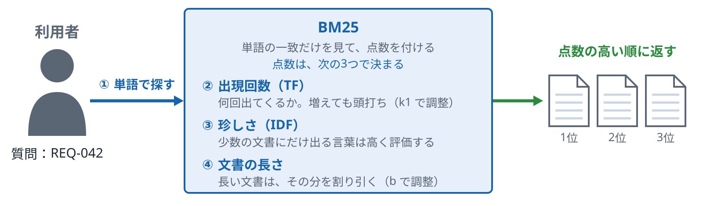

*単語の一致だけを見て、意味は見ない。得意は「REQ-042」のようなそのままの言葉、苦手は言い換え（「目が不自由な武将」）*

**確かめる**：[基礎 01 キーワード検索](../../../basic/topics/01-keyword-search/README.md)

ノート

- 言いたいこと：BM25 は単語の一致だけで点数を付けます。点数は出現回数、珍しさ、文書の長さの3つで決まります。
- 気をつけること：
  - 「得意：REQ-042」「苦手：目が不自由な武将」の対比は、p.2 のベクトル検索でちょうど逆になります。両ページで同じ例を使ってください。
  - 日本語では、アナライザー（単語の区切り方）で結果が変わる点を落とさないでください。

**図のノート**

狙い：BM25 は単語の一致だけで点数を付け、点数は出現回数、珍しさ、文書の長さの3つで決まる、と言える。

話すこと：

- 段階0：利用者が質問の単語（例：REQ-042）を渡す。BM25 は文書の中の単語の一致を見て点数を付け、点数の高い順に返す。意味は見ない
- 段階1：出現回数（TF）。文書の中に何回出てくるか。ただし、回数が増えても点数は頭打ちになる（k1 で調整）
- 段階2：珍しさ（IDF）。どの文書にも出てくる言葉は低く、少数の文書にだけ出てくる言葉は高く評価する
- 段階3：文書の長さ。長い文書は単語が出てきやすいので、その分を割り引く（b で調整）

補足：得意なのは、固有名詞、型番、ID（例：REQ-042）のように、そのままの言葉で探す質問。苦手なのは言い換え（例：「目が不自由な武将」と書かれていない文書）。Azure AI Search では、k1（既定 1.2）と b（既定 0.75）をインデックスの定義で変えられる。日本語では、単語の区切り方（形態素解析）で結果が変わる（p.7）

注意：p.2 のベクトル検索は、得意と苦手がちょうど逆になる。両ページで同じ例（REQ-042、目が不自由な武将）を使う。日本語ではアナライザー（単語の区切り方）で結果が変わる点を落とさない

### p.2 ベクトル検索

*意味の近さで探す検索と、Azure AI Search での設定*

- **一般的な説明**
  - **何をするものか**
    - 文や質問を、埋め込みモデルで数の並び（ベクトル）に変えます。そのうえで、質問のベクトルに近い文書を順に返します。
    - 単語が一致しなくても、意味が近ければ見つけられます。
  - **近さの測り方**
    - 類似度：よく使うのはコサイン類似度です。ほかに内積やユークリッド距離もあります。
    - 全件で比べる方式（厳密な KNN）：すべての文書と比べるので正確ですが、件数が増えると遅くなります。
    - 近似の方式（ANN）：HNSW などの索引を使い、少しの取りこぼしと引き換えに速く探します。
  - **得意なことと苦手なこと**
    - 得意：言い換えや、意味で探す質問（例: 「目が不自由な武将」）。
    - 苦手：固有名詞、型番、数字のちょうど一致（例: 「REQ-042」）。
    - 結果は埋め込みモデルの性能と、チャンクの切り方で大きく変わります。
- **Azure AI Search での説明**
  - **インデックスの設定**
    - ベクトルのフィールド：`Collection(Edm.Single)` のような型で、次元数（モデルに合わせる）を指定します。
    - ベクトル検索のプロファイル：フィールドに、使うアルゴリズム（`hnsw` か `exhaustiveKnn`）と類似度を結び付けます。
    - ベクトライザー：検索のときに、質問文を自動でベクトルに変える設定です。Azure OpenAI などの埋め込みモデルとつなぎます。
  - **検索のしかた**
    - vectorQueries：クエリで `k`（近傍として取る件数。ベクトル検索だけのクエリでは返る件数）を指定します。HNSW のフィールドでも、`exhaustive: true` で全件比較に切り替えられます。
    - フィルター：ベクトル検索の前か後に、条件で絞り込めます。
    - 複数のベクトル：1回のクエリで複数のベクトルのフィールドを検索できます。
  - **ほかの機能とのつながり**
    - 統合ベクトル化：取り込みのときに、チャンク分割とベクトル化を Azure 側でまとめて行う機能です。
    - 量子化：ベクトルを小さくして、保存の量とコストを減らす機能です。

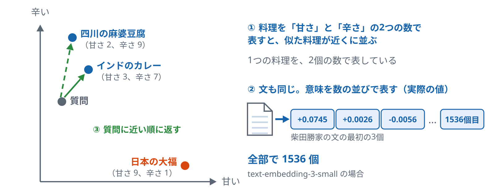

*例え話。料理の甘さと辛さが、埋め込みの数の並びに当たる。料理の数は説明用の例で、右の数の並びは実際に埋め込んだ値*

**確かめる**：[基礎 03 ベクトル検索](../../../basic/topics/03-vector-search/README.md)

ノート

- 言いたいこと：ベクトル検索は単語が一致しなくても意味の近さで見つけます。そのかわり、固有名詞や型番のちょうど一致は苦手です。
- 気をつけること：
  - p.1 と同じ例（「目が不自由な武将」と「REQ-042」）で、得意と苦手が入れ替わることを見せてください。
  - 結果は埋め込みモデルとチャンクの切り方で大きく変わります。アルゴリズムだけの話にしないでください。

**図のノート**

狙い：ベクトル検索は、文を数の並びにして意味の近さで探すと言える。そのかわり、固有名詞や型番のちょうど一致は苦手。

話すこと：

- 段階0：料理を「甘さ」と「辛さ」の2つの数で表すと、似た料理（インドのカレー、四川の麻婆豆腐）が近くに並び、日本の大福は遠くなる
- 段階1：インドのカレーは（甘さ 3、辛さ 7）、四川の麻婆豆腐は（2、9）、日本の大福は（9、1）。1つの料理を2個の数で表している。数は説明用の例
- 段階2：文も同じ。埋め込みモデルが、文を数の並びにする。text-embedding-3-small は、1つの文を1536個の数にする。図の数は、柴田勝家の文を実際に埋め込んだ最初の3個
- 段階3：質問も数の並びにして、近い順に返す。単語が一致しなくても、意味が近ければ見つけられる

補足：2軸は例え。実際の軸に名前は付いていない。近さの測り方（コサイン類似度など）は p.10、全件で比べるか近似で探すかは p.9

注意：数の一つひとつに意味はない。使うのは、数の並び全体の向き。結果は埋め込みモデルとチャンクの切り方で大きく変わる。p.1 と同じ例（目が不自由な武将、REQ-042）で、得意と苦手が入れ替わることを見せる

### p.3 ハイブリッド検索

*キーワード検索とベクトル検索を同時に行い、順位を1列にまとめる*

- **一般的な説明**
  - **何をするものか**
    - 同じ質問で、キーワード検索（BM25）とベクトル検索を両方行います。
    - 2つの結果を、1つの順位の列にまとめて返します。
  - **なぜ2つを合わせるか**
    - BM25 は「REQ-042」のようなそのままの言葉に強く、言い換えに弱い方式です。
    - ベクトル検索はその逆で、言い換えに強く、型番や数字のちょうど一致に弱い方式です。
    - 両方の結果を合わせると、片方だけでは拾えない文書が上位に入ることがあります。
  - **まとめ方**
    - 2つの方式の点数は物差しが違うので、そのまま足せません。
    - そのため、点数ではなく順位を使ってまとめる方法（RRF）がよく使われます。
    - 点数をそろえてから重みを付けて足す方法もあります。
- **Azure AI Search での説明**
  - **クエリの書き方**
    - 1回のリクエストに、`search`（キーワード）と `vectorQueries`（ベクトル）の両方を書きます。
    - 2つは並行して動き、結果は RRF で1列にまとめられます。
    - 返る `@search.score` は RRF の点数で、BM25 の点数とは別物です。
  - **調整できるところ**
    - ベクトルのクエリごとに `weight`（既定 1.0、0 より大きい数）を付けて、そのクエリの重みを変えられます。
    - フィルターは、キーワード側とベクトル側の両方に効きます。
    - 件数を決める値は別々です。ベクトル側は `k`（近傍として取る件数）、キーワード側は RRF に渡す件数の上限（プレビューの `maxTextRecallSize`、既定 1,000）、最後に返す件数は `top` です。
    - RRF の式の k（p.4）は、どれとも別の定数です。
  - **公式の測定**
    - Microsoft が公開した測定（2023年。顧客企業のデータセット4つ、NDCG@3）では、キーワード 40.6、ベクトル（Ada-002）43.8、ハイブリッド 48.4 でした。
    - 測定に使ったデータの言語は公表されていないので、日本語のデータで同じ差になるとは限りません。

出典：Microsoft Tech Community「Azure AI Search: Outperforming vector search with hybrid retrieval and reranking」（2023年9月）

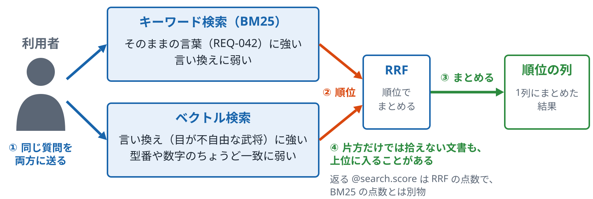

*得意なことが逆の2つの方式を合わせる。点数は物差しが違うので、順位でまとめる*

**確かめる**：[基礎 04 ハイブリッドとランカー](../../../basic/topics/04-hybrid-ranker/README.md)

ノート

- 出典の URL：https://techcommunity.microsoft.com/t5/azure-ai-foundry-blog/azure-ai-search-outperforming-vector-search-with-hybrid/ba-p/3929167
- 位置：第1部で、p.1 の BM25 と p.2 のベクトル検索を合わせるページです。まとめ方の中身は次の p.4 の RRF で見ます。
- 言いたいこと：ハイブリッド検索は、2つの方式を同時に行い、順位でまとめる方式です。得意なことが逆の2つを合わせる、という順で話します。
- 気をつけること：
  - p.1 と p.2 の例（「目が不自由な武将」と「REQ-042」）をここでも使い、両方が上位に来る様子を見せてください。
  - ハイブリッドの `@search.score` は BM25 の点数と比べられない、という点を落とさないでください。
  - この数字は Microsoft が公開した、顧客企業のデータでの測定です。教材のデータで同じ差が出ると言い切らないでください。

**図のノート**

狙い：ハイブリッド検索は、得意なことが逆の2つの方式を同時に行い、順位でまとめる方式だと言える。

話すこと：

- 段階0：同じ質問を、キーワード検索（BM25）とベクトル検索の両方に送る。1回のリクエストに、search（キーワード）と vectorQueries（ベクトル）の両方を書く
- 段階1：2つは並行して動く。BM25 は「REQ-042」のようなそのままの言葉に強く、言い換えに弱い。ベクトル検索はその逆で、言い換え（「目が不自由な武将」）に強く、型番や数字のちょうど一致に弱い。それぞれが順位を出す
- 段階2：2つの方式の点数は物差しが違うので、そのまま足せない。点数ではなく順位を使って、RRF で1つの列にまとめる（中身は p.4）
- 段階3：両方の結果を合わせると、片方だけでは拾えない文書が上位に入ることがある。返る @search.score は RRF の点数で、BM25 の点数とは別物

補足：調整できるのは、ベクトルのクエリごとの weight（既定 1.0）。フィルターは、キーワード側とベクトル側の両方に効く。件数を決める値は別々で、ベクトル側は k、キーワード側は RRF に渡す件数の上限（プレビューの maxTextRecallSize、既定 1,000）、最後に返す件数は top。RRF の式の k（p.4）は、どれとも別の定数。Microsoft が公開した測定（2023年。顧客企業のデータセット4つ、NDCG@3）では、キーワード 40.6、ベクトル（Ada-002）43.8、ハイブリッド 48.4

注意：p.1 と p.2 の例（目が不自由な武将、REQ-042）をここでも使い、両方の結果が上位に入る様子を話す。上の測定は、顧客企業のデータでの測定。教材のデータで同じ差が出ると言い切らない。測定に使ったデータの言語は公表されていないので、日本語で同じ差になるとは限らない

### p.4 RRF（Reciprocal Rank Fusion）

*点数ではなく順位を使って、いくつかの結果を1列にまとめる*

- **一般的な説明**
  - **計算のしかた**
    - 文書ごとに、それぞれの結果の中の順位を見て 1 /（k ＋ 順位）を計算し、足し合わせます。
    - k は 60 のような小さな定数がよく使われます。
    - 結果に出てこなかった方式の分は 0 として数えます。
  - **点数を使わない理由**
    - BM25 の点数とベクトルの類似度は、範囲も意味も違うので、そのままでは比べられません。
    - 順位なら、どの方式でも「何番目か」という同じ物差しで扱えます。
    - そのかわり、1位と2位の点数の差が大きいか小さいかという情報は使われません。
  - **計算の例（説明用の例）**
    - 文書 A が BM25 で1位、ベクトルで3位なら、1/(60+1) ＋ 1/(60+3) ＝ 約 0.0323 です。
    - 片方で1位だけの文書は 1/(60+1) ＝ 約 0.0164 なので、両方に出た A の方が上に来ます。
    - k が大きいほど、上位と下位の差が小さくなります。
- **Azure AI Search での説明**
  - **使われる場面**
    - ハイブリッド検索で、キーワードとベクトルの結果をまとめるときに使われます。
    - 複数のベクトルのクエリを1回で投げたときも、RRF でまとめられます。
    - 利用者が RRF を有効にする設定はなく、これらの検索では自動で使われます。
  - **返る点数**
    - まとめたあとの `@search.score` は RRF の点数です。
    - 値は小さく（例のように 0.03 前後）、BM25 の点数とは範囲が違います。
    - 点数の大きさそのものより、並び順として読むものです。
  - **ほかの機能との順番**
    - RRF でまとめたあとの上位 50 件を、セマンティックランカーが並べ直します（p.5）。
    - 式の k は定数で、ベクトル検索の k（近傍として取る件数）とは別のものです。Azure の説明では、60 のような小さな値が最もよく働くとされています。
    - リクエストで k を指定する項目は、公式の説明に出てきません。
    - ベクトルのクエリに重み（`weight`）を付けた場合は、そのクエリの順位の点に重みを掛けて足します。

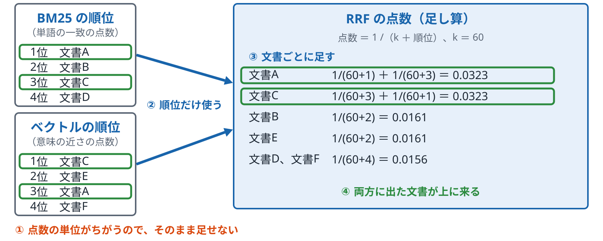

*点数 = 1 /（k + 順位）、k = 60。点数そのものは使わない。文書と数字は説明用の例*

**確かめる**：[基礎 04 ハイブリッドとランカー](../../../basic/topics/04-hybrid-ranker/README.md)

ノート

- 位置：p.3 のハイブリッド検索の「まとめ方」を詳しく見るページです。次の p.5 のセマンティックランカーは、ここでまとめた結果を受け取ります。
- 言いたいこと：RRF は順位だけを使うので、物差しの違う点数を比べずに済みます。両方の結果に出た文書が上に来やすくなります。
- 気をつけること：
  - 図の数字は説明用の例です。実際の検索結果ではないと言ってください。
  - 「点数の差の情報は使わない」という性質は、よい悪いではなく性質として話してください。
  - RRF の k は、ベクトル検索の k（近傍の件数）や top（返す件数）とは別のもの、と言ってください。

**図のノート**

狙い：RRF は順位だけを使うので、物差しの違う点数を比べずに済み、両方の結果に出た文書が上に来やすくなる、と言える。

話すこと：

- 段階0：BM25 とベクトル検索が、それぞれ順位を出した。BM25 は単語の一致の点数、ベクトルは意味の近さの点数で、単位が違うのでそのまま足せない
- 段階1：点数は使わず、順位だけを取り出す。式は 1 /（k ＋ 順位）で、k は 60 のような小さな定数
- 段階2：文書ごとに足す。文書A は BM25 で1位、ベクトルで3位なので、1/(60+1) ＋ 1/(60+3) ＝ 約 0.0323。片方でしか出てこない文書は、出てこなかった方式の分を 0 として数える
- 段階3：両方に出た文書（A と C）が、片方だけの文書より上に来る

補足：Azure AI Search では、この点数が @search.score として返る。値は 0.03 前後と小さく、BM25 の点数とは範囲が違うので、並び順として読む。RRF はハイブリッド検索と、複数のベクトルのクエリをまとめるときに自動で使われ、有効にする設定はない。まとめたあとの上位 50 件を、セマンティックランカーが並べ直す（p.5）。ベクトルのクエリに weight を付けたときは、そのクエリの順位の点に重みを掛けて足す。1位と2位の点数の差が大きいか小さいかという情報は使われない

注意：図の数字は説明用の例で、実際の検索結果ではない。点数の差の情報を使わないのは、よい悪いではなく性質として話す。RRF の k は、ベクトル検索の k（近傍として取る件数）や top（返す件数）とは別のもの

### p.5 セマンティックランカー

*上位の結果を、質問と文の意味の近さで並べ直す*

- **一般的な説明**
  - **何をするものか**
    - 一度検索した結果の上位だけを、別のモデルでもう一度採点し、並べ直します。
    - このような仕組みは、一般にリランカーと呼ばれます。
    - 最初の検索で拾えなかった文書は、並べ直しても出てきません。
  - **最初の検索との違い**
    - 最初の検索は、全部の文書から速く候補を集めるための方式です。
    - リランカーは、質問と文を一緒に読んで採点するので、件数が少ないときにしか使えません。
    - そのため、「広く集める」と「細かく並べる」の2段に分けます。
  - **返す情報**
    - 並べ直した順位と、新しい点数を返します。
    - 質問に合う文の一部（キャプション）や、短い答え（アンサー）を抜き出す仕組みを持つものもあります。
    - 文章を新しく作る生成 AI とは別の仕組みです。
- **Azure AI Search での説明**
  - **動き方**
    - `queryType: semantic` と、使うセマンティック構成を指定します。
    - キーワード、ベクトル、ハイブリッドの結果の上位 50 件を並べ直します。
    - Microsoft の言語モデル（Bing の技術から来たもの）を使い、利用者がモデルを選ぶことはありません。
  - **返るもの**
    - `@search.rerankerScore`：0〜4 の点数で、4 が最も合っていることを表します。
    - 点数の分布は、基盤側の条件やモデルの更新で少し変わることがあります。しきい値を細かくしすぎません。
    - キャプションとアンサー：抜き出しで返します。文を新しく作ることはありません。
    - セマンティック構成で、タイトル、本文、キーワードに当たるフィールドを指定します。
  - **公式の測定と料金の形**
    - p.3 の測定（顧客企業のデータセット4つ、NDCG@3）では、ハイブリッドの 48.4 が、セマンティックランカー付きで 60.1 でした。
    - 料金は2つのプランです。Free（既定）は毎月の無料枠（回数は公式の料金ページ https://azure.microsoft.com/ja-jp/pricing/details/search/）まで使え、使い切ると要求は課金のエラーになります。
    - Standard（Basic 以上）は、無料枠を超えた分が使った回数でかかります。検索サービスの層の Free とは別の言葉です。
    - エージェント型検索（p.32）も、中でこのランカーを使います。

出典：Microsoft Tech Community「Azure AI Search: Outperforming vector search with hybrid retrieval and reranking」（2023年9月）

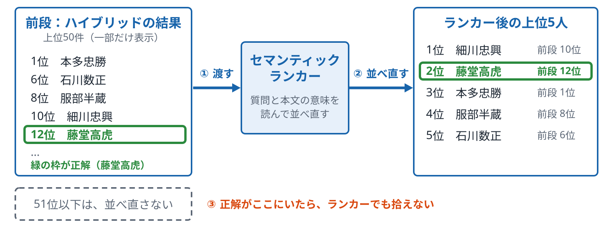

*サンプルの武将データでの実行結果（順位は一部だけ表示）。質問：「家康にも秀吉にも仕え、仕える相手を七度も替えたとされる武将は誰ですか。」*

**確かめる**：[基礎 04 ハイブリッドとランカー](../../../basic/topics/04-hybrid-ranker/README.md)

ノート

- 出典の URL：https://techcommunity.microsoft.com/t5/azure-ai-foundry-blog/azure-ai-search-outperforming-vector-search-with-hybrid/ba-p/3929167
- 位置：第1部の検索方法の最後の段です。p.3 のハイブリッドと p.4 の RRF でまとめた結果の上に乗ります。
- 言いたいこと：セマンティックランカーは、集めた上位 50 件を意味で並べ直す2段目の仕組みです。最初の検索で拾えなかった文書は出てきません。
- 気をつけること：
  - セマンティックランカーは生成 AI ではない、という点を言い間違えないでください（p.47 でも同じことを言います）。
  - `@search.rerankerScore`（0〜4）と `@search.score` を混ぜないでください。
  - 料金の金額や、プランを変える話はしません。

**図のノート**

狙い：セマンティックランカーは、新しい候補を探さず、前段の上位 50 件を意味で並べ直すだけだと言える。最初の検索で拾えなかった文書は、並べ直しても出てこない。

話すこと：

- 段階0：前段はハイブリッドの結果。質問は「家康にも秀吉にも仕え、仕える相手を七度も替えたとされる武将は誰ですか」。正解の藤堂高虎は12位
- 段階1：ランカーに、上位 50 件を渡す。ランカーは、質問と本文の意味を読んで並べ直す。Microsoft の言語モデルを使い、利用者がモデルを選ぶことはない。文章を新しく作る生成 AI ではない
- 段階2：細川忠興は10位から1位へ、藤堂高虎（正解）は12位から2位へ、本多忠勝は1位から3位へ
- 段階3：51位以下の人は、並べ直されない。正解が前段の上位 50 件に入っていなければ、ランカーでも拾えない

補足：@search.rerankerScore は 0〜4 の点数で、4 が最も合っていることを表す。@search.score とは別。点数の分布は少し変わることがあるので、しきい値を細かくしすぎない。基礎 04 の ranker.py で、同じ質問の順位を確かめられる

注意：図の順位は、サンプルの武将データで実行した値で、一部だけを表示している。ランカーの点数の分布は少し変わることがあるので、自分の画面の順位が1〜2位ずれることがある。セマンティックランカーは生成 AI ではない（p.47 でも同じことを言う）。料金の金額や、プランを変える話はしない

## B　仕組みの中身

### p.6 転置インデックス

*単語から、その単語を含む文書を引く表*

- **一般的な説明**
  - **どんな表か**
    - 本の巻末の索引と同じ形です。単語ごとに、その単語が出てくる文書と場所を並べます。
    - 文書から単語を見るのではなく、単語から文書を見るので「転置」と呼びます。
    - 検索のときは、質問の単語で表を引くだけなので、全部の文書を読み直さずに済みます。
  - **表を作る手順**
    - 文書の文を、アナライザーで単語（トークン）に分けます（p.7）。
    - 分けた単語ごとに、文書の番号、出てくる回数、位置を書き込みます。
    - 質問も同じ方法で単語に分けてから、表を引きます。
  - **点数とのつながり**
    - BM25 の出現回数（TF）と珍しさ（IDF）は、この表から計算します。
    - 位置を持っているので、「面接 評価」のような並びでの一致（フレーズ検索）もできます。
    - 単語の分け方が質問と文書で違うと、表を引いても見つかりません。
- **Azure AI Search での説明**
  - **フィールドの属性**
    - `searchable` を付けた文字列のフィールドだけが、転置インデックスに入ります。
    - `filterable`、`facetable`、`sortable` は、絞り込みや並べ替えのための別の持ち方です。
    - `retrievable` は、結果に値を返すかどうかで、検索の対象かどうかとは別です。
  - **アナライザーとの関係**
    - フィールドごとにアナライザーを決め、そのフィールドの表の作り方が決まります。
    - 入れる側のアナライザー（`analyzer`、`indexAnalyzer`）は、フィールドを作ったあとには変えられず、作り直しが要ります。探す側（`searchAnalyzer`）だけは、あとから変えられます。
    - Analyze API で、文がどう単語に分かれるかを確かめられます。
  - **ベクトルの索引との違い**
    - ベクトルのフィールドは転置インデックスではなく、HNSW などの別の索引に入ります（p.9）。
    - ハイブリッド検索では、2つの索引を同時に引きます。

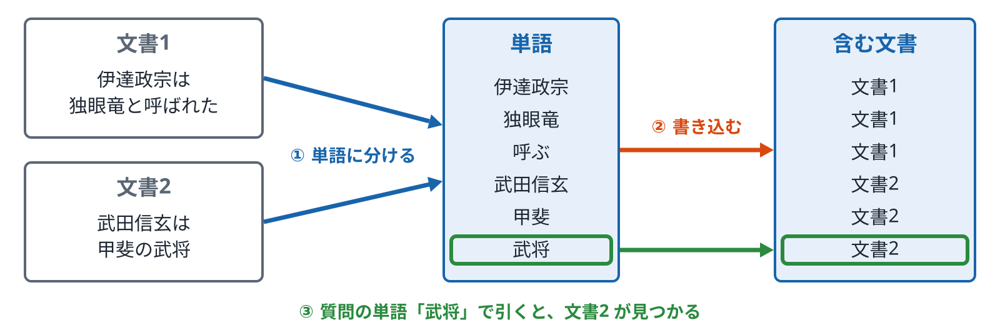

*本の巻末の索引と同じ形。BM25 はこの表を使って点数を計算する。文書と単語は説明用の例*

**確かめる**：[基礎 01 キーワード検索](../../../basic/topics/01-keyword-search/README.md)

ノート

- 位置：p.1〜p.5 で検索の方法を見たあと、その下にある仕組みに戻るページです。p.7 のアナライザーにつながります。
- 言いたいこと：キーワード検索は、単語から文書を引く表を使います。表の作り方は単語の分け方で決まります。
- 気をつけること：
  - 図の文書と単語は説明用の例です。
  - `searchable` と `retrievable` の違いは間違えやすいので、ゆっくり話してください。
  - 入れる側のアナライザーを変えるとインデックスの作り直しになります。

**図のノート**

狙い：キーワード検索は、単語から文書を引く表（転置インデックス）を使う。表の作り方は、単語の分け方で決まる、と言える。

話すこと：

- 段階0：文書1「伊達政宗は独眼竜と呼ばれた」、文書2「武田信玄は甲斐の武将」。この2つの文書から表を作る
- 段階1：文を、アナライザーで単語（トークン）に分ける（伊達政宗、独眼竜、呼ぶ、武田信玄、甲斐、武将）。分け方は p.7
- 段階2：単語ごとに、その単語を含む文書を書き込む。文書から単語を見るのではなく、単語から文書を見るので「転置」と呼ぶ
- 段階3：質問も同じ方法で単語に分けて、表を引く。「武将」を引くと文書2。全部の文書を読み直さずに済む

補足：実際の表には、出てきた回数と位置も入る。BM25 の出現回数（TF）と珍しさ（IDF）はこの表から計算し、位置があるので、並びでの一致（フレーズ検索）もできる。Azure AI Search で表に入るのは、searchable を付けた文字列のフィールドだけ。ベクトルのフィールドは別の索引に入る（p.9）

注意：図の文書と単語は説明用の例。searchable と retrievable（結果に値を返すか）の違いは間違えやすいので、ゆっくり話す。入れる側のアナライザー（analyzer、indexAnalyzer）を変えるときは、インデックスの作り直しになる

### p.7 アナライザーと日本語の形態素解析

*日本語の文を、検索の単位に分ける*

- **一般的な説明**
  - **アナライザーの役割**
    - 文を単語（トークン）に分け、表記をそろえる処理です。
    - 英語は空白で区切れますが、日本語は単語の間に空白がないので、分け方を決める必要があります。
    - 文書を入れるときと、質問を受けたときの両方で使います。
  - **日本語の分け方**
    - 形態素解析：辞書を使って、「東京 / 都庁 / で / 働く」のように意味のある単位で分けます。
    - N-gram：2文字や3文字ずつ機械的に区切ります。辞書にない言葉も拾えますが、関係のない一致も増えます。
    - どちらの方法でも、辞書や区切り方によって見つかる文書が変わります。
  - **表記をそろえる処理**
    - 全角と半角、大文字と小文字をそろえます。
    - 「働いた」を「働く」にそろえるように、言葉の形をもとに戻す処理もあります。
    - 「の」「は」のような、どこにでも出る言葉を外す処理もあります。
- **Azure AI Search での説明**
  - **選べるアナライザー**
    - `standard.lucene`：既定のアナライザーです。日本語では、ほぼ1文字ずつに近い分け方になります。
    - `ja.lucene`：Lucene の日本語用（形態素解析）のアナライザーです。日本語で「働いた」を分けると、「働く」と基本の形にそろえます（基礎 02 の Analyze API で確かめられます）。
    - `ja.microsoft`：Microsoft の日本語用のアナライザーです。言葉の形をもとに戻す処理などを持つ、と説明されていますが、「働いた」は「働い / た」のままでした。どちらがよいかは、自分のデータを Analyze API で分けて比べて決めます。
  - **設定のしかた**
    - フィールドの `analyzer` で、入れるときと探すときの両方を決めます。
    - 入れるときと探すときで変えたいときは、`analyzer` を空にして、`indexAnalyzer` と `searchAnalyzer` を別々に指定します。
    - ただし、`ja.lucene`・`ja.microsoft` のような言語アナライザーは、この2つでは指定できません。`analyzer` にだけ指定して、入れるときと探すときの両方に同じものを使います。
    - トークナイザーとフィルターを組み合わせたカスタムアナライザーも作れます。
  - **確かめ方**
    - Analyze API に文とアナライザー名を送ると、どう分かれたかが返ります。
    - 教材の例（「東京都庁で働く」）で3つのアナライザーを比べると、違いが見えます。
    - ベクトル検索は、アナライザーの影響を受けません。

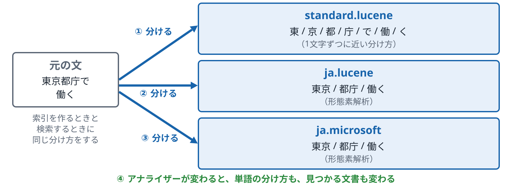

*同じ文でも、アナライザーが変わると単語の分け方が変わる。分け方は Analyze API の出力*

**確かめる**：[基礎 02 言い換えと日本語の分かれ方](../../../basic/topics/02-analyzers-synonyms/README.md)／[基礎 01 キーワード検索](../../../basic/topics/01-keyword-search/README.md)

ノート

- 位置：p.6 の転置インデックスの「表の作り方」を、日本語に当てはめたページです。p.1 の BM25 の「日本語では区切り方で結果が変わる」の続きです。
- 言いたいこと：日本語では、どのアナライザーを選ぶかで単語の分け方が変わり、見つかる文書も変わります。
- 気をつけること：
  - 図の分け方は説明用の例で、実際の出力を写したものではありません。実際の分かれ方は、基礎 02 の Analyze API で見ます。
  - どのアナライザーがよいかは言いません。分け方の違いだけを見せます。

**図のノート**

狙い：日本語では、どのアナライザーを選ぶかで単語の分け方が変わり、見つかる文書も変わる、と言える。

話すこと：

- 段階0：元の文「東京都庁で働く」を、既定の standard.lucene で分けると、1文字ずつに近い分け方になる
- 段階1：ja.lucene は形態素解析（辞書を使って、意味のある単位で分ける）。東京 / 都庁 / 働く
- 段階2：ja.microsoft も形態素解析。この文では、ja.lucene と同じ分け方になる
- 段階3：アナライザーが変わると、単語の分け方が変わる。分け方が変わると、見つかる文書も変わる

補足：索引を作るときと検索するときに、同じ分け方をする（analyzer で両方を決める。ja.lucene・ja.microsoft のような言語アナライザーは、indexAnalyzer・searchAnalyzer では指定できない）。分けた結果は Analyze API で確かめられる。ベクトル検索は、アナライザーの影響を受けない

注意：どのアナライザーがよいかは言わず、分け方の違いだけを見せる。図の分け方は、このサンプルのインデックスで Analyze API を呼んだ出力。文によっては、ja.lucene と ja.microsoft の分け方が違うことがある。ほかの言葉の分かれ方は、基礎 02 の Analyze API で見る

### p.8 埋め込みのモデルと次元数

*文を、決まった長さの数の並びにする*

- **一般的な説明**
  - **埋め込みとは**
    - 文を、決まった個数の数の並び（ベクトル）に変える処理です。
    - 意味の近い文は、近いベクトルになるように作られています。
    - 並びの個数を次元数と呼びます。
  - **モデルと次元数**
    - 次元数はモデルで決まります（例: text-embedding-3-small は 1536、text-embedding-3-large は 3072）。
    - text-embedding-3 の系統では、`dimensions` の指定で短いベクトルを出させることもできます。
    - 次元数が大きいほど、保存の量と計算の量が増えます。
  - **守る決まり**
    - 文書と質問は、同じモデル（同じ次元数）でベクトルにします。
    - モデルを変えたときは、すべての文書をベクトルにし直します。
    - 言語や分野によって、モデルごとの得意不得意があります。
- **Azure AI Search での説明**
  - **フィールドの定義**
    - ベクトルのフィールドに `dimensions` を書き、モデルの出力と同じ数にします（1つのフィールドで 4096 まで）。
    - 型は `Collection(Edm.Single)` などで、小さい型を選ぶと保存の量が減ります。
    - 数が合わないと、文書を入れるときにエラーになります。
  - **モデルとのつなぎ方**
    - 取り込み：埋め込みのスキル（Azure OpenAI など）で、チャンクをベクトルにします。
    - 検索：ベクトライザーで、質問を同じモデルでベクトルにします（p.28）。
    - 自分でベクトルにしてから、値をそのまま入れることもできます。
  - **保存の量を減らす機能**
    - 量子化で、インデックスの中のベクトルを小さくして持てます（スカラーは約4分の1、バイナリは最大で約28分の1）。
    - `retrievable` は、結果にベクトルを返すかどうかで、既定は返しません。
    - `stored` は、返却などに使う元のベクトルのコピーをディスクに残すかどうかです。`false` にすると保存量を最大で約半分にできます。検索には影響しませんが、フィールドを作るときにだけ指定でき、あとから戻せません。
    - 保存の量はサービスの容量と料金に関わります。

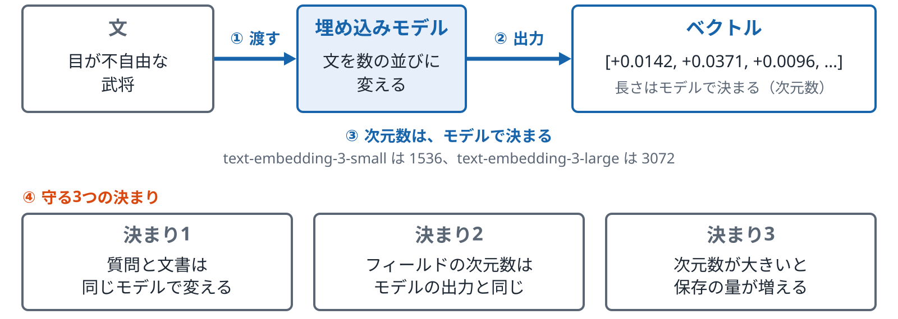

*インデックスの次元数は、使うモデルの出力に合わせる。数の並びは、実際に埋め込んだ値*

**確かめる**：[基礎 03 ベクトル検索](../../../basic/topics/03-vector-search/README.md)

ノート

- 位置：p.2 のベクトル検索の入口にある「文をベクトルにする」部分を詳しく見るページです。次の p.9 で、ベクトルの探し方に進みます。
- 言いたいこと：次元数はモデルで決まり、インデックスの定義と一致させます。文書と質問は同じモデルでベクトルにします。
- 気をつけること：
  - 次元数はモデルで決まります。モデルの説明にある数と、インデックスの定義を合わせます。
  - どのモデルがよいかは言いません。

**図のノート**

狙い：次元数はモデルで決まり、インデックスの定義と一致させる。文書と質問は同じモデルでベクトルにする、と言える。

話すこと：

- 段階0：文（例：目が不自由な武将）を、埋め込みモデルに渡す
- 段階1：モデルが、文を決まった個数の数の並び（ベクトル）にして返す。意味の近い文は、近いベクトルになる。図の値は、この文を実際に埋め込んだ最初の3個
- 段階2：並びの個数（次元数）は、モデルで決まる。text-embedding-3-small は 1536、text-embedding-3-large は 3072
- 段階3：守る決まりは3つ。質問と文書は同じモデルで変える。フィールドの次元数はモデルの出力と同じにする。次元数が大きいほど、保存の量と計算の量が増える

補足：モデルを替えたら、すべての文書をベクトルにし直す。text-embedding-3 の系統は、dimensions の指定で短いベクトルを出させることもできる。数が合わないと、文書を入れるときにエラーになる（1つのフィールドで 4096 まで）。量子化で、インデックスの中のベクトルを小さくして持てる（スカラーは約4分の1、バイナリは最大で約28分の1）。保存の量は、サービスの容量と料金に関わる

注意：どのモデルがよいかは言わない。モデルの説明にある次元数と、インデックスの定義を合わせる。数の一つひとつに意味はない

### p.9 HNSW と全件検索

*近いベクトルを、近道で探すか、全部比べるか*

- **一般的な説明**
  - **全件検索（厳密な KNN）**
    - 質問のベクトルを、すべての文書のベクトルと1つずつ比べます。
    - 必ず一番近いものが見つかりますが、文書が増えるほど時間がかかります。
    - 件数が少ないときや、近似の結果と比べる基準を作るときに使います。
  - **HNSW（近似の検索）**
    - ベクトルどうしを「近いもの」でつないだ網を、何層かに分けて作っておきます。
    - 検索のときは、上の粗い層から下の細かい層へ、つながりをたどって近いものを探します。
    - 速く探せますが、本当に一番近いものを取りこぼすことがあります。
  - **調整の項目**
    - m：1つの点から何本つなぐかです。多いほど取りこぼしが減り、保存の量が増えます。
    - efConstruction：網を作るときに、何個の候補を見るかです。
    - efSearch：検索のときに、何個の候補を見るかです。多いほど取りこぼしが減り、時間がかかります。
- **Azure AI Search での説明**
  - **アルゴリズムの設定**
    - ベクトル検索の設定で、`hnsw` か `exhaustiveKnn` を選び、プロファイルでフィールドに結び付けます。
    - `hnsw` の設定に、`m`、`efConstruction`、`efSearch` と類似度（`metric`）を書きます。
    - 既定値は m が 4、efConstruction が 400、efSearch が 500 です（m は 4〜10、ef の2つは 100〜1,000 の範囲）。
  - **検索のときの切り替え**
    - `hnsw` のフィールドでも、ベクトルのクエリに `exhaustive: true` を付けると全件で比べます。
    - 近似の結果と全件の結果を比べると、取りこぼしの程度が見えます。
    - `exhaustiveKnn` のフィールドでは、網を作らないので保存の量が少なくなります。
  - **教材での見せ方**
    - 第1部の武将 150 人のデータは件数が少ないので、2つの方式の時間の差はほとんど出ません。
    - 違いは、結果の順位がそろうかどうかで見せます。
    - 件数が多いときの時間の差は、図と言葉で説明します。

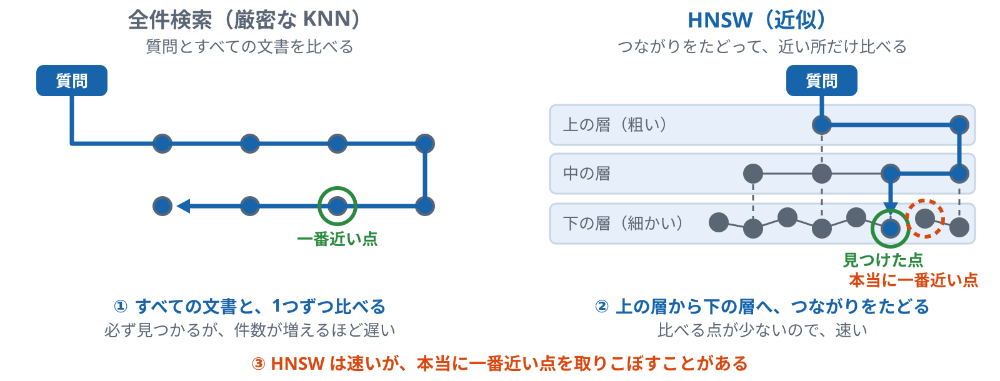

*HNSW は速いが取りこぼしがあり得る。全件検索は必ず見つかるが、件数が増えるほど遅くなる。点と網は説明用の例*

**確かめる**：[基礎 03 ベクトル検索](../../../basic/topics/03-vector-search/README.md)

ノート

- 位置：p.8 でベクトルを作ったあと、そのベクトルをどう探すかのページです。p.2 のベクトル検索の「近さの測り方」を詳しく見ます。
- 言いたいこと：HNSW は網をたどって速く探す方式で、取りこぼしがあり得ます。全件検索は遅いかわりに取りこぼしがありません。
- 気をつけること：
  - 図の網は説明用の例で、実際の HNSW の層の数や本数を表したものではありません。
  - 教材のデータは少ないので、時間の差が出ないことを先に言ってください。

**図のノート**

狙い：近いベクトルの探し方が2つあり、HNSW は速いが取りこぼしがあり得て、全件検索は遅いが必ず見つかる、と言える。

話すこと：

- 段階0：左が全件検索（厳密な KNN）、右が HNSW（近似）。点は文書のベクトル（8個）。質問のベクトルに近いものを探す
- 段階1：全件検索は、質問のベクトルをすべての文書のベクトルと1つずつ比べる。必ず一番近いものが見つかるが、文書が増えるほど時間がかかる。件数が少ないときや、近似の結果と比べる基準を作るときに使う
- 段階2：HNSW は、近いものどうしをつないだ網を、何層かに分けて作っておく。上の粗い層から下の細かい層へ、つながりをたどって近いものを探す。比べる点が少ないので速い
- 段階3：緑の輪が見つけた点。全件検索は一番近い点を必ず見つける。HNSW は、橙の点線の輪のように、本当に一番近いものを取りこぼすことがある

補足：Azure AI Search では、アルゴリズムの設定で hnsw か exhaustiveKnn を選び、プロファイルでフィールドに結び付ける。hnsw の調整は m（1つの点から何本つなぐか。既定は 4）、efConstruction（網を作るときに見る候補の数。既定は 400）、efSearch（検索のときに見る候補の数。既定は 500）。hnsw のフィールドでも、ベクトルのクエリに exhaustive: true を付けると全件で比べる。近似の結果と全件の結果を比べると、取りこぼしの程度が見える。exhaustiveKnn のフィールドは網を作らないので、保存の量が少ない

注意：図の網と点は説明用の例で、実際の HNSW の層の数や本数を表したものではない。第1部の武将 150 人のデータは件数が少ないので、2つの方式の時間の差はほとんど出ない。先にそう言い、違いは結果の順位がそろうかどうかで見せる

### p.10 類似度の測り方

*向きを見るか、向きと長さを見るか*

- **一般的な説明**
  - **コサイン類似度**
    - 2本のベクトルの向きがどれだけそろっているかを見ます。
    - 長さは見ないので、文の長さの違いの影響を受けにくくなります。
    - 値は -1 から 1 で、1 に近いほど近いと見ます。
  - **内積**
    - 向きの近さに、2本の長さを掛けた値です。
    - 長さを1にそろえたベクトルでは、コサイン類似度と同じ順位になります。
    - 計算が少ないので、長さをそろえたモデルではよく使われます。
  - **ユークリッド距離**
    - 2本の矢印の先どうしの距離です。
    - 値が小さいほど近いと見ます。ほかの2つと向きが逆なので注意が要ります。
    - 長さを1にそろえたベクトルでは、ほかの2つと同じ順位になります。
- **Azure AI Search での説明**
  - **設定の場所**
    - ベクトル検索のアルゴリズムの設定で、`metric` を選びます。
    - 選べるのは `cosine`、`dotProduct`、`euclidean`、`hamming` です。
    - `hamming` は、バイナリのベクトルのためのものです。
  - **モデルとの合わせ方**
    - 埋め込みモデルの説明に書かれている測り方に合わせます。
    - Azure OpenAI の text-embedding 系統は、長さを1にそろえた出力を返します（OpenAI の説明）。
    - 長さをそろえたベクトルでは、`dotProduct` は `cosine` と同じ結果になり、少し速く動きます（Azure AI Search の説明）。そのため、順位は同じになります。
  - **返る点数**
    - `@search.score` は、余弦などの値そのものではなく、大きいほど近い値になるように直した点数です。
    - 測り方を変えると点数の値は変わりますが、長さをそろえたベクトルなら順位は変わりません。
    - `cosine` では、`@search.score` は `1 / (1 + コサイン距離)` です（コサイン距離は 1 − コサイン類似度）。範囲は約 0.333〜1 です。

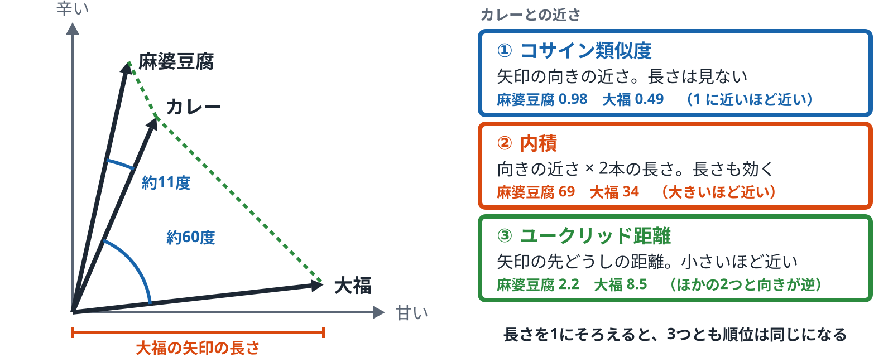

*料理を「甘い」「辛い」の2軸で矢印にした例え話。料理が文、矢印がベクトル、軸が次元に当たる。座標と値は説明用の例*

**確かめる**：[基礎 03 ベクトル検索](../../../basic/topics/03-vector-search/README.md)

ノート

- 位置：p.9 の探し方で使う「近さ」の決め方のページです。
- 言いたいこと：3つの測り方は、向きを見るか長さも見るかの違いです。長さをそろえたベクトルでは順位が同じになります。
- 気をつけること：
  - ユークリッド距離は小さいほど近い、という向きの違いを言ってください。
  - `@search.score` は余弦の値そのものではなく、順位のために直した値だ、と言ってください。

**図のノート**

狙い：コサイン類似度、内積、ユークリッド距離は、矢印の向き・長さ・先の位置のどこを見るかの違いだと言える。

話すこと：

- 段階0：料理を「甘い」「辛い」の2軸の矢印にする例え話。料理が文、矢印が文のベクトル。カレー（甘さ 3、辛さ 7）、麻婆豆腐（2、9）、大福（9、1）。右の3つが、近さの測り方
- 段階1：① コサイン類似度は、向きの近さ。長さは見ない。カレーと麻婆豆腐は向きが約11度ずれて 0.98、カレーと大福は約60度ずれて 0.49。値は -1 から 1 で、1 に近いほど近い
- 段階2：② 内積は、向きの近さに2本の長さを掛けた値。長さも効く（カレーと麻婆豆腐は 3×2 + 7×9 = 69、カレーと大福は 3×9 + 7×1 = 34）。大きいほど近い
- 段階3：③ ユークリッド距離は、矢印の先どうしの距離（カレーと麻婆豆腐は約 2.2、カレーと大福は約 8.5）。小さいほど近いので、ほかの2つと向きが逆。長さを1にそろえたベクトルでは、3つとも順位が同じになる

補足：Azure AI Search では、ベクトル検索のアルゴリズムの設定の metric で cosine、dotProduct、euclidean、hamming から選ぶ（hamming はバイナリのベクトル用）。埋め込みモデルの説明に書かれている測り方に合わせる。Azure OpenAI の text-embedding 系統は長さを1にそろえた出力を返す（OpenAI の説明）ので、dotProduct は cosine と同じ順位になり、少し速く動く。@search.score は、類似度そのものではなく、大きいほど近い値に直した点数。cosine では 1 / (1 + コサイン距離)（コサイン距離は 1 − コサイン類似度）で、範囲は約 0.333〜1。実際の文は、モデルの次元数（p.8）と同じ数の軸をもつ矢印で、測り方は同じ

注意：座標と値は説明用の例で、実際の検索の点数ではない。@search.score は余弦の値そのものではない。ユークリッド距離は小さいほど近い、という向きの違いを言う

## C　結果を整える

### p.11 フィルターとファセット

*条件で絞る、件数を数えて見せる*

- **一般的な説明**
  - **フィルター**
    - 「地方が関東」「更新日が 2026 年以降」のような条件で、検索の対象を絞ります。
    - 点数は変えず、条件に合わない文書を外すだけです。
    - 部署や見せてよい人での絞り込みにも使います（p.30）。
  - **ファセット**
    - 検索の結果の中で、項目の値ごとの件数を数えて返します（例: 関東 12 件、関西 30 件）。
    - 画面では、絞り込みのボタンや一覧に使います。
    - 利用者がボタンを押すと、その値でのフィルターが次の検索に加わります。
  - **ベクトル検索と絞り込み**
    - 先に絞ってからベクトルで探す方法と、ベクトルで探してから絞る方法があります。
    - 後で絞ると、条件に合う文書が少ないときに、結果の件数が足りなくなることがあります。
    - 先に絞ると、件数は保たれますが、時間が変わることがあります。
- **Azure AI Search での説明**
  - **書き方**
    - フィルターは `$filter` に OData の式で書きます（例: `region eq '関東'`）。
    - 複数の値のどれかに合うかは `search.in` で書きます。
    - ファセットは `facets` に、数えるフィールドを書きます。
  - **フィールドの属性**
    - フィルターに使うフィールドには `filterable` が要ります。
    - ファセットに使うフィールドには `facetable` が要ります。
    - あとから属性を足すには、インデックスの作り直しが要ることがあります。
  - **ベクトルとの組み合わせ**
    - `vectorFilterMode` で、`preFilter`（先に絞る。2023年10月ごろ以降に作ったインデックスの既定）か `postFilter`（後で絞る）かを選びます。
    - ほかに、全体の上位 k 件を決めてから絞る `strictPostFilter`（プレビュー）があります。
    - ハイブリッド検索では、同じフィルターがキーワード側とベクトル側の両方に効きます。
    - たとえば問い合わせの記録を、分類・窓口・月のファセットで数え、未解決や評価の低いものにフィルターで絞って中身を読みます。

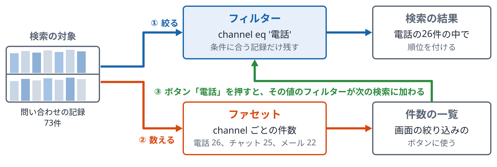

*どちらも点数は変えない。どの文書を対象にするか、何件あるかを扱う。件数は説明用の例（問い合わせの記録 73件の場合）*

ノート

- 位置：第1部で、検索の方法とは別に、検索の対象を絞る仕組みを見るページです。p.30 の権限の話の前提になります。
- 言いたいこと：フィルターは点数を変えずに対象を絞り、ファセットは件数を数えて見せます。
- 気をつけること：
  - 図の件数とフィールド名は説明用の例です。

**図のノート**

狙い：フィルターは点数を変えずに対象を絞り、ファセットは件数を数えて見せる、と言える。

話すこと：

- 段階0：検索の対象は、問い合わせの記録 73件（例）。フィルター（channel eq '電話'）は、条件に合う記録だけを残す。残った電話の26件の中で、いつもどおり順位を付ける。点数は変わらず、条件に合わない文書が外れるだけ
- 段階1：ファセットは、検索の結果の中で、項目（channel）の値ごとの件数を数えて返す。電話 26、チャット 25、メール 22。画面の絞り込みのボタンや一覧に使う
- 段階2：利用者がボタン（電話）を押すと、その値でのフィルター（channel eq '電話'）が次の検索に加わる。ファセットで全体をつかみ、フィルターで絞って中身を読む、という使い方

補足：フィルターは $filter に OData の式で書く（複数の値のどれかは search.in）。ファセットは facets に、数えるフィールドを書く。フィルターに使うフィールドには filterable、ファセットに使うフィールドには facetable が要る。あとから属性を足すには、インデックスの作り直しが要ることがある。ベクトル検索との組み合わせは vectorFilterMode で、preFilter（先に絞る）か postFilter（後で絞る）かを選ぶ。部署や見せてよい人での絞り込みにも使う（p.30）

注意：件数は説明用の例（問い合わせの記録 73件の集計）。本文の「地方が関東」の例は、フィールド名の例で、この図とは別

### p.12 スコアリングプロファイル

*BM25 の点数に、決めた条件で上乗せする*

- **一般的な説明**
  - **何をするものか**
    - 単語の一致の点数に、ほかの条件で点数を上乗せし、並び順を変える仕組みです。
    - 「タイトルで一致したものを上に」「新しい文書を上に」のような決まりを点数に入れます。
    - 決まりは人が前もって書いておきます。
  - **よく使う条件**
    - フィールドの重み：同じ単語でも、どのフィールドで一致したかで重みを変えます（説明用の例: title の一致は 3 倍）。
    - 新しさ：更新日が新しいほど点数を足します。
    - 数の大きさや距離：評価の数や、地図上の距離で点数を足します。
  - **ほかの並べ替えとの違い**
    - 並べ替え（sort）は、点数を使わず、値の順に並べます。
    - スコアリングプロファイルは、点数を足すので、単語の一致の強さも残ります。
    - リランカーは、決まりではなくモデルで並べ直します（p.5）。
- **Azure AI Search での説明**
  - **定義のしかた**
    - インデックスの定義に `scoringProfiles` を書き、名前を付けます。
    - `text` の `weights` で、フィールドごとの重みを決めます。
    - `functions` に、`freshness`、`magnitude`、`distance`、`tag` を書きます。
  - **使い方**
    - クエリで `scoringProfile` に名前を指定します。
    - インデックスに既定のプロファイルを決めておくこともできます。
    - 関数の値をクエリから渡す（`scoringParameters`）こともできます。
  - **効く範囲**
    - 主に、キーワード検索の点数に効きます。
    - ベクトル検索やハイブリッドでも使えますが、点数に効くのは文字列や数値のフィールドだけで、ベクトルのフィールドには効きません。
    - セマンティックランカーを使うと、プロファイルは2回効きます。最初の順位付けで1回、ランカーが並べ直したあとにもう1回です（GA）。
    - 最終の並び順は、ランカーのあとにプロファイルを当てた `@search.rerankerBoostedScore` で決まります（セマンティック構成の `rankingOrder` が `boostedRerankerScore` のとき。プロファイルがあるときの既定）。
    - ランカーのあとのブーストは、関数（freshness など）だけが対象です。フィールドの重みだけのプロファイルには、ランカーのあとのブーストはありません。
    - エージェント型検索では、インデックスのスコアリングプロファイルは使われません。

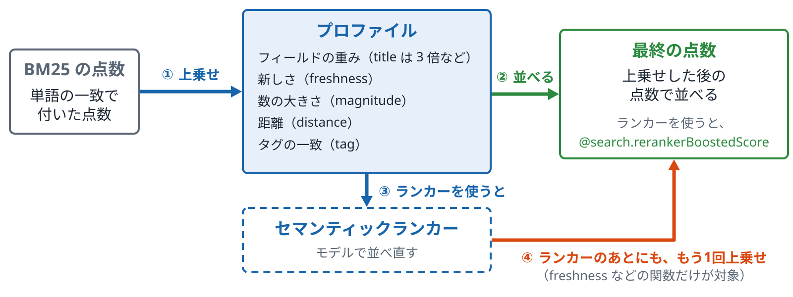

*どのフィールドで一致したか、新しさ、数の大きさなどで点数を変える。重みの「3 倍」は説明用の例*

**確かめる**：[基礎 02 言い換えと日本語の分かれ方](../../../basic/topics/02-analyzers-synonyms/README.md)（発展：順位の調整）

ノート

- 位置：第1部で、BM25 の点数を人の決まりで変える方法を見るページです。p.5 のセマンティックランカーと比べながら話します。
- 言いたいこと：スコアリングプロファイルは、前もって書いた決まりで点数を上乗せする仕組みです。
- 気をつけること：
  - 重みの「3 倍」は説明用の例です。
  - ランカーを使うと、プロファイルは最初の順位付けとランカーのあとの2回効く、と言ってください。

**図のノート**

狙い：スコアリングプロファイルは、前もって書いた決まりで点数を上乗せする仕組みで、ランカーを使うと2回効く、と言える。

話すこと：

- 段階0：BM25 の点数は、単語の一致で付いた点数。プロファイルが、決めた条件で点数を上乗せする。条件は、フィールドの重み（例：title の一致は 3 倍）、新しさ（freshness）、数の大きさ（magnitude）、距離（distance）、タグの一致（tag）。決まりは人が前もって書いておく
- 段階1：上乗せした後の点数で並べる。並べ替え（sort）は点数を使わず値の順に並べるが、プロファイルは点数を足すので、単語の一致の強さも残る
- 段階2：セマンティックランカーを使うと、プロファイルは2回効く。最初の順位付けで1回。ランカーは、決まりではなくモデルで並べ直す（p.5）
- 段階3：ランカーが並べ直したあとに、もう1回上乗せする（GA）。最終の並び順は、ランカーのあとにプロファイルを当てた @search.rerankerBoostedScore で決まる（セマンティック構成の rankingOrder が boostedRerankerScore のとき。プロファイルがあるときの既定）

補足：インデックスの定義の scoringProfiles に名前を付けて書き、text の weights でフィールドごとの重みを、functions に freshness・magnitude・distance・tag を書く。クエリの scoringProfile に名前を指定する（既定のプロファイルも決められる。関数の値は scoringParameters で渡せる）。主にキーワード検索の点数に効く。ベクトル検索やハイブリッドでも使えるが、効くのは文字列や数値のフィールドだけで、ベクトルのフィールドには効かない。ランカーのあとのブーストは関数だけが対象で、フィールドの重みだけのプロファイルには、ランカーのあとのブーストはない。エージェント型検索では、インデックスのスコアリングプロファイルは使われない

注意：重みの「3 倍」は説明用の例。ランカーを使うと、プロファイルは最初の順位付けとランカーのあとの2回効く、と言う

### p.13 同義語マップ

*言い換えを、決めた表で広げてから検索する*

- **一般的な説明**
  - **何をするものか**
    - 「独眼竜」と「伊達政宗」のような言い換えを、表にしておきます。
    - 質問に表の言葉が出てきたら、言い換えも一緒に探します。
    - ベクトル検索を使わずに、BM25 の言い換えの弱さを補う方法の1つです。
  - **表の書き方の2種類**
    - 同じ意味として扱う：「独眼竜, 伊達政宗」と書くと、どちらで探しても両方を探します。
    - 片方向に置き換える：「第六天魔王 => 織田信長」と書くと、「第六天魔王」を「織田信長」に置き換えます。
    - どちらを使うかで、広がり方が変わります。
  - **気をつける点**
    - 表に書いた言い換えしか広がりません。
    - 表を広げすぎると、関係のない文書も当たるようになります。
    - 表を足したら、どの質問に効いたかを確かめます。
- **Azure AI Search での説明**
  - **同義語マップの作り方**
    - `synonymMaps` に、Solr の形式で表を書いて登録します。
    - 作れる同義語マップの数は層で違い（Free と Basic は3つ、S1 は5つ、S2 は10、S3 は20）、1つのマップに書ける規則は Free で5,000、ほかの層で20,000までです。1つの規則に書ける言い換えは20までです。
    - 同義語マップはインデックスとは別の部品として作ります。
  - **フィールドへの結び付け**
    - フィールドの定義の `synonymMaps` に、使うマップの名前を書きます。
    - 結び付けたフィールドを検索するときだけ、言い換えが効きます。
    - 結び付けは、インデックスを作り直さずに変えられます。
  - **効く範囲**
    - 質問の側で言い換えを広げるので、文書を入れ直す必要はありません。
    - ベクトル検索には効きません。フィルター、ファセット、オートコンプリートにも効きません。
    - 表の言葉も、結び付けたフィールドと同じアナライザーで分けられてから使われます。

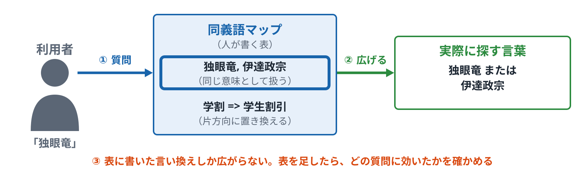

*ベクトル検索を使わずに、BM25 の言い換えの弱さを補う方法の1つ。「独眼竜」「第六天魔王」の例は説明用*

**確かめる**：[基礎 02 言い換えと日本語の分かれ方](../../../basic/topics/02-analyzers-synonyms/README.md)

ノート

- 位置：p.1 の BM25 の「苦手：言い換え」を、決めた表で補う方法のページです。p.2 のベクトル検索と並べて見せます。
- 言いたいこと：同義語マップは、人が書いた表で言い換えを広げます。表に書いたものしか広がりません。
- 気をつけること：
  - 「独眼竜」「第六天魔王」の例は説明用です。
  - どちらの方法がよいかは言いません。表で補う方法と意味で探す方法の違いだけを見せます。

**図のノート**

狙い：同義語マップは、人が書いた表で言い換えを広げる仕組みで、表に書いたものしか広がらない、と言える。

話すこと：

- 段階0：利用者が「独眼竜」と質問する。同義語マップは、言い換えを書いておく表。書き方は2種類。「独眼竜, 伊達政宗」は同じ意味として扱う（どちらで探しても両方を探す）。「第六天魔王 => 織田信長」は片方向の置き換え（「第六天魔王」を「織田信長」に置き換える）
- 段階1：質問に表の言葉が出てくると、言い換えも一緒に探す。「独眼竜」は「独眼竜 または 伊達政宗」になる。質問の側で広げるので、文書を入れ直す必要はない
- 段階2：表に書いた言い換えしか広がらない。広げすぎると関係のない文書も当たる。表を足したら、どの質問に効いたかを確かめる

補足：Azure AI Search では、synonymMaps に Solr の形式で表を書いて登録する。同義語マップはインデックスとは別の部品。フィールドの定義の synonymMaps にマップの名前を書いて結び付け、結び付けたフィールドを検索するときだけ効く（結び付けはインデックスを作り直さずに変えられる）。ベクトル検索、フィルター、ファセット、オートコンプリートには効かない。表の言葉も、結び付けたフィールドと同じアナライザーで分けられてから使われる。作れる数は層で違い（Free と Basic は3つ、S1 は5つ、S2 は10、S3 は20）、1つのマップに書ける規則は Free で 5,000、ほかの層で 20,000 まで。1つの規則に書ける言い換えは20まで

注意：どちらの方法がよいかは言わない。表で補う方法と意味で探す方法（p.2）の違いだけを見せる

### Azure で順位を調整する方法

#### 上げる

- 欄の重み（スコアリングプロファイル）
- タグ・数値・新しさの関数
- 語の重み `語^3`

#### 下げる・外す

- Vertex の bury のような、負の値での指定は載っていない
- 語の重みを1未満に `語^0.2`
- 確実に外すならフィルター `$filter`

#### 広げる・無視する

- 同義語マップで、検索語の言い換えを広げる
- ストップワードで無視する（作り直しが要る）

> 下げるときは「他を上げる」「軽く見る」「外す」で近づける

**確かめる**：[基礎 02 言い換えと日本語の分かれ方](../../../basic/topics/02-analyzers-synonyms/README.md)（発展：順位の調整）

ノート

言いたいこと：Azure AI Search で順位を上げる手段はいくつかあるが、Vertex の bury のように、負の値で下げる指定は公式資料に載っていない。ブーストの値は正の数で 1.0 以外。

- 下げることは、語の重みを 0〜1 にする、他方を上げる、フィルターで外す、で近づける。
- 除外の落とし穴：-語 で除外すると、本文にその語を含む別の文書まで外れる（小早川隆景と秀秋の例）。確実に外すならフィルター。

1 未満の重みでどれだけ順位が下がるかは、データと質問で変わる。基礎 02 の発展で確かめる。

### Vertex AI Search との違い

#### Vertex AI Search

- ルールをサービスに登録すると、自動で効く
- boost は -1〜1。負の値で下げる（bury）
- 検索語や期間の条件を付けられる

#### Azure AI Search

- アナライザーと同義語マップは、フィールドに設定しておくと、検索のたびに自動で効く
- スコアリングプロファイルは、検索のときにアプリが指定する（既定を決めておくこともできる）
- 転送・固定位置・関連付けしない語は、公式資料に当たる設定が載っておらず、アプリ側で作る

> Azure では「ルールを足す」より「インデックスの設定と検索の書き方を変える」

**確かめる**：[基礎 02 言い換えと日本語の分かれ方](../../../basic/topics/02-analyzers-synonyms/README.md)（発展：順位の調整）

ノート

言いたいこと：Vertex は、ルールをサービスに登録しておくと、条件に合う検索で自動で効く。Azure は、アナライザーと同義語マップをフィールドの設定としてインデックスに入れておく（検索のたびに自動で効く）。スコアリングプロファイルもインデックスに入れておき、検索のリクエストで名前を指定する（既定のプロファイルを決めることもできる）。

- Vertex の一般の文書検索向けは、2026-04-22 に Agent Search に改称された（リリースノート）。関連付けしない語（do not associate）は、確認できた範囲では EC 向けの資料にだけある。
- Azure の公式資料に当たる設定が載っていないもの：関連付けしない語、redirect、promote、pin（固定位置）、期間つきの自動適用。

2026年11月時点の公式資料にもとづく。

## D　質問に合わせる

### p.14 質問の種類と検索方法の向き不向き

*同じ検索方法でも、質問の種類で結果が変わる*

- **一般的な説明**
  - **質問の種類**
    - そのままの言葉で探す質問：型番、ID、固有名詞（例: 「REQ-042」）。
    - 意味で探す質問：言い換えや説明で探す質問（例: 「目が不自由な武将」）。
    - いくつかの事実をつなぐ質問：2つ以上の文書を合わせないと答えられない質問（例: 「A社の社長が提携している会社」）。
  - **検索方法との関係**
    - キーワード検索は、そのままの言葉で探す質問に向いています。
    - ベクトル検索は、意味で探す質問に向いています。
    - いくつかの事実をつなぐ質問は、1回の検索ではどちらも見つけにくくなります。
  - **組み合わせ**
    - ハイブリッド検索は、最初の2種類の両方を1回で扱います。
    - セマンティックランカーは、集めた上位の並び順を変えます。
    - 事実をつなぐ質問には、質問を分ける方法（p.32）や、関係をたどる方法（p.31、p.33）があります。
- **Azure AI Search での説明**
  - **そのままの言葉**
    - BM25 のフルテキスト検索と、`filterable` のフィールドでのフィルターが使えます。
    - アナライザーの分け方で、ID の区切りが変わることがあります。
  - **意味で探す**
    - ベクトル検索とセマンティックランカーが使えます。
    - ハイブリッドにすると、キーワードの一致も残ります。
  - **事実をつなぐ**
    - エージェント型検索で、質問をいくつかの検索に分けられます。
    - 関係をたどる機能（グラフ RAG）は、Azure AI Search の検索そのものにはありません（プレビューの Fabric Ontology をナレッジソースにする方法は p.31）。

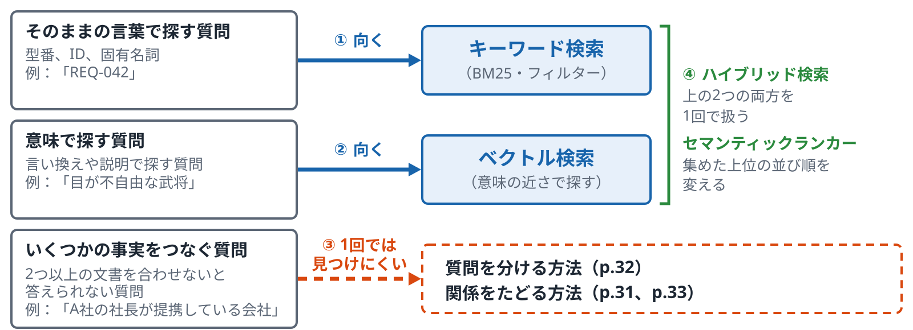

*同じ検索方法でも、質問の種類で結果が変わる*

**確かめる**：[基礎 04 ハイブリッドとランカー](../../../basic/topics/04-hybrid-ranker/README.md)

ノート

- 位置：第1部の検索方法を一通り見たあとで、質問の種類から並べ直すページです。第3部（p.31〜p.38）につなぎます。
- 言いたいこと：どの検索方法が合うかは、質問の種類で変わります。事実をつなぐ質問は、1回の検索では扱いにくい種類です。
- 気をつけること：
  - どの方法がよいかは言いません。質問の種類ごとの向き不向きを並べるだけにします。
  - 「A社の社長」の例は第3部の例と同じものを使ってください。

**図のノート**

狙い：どの検索方法が合うかは質問の種類で変わり、事実をつなぐ質問は1回の検索では扱いにくい種類だと言える。

話すこと：

- 段階0：そのままの言葉で探す質問（型番、ID、固有名詞。例「REQ-042」）には、キーワード検索が向いている
- 段階1：意味で探す質問（言い換えや説明で探す。例「目が不自由な武将」）には、ベクトル検索が向いている
- 段階2：いくつかの事実をつなぐ質問（2つ以上の文書を合わせないと答えられない。例「A社の社長が提携している会社」）は、1回の検索ではどちらの方法でも見つけにくい。質問を分ける方法（p.32）や、関係をたどる方法（p.31、p.33）がある
- 段階3：ハイブリッド検索は、最初の2種類の両方を1回で扱う。セマンティックランカーは、集めた上位の並び順を変える

補足：Azure AI Search では、そのままの言葉には BM25 のフルテキスト検索と、filterable のフィールドでのフィルターが使える。アナライザーの分け方で、ID の区切りが変わることがある。意味で探すにはベクトル検索とセマンティックランカーが使え、ハイブリッドにするとキーワードの一致も残る。事実をつなぐ質問には、エージェント型検索で質問をいくつかの検索に分けられる。関係をたどる機能（グラフ RAG）は Azure AI Search の検索そのものにはない（プレビューの Fabric Ontology をナレッジソースにする方法は p.31）

注意：どの方法がよいかは言わない。質問の種類ごとの向き不向きを並べるだけにする。「A社の社長」の例は第3部の例と同じものを使う（p.31）

### p.14 質問の種類ごとの向く検索方法

| 質問の種類 | 向く検索方法 | Azure AI Search で使うもの |
|---|---|---|
| そのままの言葉で探す （例: 「REQ-042」） | キーワード検索 | BM25 のフルテキスト検索と、filterable のフィールドでのフィルター |
| 意味で探す （例: 「目が不自由な武将」） | ベクトル検索 | ベクトル検索とセマンティックランカー。ハイブリッドにするとキーワードの一致も残る |
| いくつかの事実をつなぐ （例: 「A社の社長が提携している会社」） | 1回の検索ではどちらも見つけにくい。質問を分ける方法（p.32）や、関係をたどる方法（p.31、p.33）がある | エージェント型検索で、質問をいくつかの検索に分ける。関係をたどる機能（グラフ RAG）は、Azure AI Search の検索そのものにはない |
| 組み合わせ（上の2種類の両方） | ハイブリッド検索 | 1回で両方を扱う。セマンティックランカーは、集めた上位の並び順を変える |

**確かめる**：[基礎 04 ハイブリッドとランカー](../../../basic/topics/04-hybrid-ranker/README.md)

ノート

p.14 の表。質問の種類ごとに、向く検索方法と、Azure AI Search で使うものを並べる。

- どの方法がよいかの結論にはしない。質問の種類ごとの向き不向きを並べるだけ。
- 事実をつなぐ質問は、1回の検索では扱いにくい種類。第3部の p.31〜p.38 につなぐ。

### p.15 クエリの書き換え

*利用者の質問を、検索に向いた形に直してから探す*

- **一般的な説明**
  - **なぜ書き換えるか**
    - 利用者の質問は、話し言葉で、言葉が足りないことがあります（例: 「家から働ける日は週何日？」）。
    - 文書の言葉（「在宅勤務」「リモート」）と違うと、キーワード検索では見つかりにくくなります。
    - 会話の途中の質問は、前の話を入れないと意味が通じないこともあります。
  - **書き換えの種類**
    - 言い換えを足す：同じ意味の言葉を加えた質問をいくつか作ります（例: 「家から働ける日は週何日？」→「在宅勤務の日数」「リモート 週」）。
    - 分ける：いくつかのことを聞いている質問を、小さな質問に分けます。
    - 答えの形を作る：答えの文を先に作り、その文で探す方法もあります（HyDE と呼ばれます）。
  - **どこで書き換えるか**
    - アプリの中で、生成 AI に書き換えさせる方法があります。
    - 検索のサービスの中で、自動で書き換える機能を持つものもあります。
    - どちらでも、書き換えた結果がずれると、関係のない文書が当たります。
- **Azure AI Search での説明**
  - **セマンティックランカーの書き換え**
    - クエリに `queryRewrites`（例：`generative|count-5`。1〜10件）を指定すると、サービスが言い換えた質問をいくつか作って検索します（プレビュー）。
    - 書き換えた質問は、キーワード検索とベクトル検索の両方に使われます。
    - デバッグの指定（`debug: queryRewrites`）で、作られた質問を見られます。
  - **エージェント型検索の書き換え**
    - ナレッジベースでは、reasoning effort が low、medium、auto のとき（プレビュー）、生成 AI が質問を分けます（p.37）。
    - 会話の履歴を渡すと、前の話を入れた質問に直します。
    - minimal のときは、生成 AI で質問を分けません。
  - **アプリで書き換える**
    - アプリ側で Azure OpenAI を呼んで書き換え、その結果を検索に渡す方法もあります。
    - 生成 AI の呼び出しが増えます。

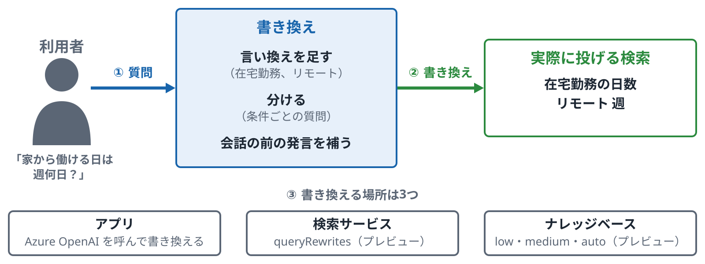

*書き換えを置く場所は、アプリ、検索サービス、ナレッジベースのどれか。例の言葉は説明用で、書き換えが増えるほど検索の回数も増える*

ノート

- 位置：第1部の最後のページです。検索の前に質問を直す方法を見て、第3部のエージェント型検索（p.32）の前置きにします。
- 言いたいこと：書き換えは、質問の言葉を文書の言葉に近づける処理です。書き換える場所には、アプリ、検索のサービス、ナレッジベースがあります。
- 気をつけること：
  - `queryRewrites` はプレビューです。GA の 2026-04-01 にあると言わないでください。
  - 書き換えの例（「在宅勤務の日数」「リモート 週」）は説明用です。書き換えが増えるほど、検索の回数も増えます。

**図のノート**

狙い：書き換えは質問の言葉を文書の言葉に近づける処理で、書き換える場所が3つある、と言える。

話すこと：

- 段階0：利用者の質問は話し言葉で、言葉が足りないことがある（例「家から働ける日は週何日？」）。文書の言葉（「在宅勤務」「リモート」）と違うと、キーワード検索では見つかりにくい。会話の途中の質問は、前の話を入れないと意味が通じないこともある
- 段階1：書き換えの種類は、言い換えを足す（「在宅勤務の日数」「リモート 週」）、いくつかのことを聞く質問を小さな質問に分ける、会話の前の発言を補う。答えの文を先に作り、その文で探す方法もある（HyDE と呼ばれる）。書き換えた結果がずれると、関係のない文書が当たる
- 段階2：書き換える場所は3つ。アプリの中で Azure OpenAI を呼んで書き換え、その結果を検索に渡す。検索のサービスの中で自動で書き換える（セマンティックランカーの queryRewrites、プレビュー）。ナレッジベースで生成 AI が質問を分ける（reasoning effort が low・medium・auto のとき、プレビュー）

補足：queryRewrites は、クエリに generative|count-5 のように指定する（1〜10件）。書き換えた質問は、キーワード検索とベクトル検索の両方に使われる。debug: queryRewrites で、作られた質問を見られる。ナレッジベースでは、会話の履歴を渡すと前の話を入れた質問に直す。minimal のときは生成 AI で質問を分けない（p.37）。アプリで書き換える方法は、生成 AI の呼び出しが増える

注意：queryRewrites はプレビュー。GA の 2026-04-01 にあると言わない。書き換えの例（「在宅勤務の日数」「リモート 週」）は説明用

