# 第2部 取り込み

<!-- この Markdown は docs/lecture/tools/build.py --md が、keywords.md・decks.json・diagrams/ から作る。直すときは原稿を直す -->

読む、ばらす、切る、出典、索引の順番と、Azure の取り込みの仕組み

*ハンズオン資料 p.16〜30　／　確かめるトピック：14・15・16・17*

[目次に戻る](index.md)

## A　取り込みの流れ

### p.16 取り込みの順番

*読む、ばらす、切る、出典、索引*

- **一般的な説明**
  - **読む**
    - PDF、Word、Excel などのファイルを開いて、文字を取り出します。
    - スキャンした PDF や画像は、OCR で文字にします。
    - ここで文字化けや読み落としがあると、後のどの段でも取り戻せません。
  - **ばらす**
    - 取り出した中身を、見出し、段落、表、行のような構造ごとに分けます。
    - 表は行と列の関係を残したまま分けます（例: 1行を「列名: 値」の文にする）。
    - 単純な検索ではこの段を飛ばしますが、文書の中の構造を検索するにはこの段が要ります。
  - **切る**
    - 検索の単位（チャンク）に切ります。長さを決めて切る方法、見出しで切る方法、親子で持つ方法があります。
    - チャンクが大きすぎると答えがぼやけ、小さすぎると前後の文脈が消えます。
    - 必要ならここでベクトルにします。
  - **出典**
    - チャンクごとに、ファイル名、ページ、章、表の名前などを書き添えます。
    - 回答に「どの文書のどこか」を示すためと、範囲を絞るフィルターに使うためです。
    - 後から足すのは難しいので、切る段の直後に付けます。
  - **索引**
    - 本文、ベクトル、出典の情報をインデックスに入れて、検索できる状態にします。
    - BM25 用の転置インデックスと、ベクトル用の索引（HNSW など）が作られます。
    - ファイルが変わったときに、どう入れ直すかもここで決めます。
- **Azure AI Search での説明**
  - **読む**
    - インデクサー：Blob や SharePoint からファイルを取りに行き、文字を取り出します。
    - OCR スキル：画像の中の文字を取り出します。
  - **ばらす**
    - Document Layout スキル：見出し、段落、表を読み取ります。
    - Content Understanding スキル：文書の中身を構造として取り出す、新しい方の機能です。
  - **切る**
    - Text Split スキル：ページや文の単位で、重なりを付けて切ります。
    - 統合ベクトル化：埋め込みのスキルで、切ったチャンクをベクトルにします。
  - **出典**
    - インデックスプロジェクション：子のチャンクに親の文書の ID を付けて、別のインデックスに入れます。
    - フィールドの対応付け：ファイル名、パス、ページ番号などを、フィールドとして残します。
  - **索引**
    - インデックス：フィールドの定義、アナライザー、ベクトルのプロファイルを決めて作ります。
    - スキルセットとインデクサーの実行：上の段を一続きで動かし、スケジュールで入れ直しもできます。

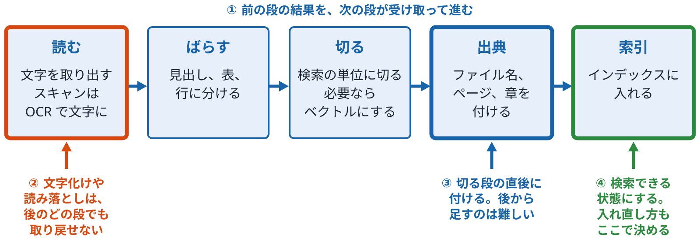

*読む、ばらす、切る、出典、索引*

**確かめる**：[応用 14 種類の違う文書をまとめて取り込む](../../../applied/topics/14-mixed-documents/README.md)

ノート

- 言いたいこと：取り込みは5段の順番で進みます。前の段の誤りは後の段で取り戻せないので、順番そのものに意味があります。
- 気をつけること：
  - 「読む」の段の文字化けや読み落としは、後のどの段でも取り戻せない点を最初に言ってください。
  - 出典は後から足すのが難しいので、切る段の直後に付ける、という順番の理由を落とさないでください。
  - OCR、Document Layout、Text Split、Content Understanding、GenAI Prompt のスキルは GA（2026-04-01）です。Text Split のトークン単位と、Azure Vision のマルチモーダル埋め込みはプレビューです。

**図のノート**

狙い：取り込みは5段の順番で進み、前の段の落ちは後の段で取り戻せないので、順番そのものに意味があると言える。

話すこと：

- 段階0：読む（ファイルから文字を取り出す。スキャンは OCR）、ばらす（見出し、表、行に分ける）、切る（検索の単位のチャンクに切る。必要ならベクトルにする）、出典（ファイル名、ページ、章を付ける）、索引（インデックスに入れる）の順に進む。前の段の結果を、次の段が受け取る
- 段階1：読む段の文字化けや読み落としは、後のどの段でも取り戻せない。最初にここを言う
- 段階2：出典は後から足すのが難しいので、切る段の直後に付ける。回答に「どの文書のどこか」を示すためと、範囲を絞るフィルターに使うため
- 段階3：本文、ベクトル、出典の情報をインデックスに入れる。BM25 用の転置インデックスと、ベクトル用の索引（HNSW など）が作られる。ファイルが変わったときに、どう入れ直すかもここで決める

補足：Azure AI Search では、読む＝インデクサー（Blob や SharePoint から取る）と OCR スキル、ばらす＝Document Layout スキルと Content Understanding スキル、切る＝Text Split スキルと統合ベクトル化、出典＝インデックスプロジェクションとフィールドの対応付け、索引＝インデックスと、スキルセット・インデクサーの実行（p.27）。「ばらす」は単純な検索では飛ばすが、文書の中の構造を検索するには要る

注意：OCR、Document Layout、Text Split、Content Understanding、GenAI Prompt のスキルは GA（2026-04-01）。Text Split のトークン単位と、Azure Vision のマルチモーダル埋め込みはプレビュー

### p.17 Azure による PDF の取り込み

*文字ありの PDF と画像だけの PDF、出典はページで残す*

- **一般的な説明**
  - **文字ありの PDF**
    - ファイルの中に文字のデータが入っているので、そのまま取り出せます。
    - 表は、文字を取り出すだけだと行と列がくずれやすいので、表として読み取る処理を別に通します。
    - 出典はファイル名とページで、本文か表かの種類も付けておきます（表の text・table）。
  - **画像だけの PDF**
    - スキャンした紙などで、中身は絵なので文字のデータがありません。
    - OCR で絵から文字を起こします。読み間違いが出ることがあります。
    - 出典はファイル名とページで、種類を ocr にしておくと、読み間違いがあり得ることが後からわかります。
  - **ページを出典にする理由**
    - PDF はページが固定されているので、「何ページ」が人にとって一番確かめやすい場所です。
    - 1枚の PDF の中に、文字のページと画像のページが混ざることがあります。
    - そのため、種類はファイルごとではなくページやチャンクごとに持ちます。
- **Azure AI Search での説明**
  - **読む（インデクサー）**
    - Blob Storage などに置いた PDF を、インデクサーが取りに行きます。
    - 文字のデータは、標準の取り出し処理で `content` に入ります。
    - インデクサーの `imageAction` を `generateNormalizedImages` にすると、ページの中の画像が `/document/normalized_images` に取り出され、OCR スキルに渡せます。
  - **読む・ばらす（スキル）**
    - OCR スキル：画像の中の文字を起こします。画像だけの PDF の場合です。
    - Document Layout スキル：見出し、段落、表を読み取り、Markdown などの形で返します。文字ありの PDF と画像だけの PDF のどちらにも使えます。入力は元のファイルで、インデクサーの `allowSkillsetToReadFileData` を `true` にして渡します。
    - `extractionOptions` に `locationMetadata` を指定すると、ページ番号など、内容がどこにあったかの情報も返ります。
  - **出典を残す**
    - ファイル名とパスは、インデクサーが付ける `metadata_storage_name` と `metadata_storage_path` から取れます。
    - ページや種類は、スキルの出力からフィールドに対応づけます。
    - インデックスプロジェクションを使えば、チャンクごとに親の PDF の ID を付けられます。

（欄外の注）Word と Excel の表の行は、このページでは扱っていません。

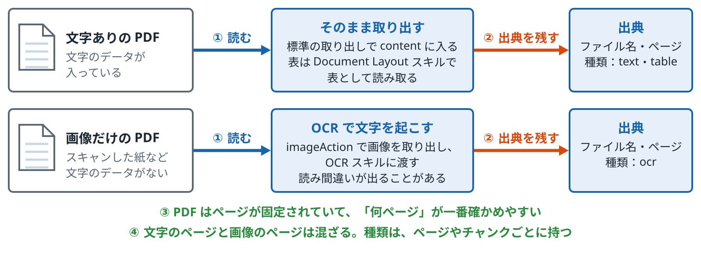

*文字ありの PDF と画像だけの PDF、出典はページで残す*

**確かめる**：[応用 15 Azure の仕組みに置き換える](../../../applied/topics/15-azure-indexer/README.md)

ノート

- 言いたいこと：PDF は「文字があるか、絵だけか」で読み方が変わります。どちらでも出典はファイル名とページで残します。
- 気をつけること：
  - 1つの PDF の中で、文字のページとスキャンのページが混ざることがあります。種類はページやチャンクごとに持つ、という点を落とさないでください。

**図のノート**

狙い：PDF は「文字があるか、絵だけか」で読み方が変わり、どちらでも出典はファイル名とページで残すと言える。

話すこと：

- 段階0：文字ありの PDF は、中に文字のデータが入っているのでそのまま取り出せる（インデクサーの標準の取り出しで content に入る）。表は文字を取り出すだけだと行と列がくずれやすいので、表として読み取る処理（Document Layout スキル）を別に通す。画像だけの PDF（スキャンした紙など）は中身が絵なので、OCR で文字を起こす。インデクサーの imageAction を generateNormalizedImages にすると、ページの中の画像が /document/normalized_images に取り出され、OCR スキルに渡せる。読み間違いが出ることがある
- 段階1：出典はどちらもファイル名とページ。種類（text、table、ocr）も付けておくと、OCR の読み間違いがあり得ることが後からわかる。ファイル名とパスは、インデクサーが付ける metadata_storage_name と metadata_storage_path から取れる。ページや種類は、スキルの出力からフィールドに対応づける
- 段階2：PDF はページが固定されているので、「何ページ」が人にとって一番確かめやすい場所
- 段階3：1枚の PDF の中に、文字のページと画像のページが混ざることがある。種類はファイルごとではなく、ページやチャンクごとに持つ

補足：Document Layout スキルは、見出し、段落、表を読み取り、Markdown などの形で返す。文字ありの PDF と画像だけの PDF のどちらにも使える。入力は元のファイルで、インデクサーの allowSkillsetToReadFileData を true にして渡す。extractionOptions に locationMetadata を指定すると、ページ番号など、内容がどこにあったかの情報も返る。インデックスプロジェクションを使えば、チャンクごとに親の PDF の ID を付けられる。Word と Excel の表の行は、このページでは扱わない

注意：1つの PDF の中で、文字のページとスキャンのページが混ざることがある。種類はページやチャンクごとに持つ、という点を落とさない

### p.18 PDF や画像をナレッジにする方法の決め方

*文字を選択できるか、構造を残すか、絵そのものに意味があるか*

- **一般的な説明**
  - **最初の分かれ道：文字を選択できるか**
    - PDF を開いて、マウスで文字を選択できれば、中に文字のデータがあります。そのまま取り出せます。
    - 選択できなければ、中身は絵です。OCR で文字を起こす必要があります。
    - 1つのファイルの中で、ページによって答えが変わることがあります（たとえば、途中にスキャンしたページが入っているとき）。
  - **2つ目の分かれ道：構造を残す必要があるか**
    - 本文だけ探せればよいなら、文字を取り出して切るだけで足ります。
    - 表、見出し、段組みを使って答えたいなら、レイアウトを読み取る処理を通します。
    - 表をくずすと、「どの行のどの値か」がわからなくなり、答えを間違えやすくなります。
  - **3つ目の分かれ道：絵そのものに意味があるか**
    - 図、写真、グラフに答えが入っているなら、OCR では足りません（OCR が拾うのは絵の中の文字だけです）。
    - そのときは、絵の説明文を作る（画像に言葉で説明を付ける）か、絵をそのままベクトルにします。
    - 絵に意味がなければ、絵は捨てて文字だけで足ります。
- **Azure AI Search での説明**
  - **文字を選択できる PDF**
    - インデクサーが標準で文字を取り出します。
    - 表や見出しが要るときは、Document Layout スキルを足します。
  - **文字を選択できない PDF と画像**
    - OCR スキル：絵の中の文字を起こします。
    - Document Layout スキル：文字の読み取り（OCR）とあわせて、表や見出しも読み取ります。
    - 入力が違います。OCR スキルは、インデクサーの `imageAction` で取り出した画像を入力にします。
    - Document Layout スキルは、元のファイルそのもの（`allowSkillsetToReadFileData`）を入力にするので、画像の取り出し設定は要りません。
  - **絵そのものに意味がある場合**
    - GenAI Prompt スキル（GA）：生成 AI に絵の説明文を書かせて、その文を索引に入れます。
    - マルチモーダルの埋め込み（Azure Vision のスキルはプレビュー）：絵をそのままベクトルにして、文で絵を探せるようにします。
    - Content Understanding スキル（GA）：文書と絵の中身をまとめて取り出します。新しい方の機能です。

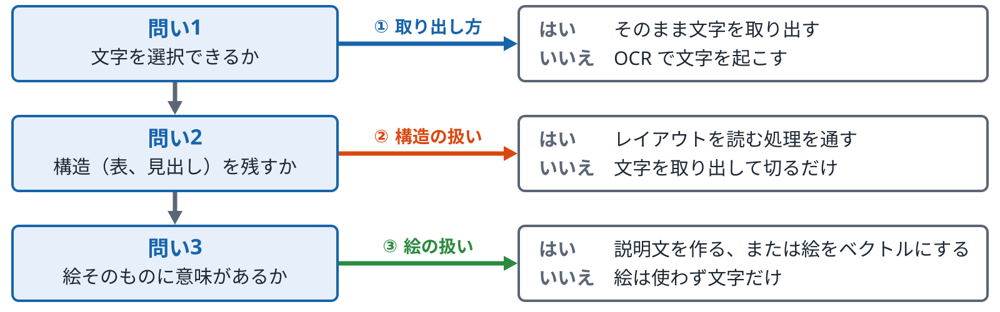

*問いはページごとに答える。1つのファイルの中で答えが変わることがある*

**確かめる**：[応用 14 種類の違う文書をまとめて取り込む](../../../applied/topics/14-mixed-documents/README.md)／[応用 15 Azure の仕組みに置き換える](../../../applied/topics/15-azure-indexer/README.md)

ノート

- 位置：p.17 の PDF の取り込みの続きで、どの読み方を選ぶかを決める順番のページです。
- 言いたいこと：3つの問い（文字を選択できるか、構造を残すか、絵に意味があるか）を順に答えれば、使う処理が決まります。
- 気をつけること：
  - OCR は絵の中の文字しか拾わない、という点を言葉ではっきり言ってください。図やグラフの意味までは取れません。
  - GenAI Prompt スキルとマルチモーダルの埋め込みは生成 AI や埋め込みの呼び出しが増えます。

**図のノート**

狙い：3つの問い（文字を選択できるか、構造を残すか、絵に意味があるか）を順に答えれば、使う処理が決まると言える。

話すこと：

- 段階0：問い1「文字を選択できるか」。PDF を開いて、マウスで文字を選択できれば、中に文字のデータがあるのでそのまま取り出す。選択できなければ、中身は絵なので OCR で文字を起こす。1つのファイルの中でも、ページによって答えが変わることがある
- 段階1：問い2「構造（表、見出し）を残すか」。表、見出し、段組みを使って答えたいなら、レイアウトを読み取る処理を通す。本文だけ探せればよいなら、文字を取り出して切るだけで足りる。表をくずすと「どの行のどの値か」がわからなくなり、答えを間違えやすい
- 段階2：問い3「絵そのものに意味があるか」。図、写真、グラフに答えが入っているなら、絵の説明文を作るか、絵をそのままベクトルにする。絵に意味がなければ、絵は使わず文字だけで足りる

補足：Azure AI Search では、問い1の「はい」はインデクサーの標準の取り出し（表や見出しが要るときは Document Layout スキルを足す）。「いいえ」は OCR スキル（入力は、インデクサーの imageAction で取り出した画像）か、Document Layout スキル（文字の読み取りとあわせて表や見出しも読み取る。入力は元のファイルそのもの＝allowSkillsetToReadFileData なので、画像の取り出し設定は要らない）。問い2の「はい」は Document Layout スキル。問い3の「はい」は、GenAI Prompt スキル（GA。生成 AI に絵の説明文を書かせて索引に入れる）、マルチモーダルの埋め込み（Azure Vision のスキルはプレビュー。絵をそのままベクトルにして、文で絵を探せるようにする）、Content Understanding スキル（GA。文書と絵の中身をまとめて取り出す）

注意：OCR が拾うのは絵の中の文字だけで、図やグラフの意味までは取れない。GenAI Prompt スキルとマルチモーダルの埋め込みは、生成 AI や埋め込みの呼び出しが増える

### p.19 事業部がインデックスのポリシーを出し、システム側は共通の仕組みだけを持つ

*PDF、Word、Excel、Outlook のメール、テキストが混ざって置いてある場合*

- **一般的な説明**
  - **何を分けるか**
    - システム側が持つもの：読む、ばらす、切る、索引に入れるという共通の流れと、ファイルの種類ごとの読み方です。
    - 事業部側が出すもの：何を入れて何を外すか、出典に何を残すか、どの単位で切るか、誰に見せるかです。
    - 事業部が出したポリシーを、システム側の流れが読んでそのとおりに動きます。こうすれば、事業部が増えても仕組みを作り直さずに済みます。
  - **ポリシーに書く項目（例）**
    - 対象：フォルダ、ファイルの種類、期間、外すもの（下書き、個人のメモなど）。
    - 出典の欄：ファイルの種類ごとに残す項目です（PDF はページ、Word は見出し、Excel はシートと行、メールは差出人、日付、件名）。
    - 切り方と付ける情報：見出しで切るか長さで切るか、部署、文書の種類、有効期限などのタグ、見せてよい人の範囲です。
  - **全社で揃えるもの**
    - 共通の欄：出典、種類、部署、更新日、見せてよい人。この欄があれば、どの事業部のデータも同じやり方で絞り込めます。
    - 事業部ごとの欄：その部署でしか使わない言葉や分類です。共通の欄とは分けて持ちます。
    - 決める人：項目の意味は事業部が決め、欄の名前と型はシステム側が決めます。
- **Azure AI Search での説明**
  - **共通の流れ（システム側）**
    - データソースとインデクサー：Blob や SharePoint など、置き場所ごとに作ります。
    - スキルセット：ファイルの種類ごとに読み方を切り替えます（OCR、Document Layout、Text Split など）。
    - インデックス：共通の欄を持つ1つの形を決めておきます。
  - **事業部のポリシーをどう効かせるか**
    - 対象を絞る：置き場所やフォルダを分け、インデクサーごとに対象を変えます。
    - タグを付ける：フィールドの対応付けやスキルで、部署や種類の欄を埋めます。
    - 見せる範囲：セキュリティフィルター（GA）、または文書ごとの権限を持ち込む機能（プレビュー、p.30）を使います。
  - **全社で使う形**
    - 1つのインデックスにまとめて部署の欄で絞るか、事業部ごとにインデックスを分けるかを選びます。
    - Foundry IQ のナレッジベースでは、事業部ごとのインデックスをナレッジソースとして並べられます。
    - Outlook のメールは、Azure AI Search の標準のデータソースにはありません。いったん Blob などに書き出すか、別の仕組みで入れることになります。

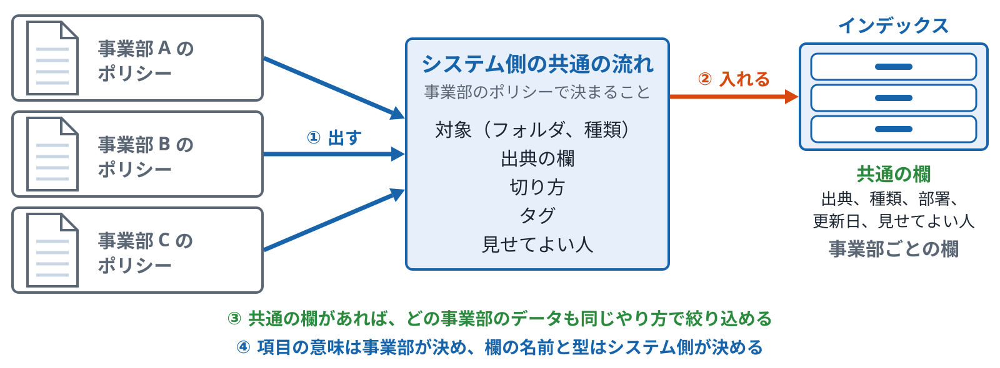

*ポリシーを読んでインデクサーやスキルセットを作る部分は、自分で作る前提*

**確かめる**：[応用 14 種類の違う文書をまとめて取り込む](../../../applied/topics/14-mixed-documents/README.md)

ノート

- 位置：p.16〜p.18 の取り込みを、1つの部署から全社に広げるページです。
- 言いたいこと：取り込みの流れはシステム側が1つだけ持ち、何を入れるか、出典に何を残すか、誰に見せるかは事業部がポリシーとして出します。
- 気をつけること：
  - ポリシーを読んでインデクサーやスキルセットを作る部分は、Azure AI Search の機能ではなく自分で作る前提です。機能として存在するように聞こえないよう話してください。
  - Outlook のメールは標準のデータソースにない、という点は必ず言ってください。
  - 1つのインデックスにまとめるか分けるかは、料金と上限が変わります。ここでは選び方を並べるだけにします。

**図のノート**

狙い：取り込みの流れはシステム側が1つだけ持ち、何を入れるか、出典に何を残すか、誰に見せるかは事業部がポリシーとして出す、と言える。

話すこと：

- 段階0：事業部 A、B、C がそれぞれポリシーを出す。システム側は、読む、ばらす、切る、索引に入れるという共通の流れと、ファイルの種類ごとの読み方を持つ。ポリシーに書くのは、対象（フォルダ、ファイルの種類、期間、外すもの）、出典の欄（種類ごとに残す項目）、切り方、タグ（部署、文書の種類、有効期限など）、見せてよい人の範囲
- 段階1：システム側の流れが、出されたポリシーを読んでそのとおりに動き、インデックスに入れる。事業部が増えても、仕組みを作り直さずに済む
- 段階2：インデックスの共通の欄（出典、種類、部署、更新日、見せてよい人）があれば、どの事業部のデータも同じやり方で絞り込める。事業部ごとの欄は、その部署でしか使わない言葉や分類で、共通の欄とは分けて持つ
- 段階3：決める人は分かれる。項目の意味は事業部が決め、欄の名前と型はシステム側が決める

補足：Azure AI Search では、共通の流れは、データソースとインデクサー（Blob や SharePoint など、置き場所ごとに作る）、スキルセット（ファイルの種類ごとに OCR、Document Layout、Text Split などを切り替える）、共通の欄を持つ1つの形のインデックスで作る。ポリシーの効かせ方は、対象を絞るのは置き場所やフォルダを分けてインデクサーごとに変える、タグを付けるのはフィールドの対応付けやスキルで部署や種類の欄を埋める、見せる範囲はセキュリティフィルター（GA）か、文書ごとの権限を持ち込む機能（プレビュー、p.30）。全社では、1つのインデックスにまとめて部署の欄で絞るか、事業部ごとにインデックスを分けるかを選ぶ。Foundry IQ のナレッジベースでは、事業部ごとのインデックスをナレッジソースとして並べられる。Outlook のメールは、Azure AI Search の標準のデータソースにない。いったん Blob などに書き出すか、別の仕組みで入れる

注意：ポリシーを読んでインデクサーやスキルセットを作る部分は、Azure AI Search の機能ではなく自分で作る前提。機能として存在するように聞こえないよう話す。Outlook のメールは標準のデータソースにない、という点は必ず言う。1つにまとめるか分けるかは、料金と上限が変わる。ここでは選び方を並べるだけにする

## B　切り方

### p.20 階層型検索

*単純な文書の検索と、文書の中の構造の検索*

- **一般的な説明**
  - **単純な文書の検索**
    - 1つの文書、または同じ長さで切ったチャンクを、1つの検索の単位にします。
    - 当たったときは、文書やチャンクがそのまま返ります。
    - 答えが文書の中のどこにあるかは、読む人が探すことになります。
  - **文書の中の構造の検索**
    - 文書を、章、節、段落、表、表の行のような構造に分け、親と子の関係を持たせます。
    - 子の単位で探し、当たったら親をたどって「どの文書のどの章か」を返します。
    - 出典が細かくなり、文脈を足したいときは親の単位を読ませられます。
  - **必要になるもの**
    - 取り込みの「ばらす」の段で、構造を読み取る処理が要ります（p.16）。
    - 子のチャンクごとに、親の ID と、構造の種類（見出し、表、行）を持たせます。
    - 構造がくずれた文書（見出しのスタイルがない Word など）では、この方法が使えないことがあります。
- **Azure AI Search での説明**
  - **構造を読み取る**
    - Document Layout スキルで、見出し、段落、表を読み取ります。
    - 見出しで区切った Markdown を出す設定があり、`markdownHeaderDepth`（h1〜h6。既定は h6）で見出しの深さを指定できます。
    - 表は、表の構造を残した Markdown として出力に含まれます。表や行を別のチャンクにするには、その出力から分ける処理を自分で足します（p.23）。
  - **親子を持つ**
    - インデックスプロジェクションで、子のチャンクを別のインデックスに入れ、親のキーを欄に持たせます（p.22）。
    - 見出しの道筋（例: 「第2章 > 第3条」）を欄として残せます。
    - `projectionMode` を `skipIndexingParentDocuments` にすると、親の文書そのものは入れず、子のチャンクだけを入れられます。
  - **探し方**
    - 子のチャンクで探し、構造の種類の欄でフィルターをかけられます（例: 表だけ）。
    - 親の情報は、親のキーで別に引きます。

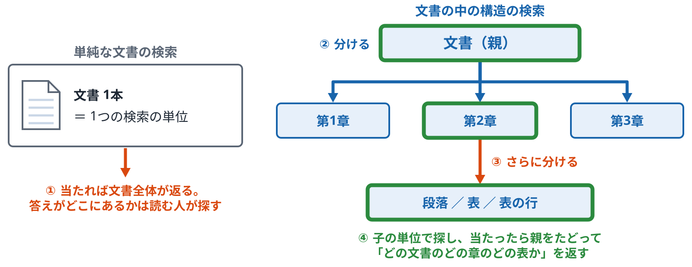

*構造ごとに探すと、出典が「どの文書のどの章のどの表か」まで下りる*

ノート

- 位置：第2部で、取り込みの順番（p.16〜p.19）を見たあと、「ばらす」の段の使い道を見るページです。p.21〜p.24 で切り方の細かい点に進みます。
- 言いたいこと：文書の中の構造を検索の単位にすると、出典が章や表まで下ります。そのためには、取り込みで構造を読み取り、親子の関係を持たせます。
- 気をつけること：
  - Azure AI Search に「階層型検索」という名前の機能があるわけではありません。いくつかの機能の組み合わせで作る、と話してください。
  - 図の構造は説明用の例です。

**図のノート**

狙い：文書の中の構造を検索の単位にすると、出典が章や表まで下りると言える。そのためには、取り込みで構造を読み取り、親子の関係を持たせる。

話すこと：

- 段階0：単純な文書の検索は、1つの文書（または同じ長さで切ったチャンク）が1つの検索の単位。当たると文書やチャンクがそのまま返り、答えが文書の中のどこにあるかは、読む人が探すことになる
- 段階1：文書の中の構造の検索では、文書を章、節、段落、表、表の行のような構造に分け、親と子の関係を持たせる。取り込みの「ばらす」の段で、構造を読み取る処理が要る（p.16）
- 段階2：子の単位（段落、表、表の行）まで分ける。子のチャンクごとに、親の ID と、構造の種類（見出し、表、行）を持たせる
- 段階3：子の単位で探し、当たったら親をたどって「どの文書のどの章のどの表か」を返す。出典が細かくなり、文脈を足したいときは親の単位を読ませられる

補足：Azure AI Search では、親子の関係をインデックスプロジェクションで持ち、章や表の種類をフィールドに入れて絞り込む。構造を読み取るのは Document Layout スキルで、見出しで区切った Markdown を出す設定があり、markdownHeaderDepth（h1〜h6。既定は h6）で見出しの深さを指定できる。表は、表の構造を残した Markdown として出力に含まれる。表や行を別のチャンクにするには、その出力から分ける処理を自分で足す（p.23）。親子は、インデックスプロジェクションで子のチャンクを別のインデックスに入れ、親のキーを欄に持たせる（p.22）。見出しの道筋（例：第2章 > 第3条）も欄として残せる。projectionMode を skipIndexingParentDocuments にすると、親の文書そのものは入れず、子のチャンクだけを入れられる。探すときは、子のチャンクで探し、構造の種類の欄でフィルターをかけられる（例：表だけ）。親の情報は、親のキーで別に引く

注意：Azure AI Search に「階層型検索」という名前の機能があるわけではない。いくつかの機能の組み合わせで作る、と話す。図の構造は説明用の例。構造がくずれた文書（見出しのスタイルがない Word など）では、この方法が使えないことがある

### p.21 チャンクの大きさと重なり

*どこで切るかで、見つかる文が変わる*

- **一般的な説明**
  - **大きさ**
    - チャンクが大きいと、1つのチャンクにいくつもの話が入り、ベクトルの意味がぼやけます。
    - チャンクが小さいと、前後の文脈が消え、1つのチャンクだけでは答えにならないことがあります。
    - 大きさは、文字の数か、トークンの数で決めます。
  - **重なり**
    - 隣り合うチャンクの境目を、少し重ねて切る方法です。
    - 「ただし、部長が認めた場合は延長できる」のような、境目をまたぐ文が両方に残ります。
    - 重ねた分だけ、チャンクの数と保存の量が増えます。
  - **切る位置**
    - 決めた長さで機械的に切る方法と、文や段落の区切りで切る方法があります。
    - 見出しで切る方法では、話のまとまりごとにチャンクができます（p.24）。
    - どれを使うかで、同じ質問への答えが変わることがあります。
- **Azure AI Search での説明**
  - **Text Split スキル**
    - `textSplitMode` で、ページ（決めた長さ）か、文かを選びます。
    - `maximumPageLength` でチャンクの長さ（既定は5,000文字。300〜50,000）、`pageOverlapLength` で重なりの長さを決めます。
    - 長さの単位（`unit`）は、既定が文字です。トークン（`azureOpenAITokens`）で数える設定はプレビューです。
  - **Document Layout と組み合わせる**
    - Document Layout で見出しごとに区切ってから、Text Split で長すぎる部分を切ります。
    - この順番にすると、見出しをまたいだチャンクができにくくなります。
    - 切ったあとの各チャンクに、見出しの道筋を付けられます。
  - **確かめ方**
    - 同じ質問で、どのチャンクが上位に来るかを比べます。
    - 決まった正解の長さはないので、評価（p.39〜p.45）で確かめます。

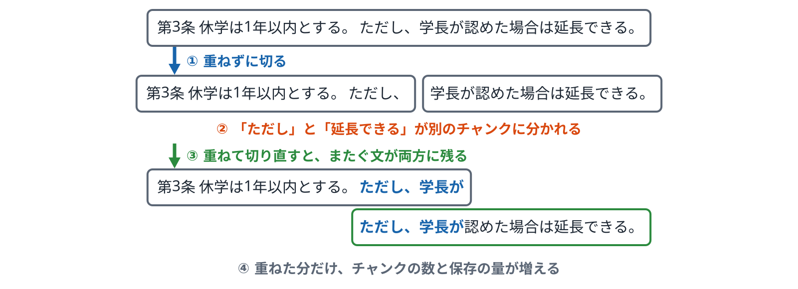

*重なりを付けると、切れ目をまたぐ文が両方のチャンクに残る。文は説明用の例*

ノート

- 位置：第2部で、取り込みの「切る」の段を詳しく見るページです。p.22 の親子チャンクの前提になります。
- 言いたいこと：チャンクの大きさと重なりで、見つかる文が変わります。決まった正解の長さはありません。
- 気をつけること：
  - どの長さがよいかは言いません。変えたときに何が変わるかだけを見せます。

**図のノート**

狙い：チャンクの大きさと重なりで、見つかる文が変わると言える。決まった正解の長さはない。

話すこと：

- 段階0：例の文は「第3条 経費の精算は翌月5日までとする。ただし、部長が認めた場合は延長できる。」
- 段階1：重ならずに切ると、境目をまたぐ文が分かれる。「ただし」と「延長できる」が別のチャンクに分かれてしまう
- 段階2：隣り合うチャンクの境目を少し重ねて切ると、境目をまたぐ文が両方のチャンクに残る。後ろのチャンクだけで「ただし、部長が認めた場合は延長できる」が読める
- 段階3：重ねた分だけ、チャンクの数と保存の量が増える

補足：大きさは、文字の数かトークンの数で決める。チャンクが大きいと、1つのチャンクにいくつもの話が入ってベクトルの意味がぼやけ、小さいと、前後の文脈が消えて、1つのチャンクだけでは答えにならないことがある。Azure AI Search の Text Split スキルでは、textSplitMode でページ（決めた長さ）か文かを選び、maximumPageLength でチャンクの長さ（既定は5,000文字。300〜50,000）、pageOverlapLength で重なりの長さを決める。長さの単位（unit）は既定が文字で、トークン（azureOpenAITokens）で数える設定はプレビュー。Document Layout で見出しごとに区切ってから Text Split で長すぎる部分を切ると、見出しをまたいだチャンクができにくい（p.24）。確かめ方は、同じ質問でどのチャンクが上位に来るかを比べる。決まった正解の長さはないので、評価（p.39〜p.45）で確かめる

注意：どの長さがよいかは言わない。変えたときに何が変わるかだけを見せる。文は説明用の例

### p.22 親子チャンク

*小さく切って探し、親の ID で元の文書に戻る*

- **一般的な説明**
  - **考え方**
    - 探す単位（子）と、見せる単位や出典にする単位（親）を分けます。
    - 子は小さく切るので、質問と意味が近い部分を見つけやすくなります。
    - 親は大きいので、生成 AI に渡すときに前後の文脈を足せます。
  - **持たせる情報**
    - 子には、親の ID を持たせます。
    - 親には、ファイル名、更新日、部署のような文書全体の情報を持たせます。
    - 子に親の情報を写しておくと、子だけでフィルターをかけられます。
  - **使い方の形**
    - 子で探して、子をそのまま返す形があります。
    - 子で探して、親の ID でまとめ、親を返す形もあります。
    - 親が大きすぎると、生成 AI に渡す量が増えます。
- **Azure AI Search での説明**
  - **インデックスプロジェクション**
    - スキルセットの中で、1つの文書から作った子のチャンクを、別のインデックスの行として入れます。
    - `parentKeyFieldName` で、親のキーを入れる欄を決めます。
    - 親の欄（ファイル名など）を、子の行に写せます。
  - **親の扱い**
    - 親の文書も同じインデックスに入れるか、入れないかを `projectionMode` で選べます（既定は入れる `includeIndexingParentDocuments`）。
    - 入れない場合は、子の行だけのインデックスになります。
    - 親の文書を別のインデックスに入れて、親のキーで引く形もあります。
  - **検索の結果**
    - 検索の結果は子の行で返ります。
    - 親でまとめて返す設定は、検索のクエリにありません。子の結果を親のキーでまとめる処理は、アプリで書きます。

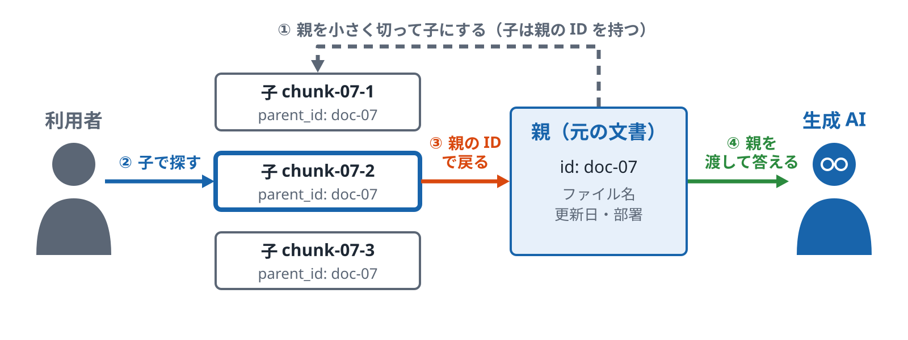

*探す単位（子）と、見せる・出典にする単位（親）を分ける。ID は説明用の例*

ノート

- 位置：p.21 の切り方の続きで、切ったチャンクと元の文書をどうつなぐかのページです。p.20 の階層型検索の「親子を持つ」を詳しく見ます。
- 言いたいこと：子で探し、親の ID で元の文書に戻ります。探す単位と見せる単位を分ける考え方です。
- 気をつけること：
  - 図の ID は説明用の例です。
  - 親でまとめて返すのはアプリの仕事です。サービスの機能として話さないでください。

**図のノート**

狙い：探す単位（子）と、生成 AI に渡す単位（親）を分ける考え方が言える。

話すこと：

- 段階0：親の文書を小さく切って子にする。子は親の ID（parent_id）を持つ
- 段階1：質問で子を探す。子は小さいので、質問と意味が近い部分が当たりやすい
- 段階2：当たった子の親の ID で、元の文書（親）に戻る
- 段階3：親を生成 AI に渡す。前後の文脈が入る。親が大きすぎると、渡す量が増える

補足：Azure AI Search では、インデックスプロジェクションで子のチャンクを別のインデックスの行として入れ、parentKeyFieldName で親のキーを入れる欄を決める。親でまとめて返すのはアプリの仕事（検索のクエリにその設定はない）

注意：図の ID は説明用の例

### p.23 表と Excel の行の扱い

*1行を「列名: 値」の文にしてから切る*

- **一般的な説明**
  - **表をそのまま文字にしたとき**
    - 表の中身を左上から順に文字にすると、「一次 4 10月2日 二次 …」のように値だけが並びます。
    - どの値がどの列のものかがわからなくなります。列名のない文書は、正しい行の順位が下がることがあります。表まるごとを1件にすると、LLM に渡す量が増え、表が大きいと、答えを取り違えることもあります。
    - 長い表は、途中で切られて、列名のないチャンクができます。
  - **1行を1つの文にする**
    - 1行ごとに「段階: 一次、評価: 4、実施日: 10月2日」のように、列名を付けた文にします。
    - こうすると、行ごとに意味がそろったチャンクになります。
    - 出典は、ファイル名、シート名、行の番号で残します。
  - **表全体で答える質問**
    - 「一番高いのはどれか」のような質問は、行ごとのチャンクでは答えにくくなります。
    - そのような質問には、表全体を1つのチャンクにしたものも別に持つ方法があります。
    - 数の集計が要る質問は、検索ではなく表の計算で答える方が向いている場合があります。
- **Azure AI Search での説明**
  - **Excel を1行ずつ入れる**
    - Blob のインデクサーで、`parsingMode` を `delimitedText`（区切り文字のテキスト。CSV）にすると、1行が1つの文書になります。
    - Excel のファイル（XLSX など）は、標準では1ファイルが1つの文書になり、中の文字がまとめて取り出されます。
    - 行ごとにしたいときは、CSV に書き出すか、自分の処理で行に分けます。
  - **PDF や Word の中の表**
    - Document Layout スキルで、表を表の形（Markdown の表）のまま読み取れます。
    - Document Layout スキルに、表だけを取り出す出力はありません。表の構造を含む Markdown（`markdown_document`）が返るので、そこから表や行を別のチャンクにする処理は、カスタムの Web API スキルなどで自分で書きます。
    - 表かどうかを欄に残すと、表だけに絞れます。

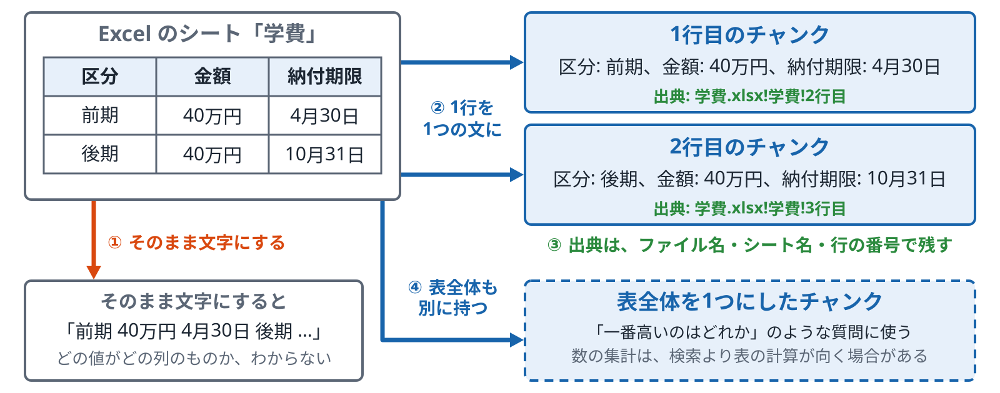

*列名を落とすと、値だけが残り「何の数字か」がわからなくなる。表の中身は説明用の例*

ノート

- 位置：第2部で、表の「ばらす」と「切る」を見るページです。p.17 の Azure による PDF の取り込みで扱わなかった Word と Excel の表の行を、ここで扱います。
- 言いたいこと：表は、1行を列名付きの文にしてから切ると、行ごとに意味がそろいます。
- 気をつけること：
  - 行を文に直す処理は、自分で書く前提です。Azure の機能として話さないでください。

**図のノート**

狙い：表は、1行を列名付きの文にしてから切ると、行ごとに意味がそろうと言える。

話すこと：

- 段階0：Excel のシートを左上から順にそのまま文字にすると、「一次 4 10月2日 二次 …」と値だけが並ぶ。どの値がどの列のものかがわからず、答えを間違えやすい。長い表は、途中で切られて列名のないチャンクもできる
- 段階1：1行ごとに「段階: 一次、評価: 4、実施日: 10月2日」のように、列名を付けた文にする。行ごとに意味がそろったチャンクになる
- 段階2：出典は、ファイル名、シート名、行の番号で残す
- 段階3：「一番高いのはどれか」のような質問は、行ごとのチャンクでは答えにくい。表全体を1つのチャンクにしたものも別に持つ方法がある。数の集計が要る質問は、検索ではなく表の計算で答える方が向いている場合がある

補足：Azure AI Search では、Blob のインデクサーで parsingMode を delimitedText（CSV）にすると、1行が1つの文書になる。Excel のファイル（XLSX など）は、標準では1ファイルが1つの文書で、行ごとにしたいときは CSV に書き出すか、自分の処理で行に分ける。PDF や Word の中の表は、Document Layout スキルで Markdown の表のまま読める。表だけを取り出す出力はないので、表や行を別のチャンクにする処理は、カスタムの Web API スキルなどで自分で書く

注意：行を文に直す処理は、自分で書く前提。Azure の機能として話さない。図の表の中身は説明用の例

## C　形式と出典

### p.24 Word の見出しの扱い

*見出しで切り、見出しの道筋を出典にする*

- **一般的な説明**
  - **見出しで切る**
    - Word の見出しのスタイル（見出し1、見出し2）を使って、話のまとまりごとに切ります。
    - 長さで切るより、1つのチャンクに1つの話が入りやすくなります。
    - 1つの見出しの下が長いときは、その中をさらに長さで切ります。
  - **見出しの道筋を残す**
    - チャンクごとに、上の見出しを順に並べた道筋（例: 「経費精算 > 差し戻し」）を付けます。
    - 本文だけでは何の話かわからない段落でも、道筋があれば意味が通じます。
    - 出典にも、この道筋を使えます。
  - **見出しが読めない文書**
    - 太字や大きな文字だけで見出しに見せている文書は、見出しとして読めないことがあります。
    - その場合は、長さで切るか、文字の大きさなどから見出しを推し量る処理が要ります。
    - 取り込む前に、文書の作り方を確かめておきます。
- **Azure AI Search での説明**
  - **Document Layout スキル**
    - Word のファイルも読み取れ、見出しで区切った Markdown を返す設定があります。
    - 見出しの深さ（`markdownHeaderDepth`。h1〜h6）を指定して区切れます。
    - 出力には、区切った部分ごとの見出しの情報が付きます。
  - **標準の取り出し**
    - インデクサーの標準の取り出しでは、Word の本文はまとめて文字になり、見出しの構造は残りにくくなります。
    - そのため、見出しを使うときは Document Layout を通します。
    - Text Split スキルは、見出しを見ずに長さで切ります。
  - **出典の欄**
    - 見出しの道筋を、インデックスの欄に入れます。
    - インデックスプロジェクションで、子のチャンクごとに道筋を持たせます。

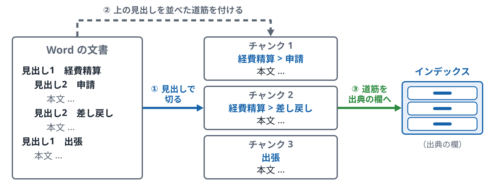

*見出しのスタイルが使われていれば、構造として読める。例は説明用*

**確かめる**：[応用 14 種類の違う文書をまとめて取り込む](../../../applied/topics/14-mixed-documents/README.md)

ノート

- 位置：p.23 の表の続きで、Word の見出しを使った切り方のページです。p.20 の階層型検索の具体例になります。
- 言いたいこと：見出しで切り、見出しの道筋を付けると、チャンクの意味と出典がはっきりします。
- 気をつけること：
  - 図の見出しは説明用の例です。

**図のノート**

狙い：見出しで切り、見出しの道筋を付けると、チャンクの意味と出典がはっきりすると言える。

話すこと：

- 段階0：Word の見出しのスタイル（見出し1、見出し2）を使って、話のまとまりごとに切る。長さで切るより、1つのチャンクに1つの話が入りやすい。1つの見出しの下が長いときは、その中をさらに長さで切る
- 段階1：チャンクごとに、上の見出しを順に並べた道筋（例：「経費精算 > 差し戻し」）を付ける。本文だけでは何の話かわからない段落でも、道筋があれば意味が通じる
- 段階2：道筋を、インデックスの出典の欄に入れる。インデックスプロジェクションで、子のチャンクごとに道筋を持たせる

補足：Azure AI Search では、Document Layout スキルが Word のファイルも読み取り、見出しで区切った Markdown を返せる（見出しの深さは markdownHeaderDepth で h1〜h6）。インデクサーの標準の取り出しでは、Word の本文はまとめて文字になり、見出しの構造は残りにくい。Text Split スキルは、見出しを見ずに長さで切る

注意：太字や大きな文字だけで見出しに見せている文書は、見出しとして読めないことがある。その場合は、長さで切るか、文字の大きさなどから見出しを推し量る処理が要る。取り込む前に文書の作り方を確かめる。図の見出しは説明用の例

### p.25 メールの取り込み

*本文と、差出人、日付、件名を分けて持つ*

- **一般的な説明**
  - **メールの特徴**
    - 1通のメールに、新しく書いた本文と、前のメールの引用が混ざっています。
    - 同じ話が、返信のたびに何度も引用されて残ります。
    - 添付ファイルに答えがあることもあります。
  - **分けて持つもの**
    - 本文：引用の部分を分けると、同じ文が何度も当たることが減ります。
    - 差出人、宛先、日付、件名：出典と、絞り込みに使います。
    - スレッド：同じ話のメールをまとめるための目印です。
  - **日付の扱い**
    - メールは、後から条件が変わることがよくあります（例: 出社の日数が変わった連絡）。
    - 日付を欄に持たせておくと、新しいメールを上にしたり、期間で絞ったりできます。
    - 古いメールと新しいメールが食い違うことを、前もって考えておきます。
- **Azure AI Search での説明**
  - **データソース**
    - Outlook や Exchange のメールボックスは、Azure AI Search の標準のデータソースにはありません。
    - メールをファイル（.eml や .msg）として Blob などに書き出してから、インデクサーで読みます。
    - 書き出す仕組みは、自分で作るか、別のサービスを使います。
  - **読み取れる情報**
    - Blob のインデクサーは、.eml や .msg のファイルから、本文と、差出人（`metadata_message_from`）、宛先、日付（`metadata_creation_date`）、件名（`metadata_subject`）などのメタデータを取り出せます。
    - 添付ファイルの文字も、同じ1件の文書に入ります。
    - 取り出したメタデータは、フィールドの対応付けで欄に入れます。
    - 引用の部分を分ける処理は、標準にはないので自分で書きます。

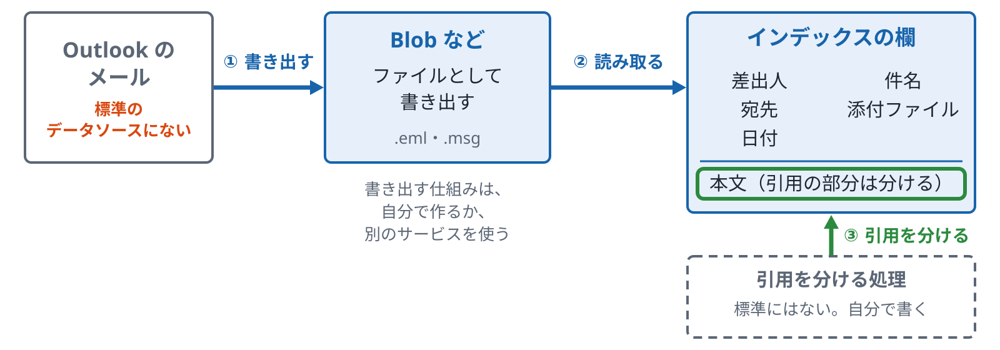

*Outlook のメールは Azure AI Search の標準のデータソースにはない*

**確かめる**：[応用 14 種類の違う文書をまとめて取り込む](../../../applied/topics/14-mixed-documents/README.md)

ノート

- 位置：第2部で、PDF、Word、Excel のあとに、メールを取り込むページです。p.19 の事業部のポリシーの「メールは差出人、日付、件名」の続きです。
- 言いたいこと：メールは、本文と引用、差出人や日付を分けて持ちます。Outlook は標準のデータソースにないので、ファイルに書き出してから読みます。
- 気をつけること：
  - Outlook が標準のデータソースにないことは、必ず言ってください。
  - メールを書き出す仕組みを作るときに、権限の付与が要る場合があります。

**図のノート**

狙い：メールは、本文と引用、差出人や日付を分けて持つこと、Outlook は標準のデータソースにないのでファイルに書き出してから読むことが言える。

話すこと：

- 段階0：Outlook や Exchange のメールボックスは、Azure AI Search の標準のデータソースにない。メールをファイル（.eml や .msg）として Blob などに書き出してから、インデクサーで読む。書き出す仕組みは、自分で作るか、別のサービスを使う
- 段階1：Blob のインデクサーは、.eml や .msg のファイルから、本文と、差出人、宛先、日付、件名などのメタデータを取り出せる。添付ファイルの文字も、同じ1件の文書に入る。メタデータは、フィールドの対応付けで欄に入れる
- 段階2：1通のメールには、新しく書いた本文と前のメールの引用が混ざり、同じ話が返信のたびに何度も引用される。引用の部分を分けると、同じ文が何度も当たることが減る。この処理は標準にないので、自分で書く

補足：差出人、宛先、日付、件名は、出典と絞り込みに使う。スレッドは、同じ話のメールをまとめるための目印。日付を欄に持たせておくと、新しいメールを上にしたり、期間で絞ったりできる。古いメールと新しいメールが食い違うことを、前もって考えておく（p.29）

注意：Outlook が標準のデータソースにないことは、必ず言う。メールを書き出す仕組みを作るときに、権限の付与が要る場合がある

### p.26 メタデータと出典

*チャンクごとに「どの文書のどこか」を欄で持つ*

- **一般的な説明**
  - **メタデータとは**
    - 本文のほかに、文書について書かれた情報です（ファイル名、場所、更新日、作った人など）。
    - ファイルそのものが持っている情報と、取り込みのときに付ける情報があります。
    - 部署や文書の種類のように、人が決めて付ける情報もあります。
  - **出典の欄**
    - チャンクごとに、ファイル名と、文書の中の場所を持たせます。
    - 場所の書き方は、ファイルの種類で変わります（PDF はページ、Word は見出し、Excel はシートと行）。
    - 種類（text、table、ocr、row）も持たせると、読み間違いがあり得るチャンクを後から見分けられます。
  - **使い道**
    - 回答に出典を示すために使います（p.49）。
    - 部署や期間で絞り込むフィルターに使います（p.11）。
    - 新しさで点数を足すときにも使えます（p.12）。
- **Azure AI Search での説明**
  - **インデクサーが付ける情報**
    - Blob では、`metadata_storage_name`（ファイル名）、`metadata_storage_path`（パス）、`metadata_storage_last_modified`（更新日）などが付きます。
    - 付く情報は、データソースの種類とファイルの種類で変わります。
    - パスはキーに使われることが多く、そのままでは使えない文字を含むため、`base64Encode` というマッピング関数で変換して入れます。
  - **欄に入れる方法**
    - `fieldMappings`：元の情報を、インデックスの欄に対応づけます。
    - `outputFieldMappings`：スキルの出力を、インデックスの欄に対応づけます。
    - インデックスプロジェクションでは、親の情報を子のチャンクの欄に写せます。
  - **欄の型**
    - 文字、日付、数のほかに、複合型やコレクションの型で、いくつかの値をまとめて持てます。
    - フィルターに使う欄は `filterable` にします。

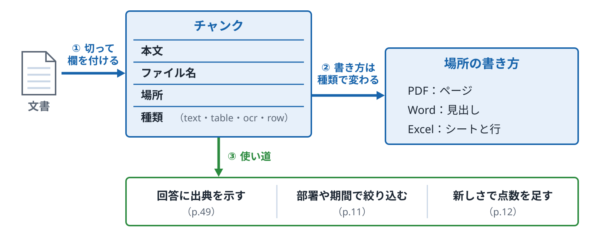

*場所の書き方は、ファイルの種類で変わる*

ノート

- 位置：第2部で、取り込みの「出典」の段を詳しく見るページです。p.21〜p.25 で切り方を見たあとにまとめます。
- 言いたいこと：出典は、チャンクごとに欄として持ちます。場所の書き方はファイルの種類で変わります。
- 気をつけること：
  - 出典は後から足すのが難しい、という p.16 の話をもう一度言ってください。

**図のノート**

狙い：出典は、チャンクごとに欄として持つこと、場所の書き方はファイルの種類で変わることが言える。

話すこと：

- 段階0：文書を切ったチャンクごとに、本文のほかに、ファイル名、文書の中の場所、種類の欄を持たせる。メタデータには、ファイルそのものが持っている情報（ファイル名、場所、更新日、作った人）、取り込みのときに付ける情報、部署や文書の種類のように人が決めて付ける情報がある。種類（text、table、ocr、row）も持たせると、読み間違いがあり得るチャンクを後から見分けられる
- 段階1：場所の書き方は、ファイルの種類で変わる。PDF はページ、Word は見出し、Excel はシートと行
- 段階2：回答に出典を示す（p.49）、部署や期間で絞り込むフィルターに使う（p.11）、新しさで点数を足す（p.12）のに使う

補足：Azure AI Search では、Blob のインデクサーが metadata_storage_name（ファイル名）、metadata_storage_path（パス）、metadata_storage_last_modified（更新日）などを付ける。付く情報は、データソースの種類とファイルの種類で変わる。パスはキーに使われることが多く、そのままでは使えない文字を含むので、base64Encode のマッピング関数で変換して入れる。欄への入れ方は、fieldMappings（元の情報）、outputFieldMappings（スキルの出力）、インデックスプロジェクション（親の情報を子のチャンクへ）。フィルターに使う欄は filterable にする

注意：出典は後から足すのが難しい、という p.16 の話をもう一度言う

## D　Azure の仕組み

### p.27 インデクサーとスキルセット

*取りに行く、加工する、入れる*

- **一般的な説明**
  - **取り込みの部品**
    - 置き場所への接続、取りに行く係、途中の加工、入れる先の4つに分けて考えます。
    - 手元の Python では、この4つを1本のスクリプトに書くことが多くなります。
    - サービスでは、4つが別々の部品になっていて、組み合わせて使います。
  - **途中の加工**
    - 文字の取り出し、OCR、切る、ベクトルにする、などの処理を順につなぎます。
    - 前の処理の出力を、次の処理の入力にします。
    - どの処理の出力をどの欄に入れるかを決めておきます。
  - **動かし方**
    - 一度だけ動かす方法と、決まった間隔で動かす方法があります。
    - 前回から変わったものだけを入れ直す仕組みがあると、時間が短くなります（p.29）。
    - 失敗したファイルの記録を見て、原因を調べます。
- **Azure AI Search での説明**
  - **4つの部品**
    - データソース：Blob、ADLS Gen2、SQL、Cosmos DB などへの接続です。
    - インデクサー：データソースから取りに行き、スキルセットを通し、インデックスに入れます。
    - スキルセットとインデックス：途中の加工の一覧と、入れる先の欄の定義です。
  - **スキルセットの中**
    - 組み込みのスキル：OCR、Document Layout、Text Split、埋め込みなどです。
    - カスタムの Web API スキル：自分で書いた処理を呼べます。
    - スキルの出力は、文書ごとの木の形（エンリッチメントの木）に積み上げられ、`outputFieldMappings` で欄に入れます。
  - **動かし方と記録**
    - `schedule` で、決まった間隔で動かせます。
    - 実行の記録で、成功と失敗の件数と、失敗の理由が見られます。
    - スキルの中には、料金がかかるものがあります。

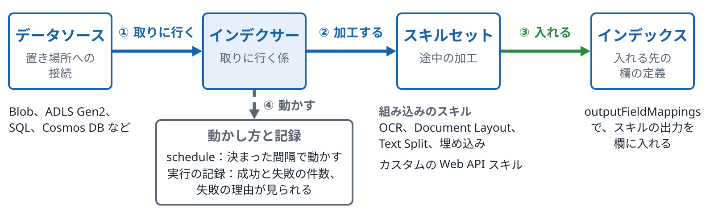

*インデクサーが流れを動かし、スキルセットが途中の加工を受け持つ*

**確かめる**：[応用 15 Azure の仕組みに置き換える](../../../applied/topics/15-azure-indexer/README.md)

ノート

- 言いたいこと：取り込みは、データソース、インデクサー、スキルセット、インデックスの4つの部品で組みます。
- 気をつけること：
  - インデクサーを実際に作って動かすと、料金がかかることがあります。
  - データソースの一覧は版で変わります。

**図のノート**

狙い：取り込みは、データソース、インデクサー、スキルセット、インデックスの4つの部品で組むと言える。

話すこと：

- 段階0：データソースは、置き場所への接続（Blob、ADLS Gen2、SQL、Cosmos DB など）。インデクサーが、そこから取りに行く。手元の Python では4つを1本のスクリプトに書くことが多いが、サービスでは別々の部品を組み合わせる
- 段階1：途中の加工は、スキルセットの中に並べる。組み込みのスキル（OCR、Document Layout、Text Split、埋め込みなど）と、自分で書いた処理を呼べるカスタムの Web API スキルがある。前の処理の出力が、次の処理の入力になる
- 段階2：スキルの出力は、文書ごとの木の形（エンリッチメントの木）に積み上げられ、outputFieldMappings でインデックスの欄に入れる
- 段階3：schedule で、決まった間隔で動かせる。実行の記録で、成功と失敗の件数と、失敗の理由が見られる。前回から変わったものだけ入れ直す仕組みは p.29

補足：スキルセットとインデックスは、途中の加工の一覧と、入れる先の欄の定義。スキルの中には、料金がかかるものがある

注意：インデクサーを実際に作って動かすと、料金がかかることがある。データソースの一覧は版で変わる

### p.28 統合ベクトル化

*取り込みと検索の両方で、ベクトル化を Azure 側に任せる*

- **一般的な説明**
  - **ベクトル化を自分で行う場合**
    - 取り込みのときに、チャンクを埋め込みモデルに送ってベクトルにし、値を入れます。
    - 検索のときも、質問を同じモデルでベクトルにしてから、検索に渡します。
    - 2つの場所で同じモデルを使うことを、自分で守ります。
  - **サービスに任せる場合**
    - 取り込みでは、切る処理とベクトルにする処理を、サービスの取り込みの流れの中で行います。
    - 検索では、質問の文を渡すだけで、サービスがベクトルにします。
    - アプリの側で埋め込みモデルを呼ぶコードが要らなくなります。
  - **変わらないこと**
    - 文書と質問で同じモデルを使う決まりは、同じです。
    - モデルを変えたときに、全部の文書をベクトルにし直すことも同じです。
    - 埋め込みモデルの呼び出しの料金がかかることも同じです。
- **Azure AI Search での説明**
  - **取り込みのとき**
    - スキルセットに Text Split スキルと埋め込みのスキル（Azure OpenAI の埋め込みなど）を入れます。
    - インデックスプロジェクションで、チャンクとベクトルを子の行として入れます。
    - ポータルのウィザードで、この組み合わせを作ることもできます。
  - **検索のとき**
    - インデックスのベクトル検索のプロファイルに、ベクトライザーを結び付けます。
    - クエリで `kind: text` のベクトルのクエリを使うと、文を渡すだけでベクトルにしてから探します。
    - 取り込みと検索で、同じモデルにつながっていることを確かめます。
  - **つなぐ先**
    - Azure OpenAI、カスタムの Web API のほか、Azure Vision と Foundry のモデルカタログ（どちらもプレビュー）などにつなげます。
    - つなぐときに、サービスの間の認証（マネージド ID など）の設定が要ります。

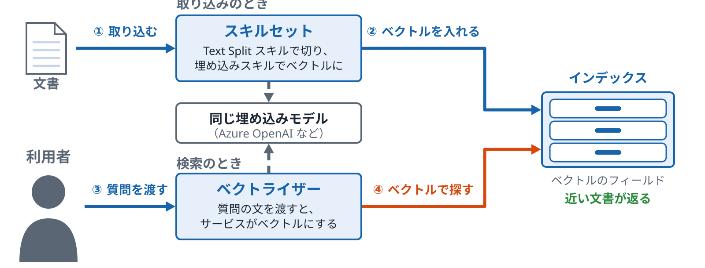

*取り込みは埋め込みのスキル、検索はベクトライザーが受け持つ。同じ埋め込みモデルにつなぐ*

**確かめる**：[応用 15 Azure の仕組みに置き換える](../../../applied/topics/15-azure-indexer/README.md)

ノート

- 言いたいこと：統合ベクトル化は、取り込みと検索の両方で、ベクトル化をサービスに任せる仕組みです。同じモデルを使う決まりは変わりません。
- 気をつけること：
  - 認証の設定で、ロールの付与が要る場合があります。
  - 埋め込みの呼び出しには料金がかかります。

**図のノート**

狙い：統合ベクトル化は、取り込みと検索の両方でベクトル化をサービスに任せる仕組みで、同じモデルを使う決まりは変わらないと言える。

話すこと：

- 段階0：取り込みのとき。スキルセットに、Text Split スキルと埋め込みのスキル（Azure OpenAI の埋め込みなど）を入れ、文書を切ってベクトルにする。ポータルのウィザードで、この組み合わせを作ることもできる
- 段階1：インデックスプロジェクションで、チャンクとベクトルを子の行として入れる。埋め込みのスキルは、埋め込みモデルを呼ぶ
- 段階2：検索のとき。インデックスのベクトル検索のプロファイルにベクトライザーを結び付けておくと、クエリで kind: text のベクトルのクエリを使い、質問の文を渡すだけでよい
- 段階3：サービスが質問をベクトルにして探し、近い文書が返る。アプリの側で埋め込みモデルを呼ぶコードは要らない。取り込みと検索で、同じモデルにつながっていることを確かめる

補足：変わらないこと。文書と質問で同じモデルを使う決まり、モデルを変えたときに全部の文書をベクトルにし直すこと、埋め込みモデルの呼び出しの料金がかかること。つなぐ先は、Azure OpenAI、カスタムの Web API のほか、Azure Vision と Foundry のモデルカタログ（どちらもプレビュー）など

注意：つなぐときに、サービスの間の認証（マネージド ID など）の設定が要り、ロールの付与が要る場合がある。埋め込みの呼び出しには料金がかかる

### p.29 差分の更新と削除の検出

*変わったものだけ入れ直し、消えたものを知る*

- **一般的な説明**
  - **差分の更新**
    - 前回の取り込みのあとに変わった文書だけを、もう一度取り込みます。
    - 変わったかどうかは、更新日や版の番号のような欄で見分けます。
    - 全部を入れ直すより、時間と処理の量が少なくなります。
  - **削除の検出**
    - 元の場所で消された文書は、目印がないと、取り込みの係からは見えません。
    - 見えないまま残ると、古い文書が検索の結果に出続けます。
    - そのため、「消した」という目印を元の場所に残す方法が使われます（論理削除）。
  - **古い版の扱い**
    - 条件が変わった文書（例: 出社の日数）は、新しい版を入れても、古い版が残っていることがあります。
    - 古い版を残すか外すかは、事業部のポリシーで決めます（p.19）。
    - 残す場合は、日付や版の欄で見分けられるようにします。
- **Azure AI Search での説明**
  - **変更の検出**
    - Blob では、最終更新日で、変わったファイルだけを取り込みます。
    - SQL では、`HighWaterMarkChangeDetectionPolicy`（更新日などの列）か、SQL の変更追跡を使う方法があります。
    - インデクサーは、前回どこまで取り込んだかを覚えています。
  - **削除の検出**
    - `SoftDeleteColumnDeletionDetectionPolicy`：決めた列が決めた値になった文書を、インデックスから外します。消したい Blob に印（例：`IsDeleted=true`）を付け、文書を外してから、Blob 本体を消します。
    - Blob の論理削除の機能（`NativeBlobSoftDeleteDeletionDetectionPolicy`）：ストレージで論理削除を有効にし、保持期間を実行間隔よりずっと長くします（論理削除の状態の間に処理したときだけ消えるため）。バージョン管理は無効にします。
    - どちらも最初のインデクサー実行から設定します。あとから設定しても、リセットしても、それ以前に消した Blob の文書はインデックスに残ります。
  - **入れ直しの操作**
    - インデクサーのリセットで、前回の記録を消して、次の実行で全部を取り込み直せます。
    - 決めた文書だけを取り込み直す操作（Reset Docs。`resetdocs`）もあります（プレビュー）。

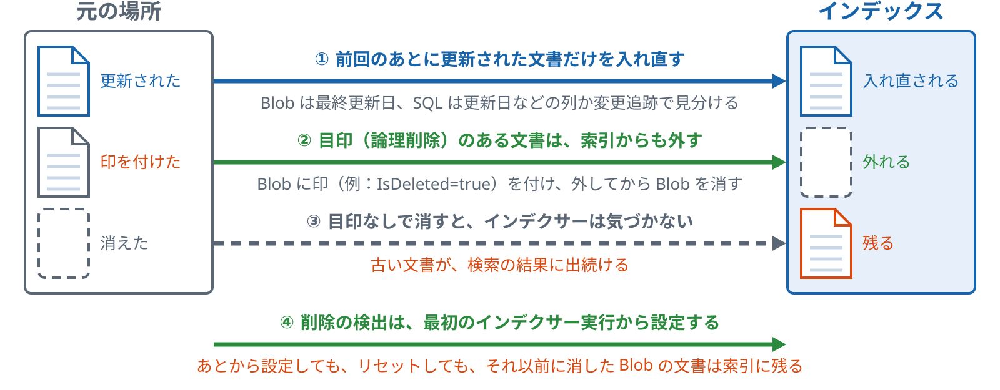

*削除は、元の場所で消えたことを検出できる形にしておかないと、索引に残る*

**確かめる**：[応用 17 更新と削除](../../../applied/topics/17-update-delete/README.md)

ノート

- 位置：第2部の終わりで、取り込んだあとの運用を見るページです。p.27 のインデクサーの動かし方の続きです。
- 言いたいこと：差分の更新は変わったものだけを入れ直し、削除の検出は元の場所の目印で消えたものを知ります。目印がないと、古い文書が残ります。
- 気をつけること：
  - リセットや削除を伴う操作は実演しません。

**図のノート**

狙い：差分の更新は変わったものだけを入れ直し、削除の検出は元の場所の目印で消えたものを知る、目印がないと古い文書が残る、と言える。

話すこと：

- 段階0：差分の更新。前回の取り込みのあとに変わった文書だけを、もう一度取り込む。Blob では最終更新日、SQL では HighWaterMarkChangeDetectionPolicy（更新日などの列）か SQL の変更追跡を使う。インデクサーは、前回どこまで取り込んだかを覚えている。全部を入れ直すより、時間と処理の量が少ない
- 段階1：削除の検出。SoftDeleteColumnDeletionDetectionPolicy は、決めた列が決めた値になった文書をインデックスから外す。消したい Blob に印（例：IsDeleted=true）を付け、文書を外してから、Blob 本体を消す。Blob の論理削除の機能（NativeBlobSoftDeleteDeletionDetectionPolicy）も使える。ストレージで論理削除を有効にし、保持期間を実行間隔よりずっと長くし、バージョン管理は無効にする
- 段階2：元の場所で消された文書は、目印がないと、取り込みの係からは見えない。見えないまま残ると、古い文書が検索の結果に出続ける
- 段階3：どちらの方法も、最初のインデクサー実行から設定する。あとから設定しても、リセットしても、それ以前に消した Blob の文書はインデックスに残る

補足：古い版の扱い。条件が変わった文書（例：出社の日数）は、新しい版を入れても古い版が残ることがある。残すか外すかは事業部のポリシーで決め（p.19）、残す場合は日付や版の欄で見分けられるようにする。入れ直しの操作として、インデクサーのリセット（前回の記録を消して、次の実行で全部を取り込み直す）と、決めた文書だけを取り込み直す Reset Docs（resetdocs。プレビュー）がある

注意：リセットや削除を伴う操作は実演しない

### p.30 権限：誰に何を見せるか

*見せてよい人は、検索の前に決めて絞り込む*

- **一般的な説明**
  - **なぜ検索の段で決めるか**
    - RAG では、検索で取った文書がそのまま生成 AI に渡り、回答の材料になります。
    - 見せてはいけない文書が検索で取られると、回答の中に内容が出てしまうことがあります。
    - そのため、回答を作る前に、検索の段で見せてよい文書だけに絞ります。
  - **2つのやり方**
    - 自分で絞る：文書ごとに見せてよいグループを欄に持たせ、利用者のグループで絞り込みます。
    - 元の権限を引き継ぐ：ファイルの置き場所の権限を取り込み、検索のときにその権限で絞ります。
    - どちらでも、利用者が誰かを、アプリが正しく知っている必要があります。
  - **気をつける点**
    - 元の場所で権限を変えたら、インデックスの側も変わるまでに時間差があります。
    - 権限の欄の値を、利用者が書き換えられないようにします。
    - 生成 AI へのプロンプトで「見せないで」と頼む方法では、絞り込みにはなりません。
- **Azure AI Search での説明**
  - **セキュリティフィルター（GA）**
    - 文書に `group_ids` のような欄を持たせ、`filterable` にします。
    - 検索のときに、アプリが利用者のグループを `search.in` のフィルターで渡します。
    - フィルターを付けるのはアプリの仕事で、付け忘れると全部の文書が対象になります。
  - **権限を引き継ぐ機能（プレビュー）**
    - ADLS Gen2 の ACL、SharePoint の権限、Purview のラベルを取り込んで、検索のときに効かせる機能があります。
    - 利用者のトークンを、検索の要求のヘッダー `x-ms-query-source-authorization` に付けて、その人の権限で絞ります。

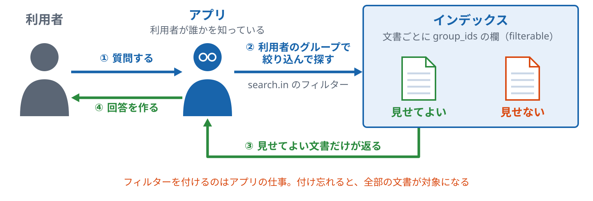

*回答を作る前に、見せてよい文書だけに絞る。フィルターを付けるのはアプリの仕事*

**確かめる**：[応用 16 見せてよい人で絞る](../../../applied/topics/16-security-filter/README.md)

ノート

- 言いたいこと：誰に何を見せるかは、検索の前に決めて絞り込みます。自分で絞るやり方（GA）と、元の権限を引き継ぐやり方（プレビュー）があります。
- 気をつけること：
  - プロンプトで「見せないで」と頼むのは絞り込みではない、という点を言ってください。
  - 参加者にトークンやキーを画面に貼ってもらうことはしません。
  - ロールの付与は実演しません。

**図のノート**

狙い：誰に何を見せるかは、検索の前に決めて絞り込むと言える。

話すこと：

- 段階0：利用者がアプリに質問する。RAG では、検索で取った文書がそのまま生成 AI に渡り、回答の材料になる。見せてはいけない文書が検索で取られると、回答の中に内容が出てしまうことがある
- 段階1：そのため、検索の段で絞る。自分で絞るやり方では、文書ごとに見せてよいグループを group_ids のような欄に持たせて filterable にし、アプリが利用者のグループを search.in のフィルターで渡す（セキュリティフィルター。GA）。どちらのやり方でも、利用者が誰かを、アプリが正しく知っている必要がある。フィルターを付けるのはアプリの仕事で、付け忘れると全部の文書が対象になる
- 段階2：見せてよい文書だけが返る。見せない文書は、生成 AI に渡らない
- 段階3：返った文書だけを材料に、回答を作る

補足：元の権限を引き継ぐやり方もある（プレビュー）。ADLS Gen2 の ACL、SharePoint の権限、Purview のラベルを取り込み、検索の要求のヘッダー x-ms-query-source-authorization に利用者のトークンを付けて、その人の権限で絞る。気をつける点：元の場所で権限を変えたら、インデックスの側が変わるまでに時間差がある。権限の欄の値を、利用者が書き換えられないようにする

注意：生成 AI へのプロンプトで「見せないで」と頼む方法は、絞り込みではない。参加者にトークンやキーを画面に貼ってもらうことはしない。ロールの付与は実演しない

