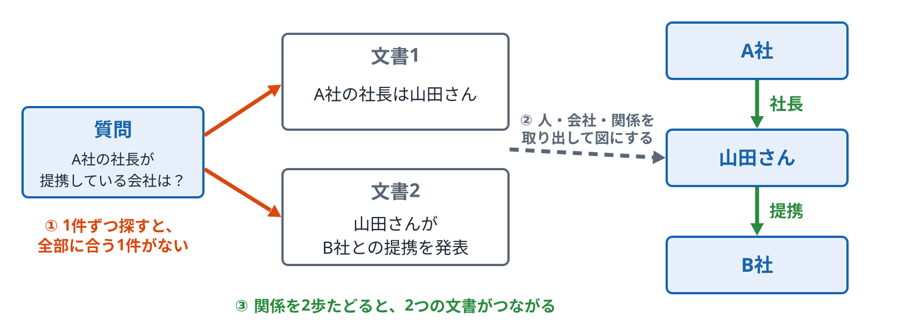
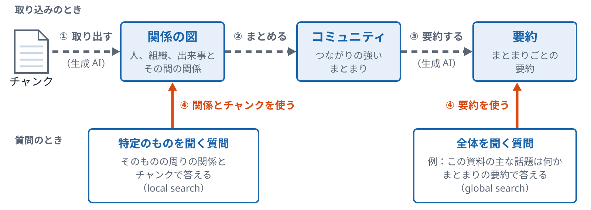
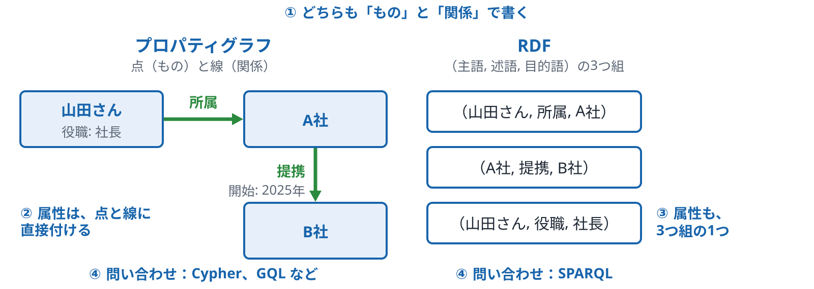
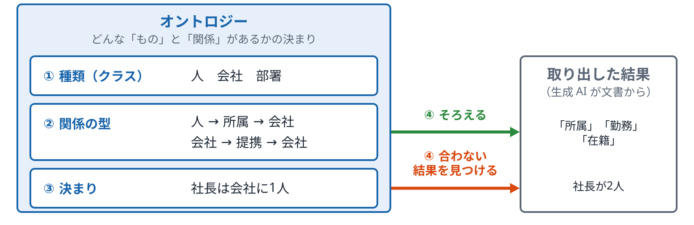
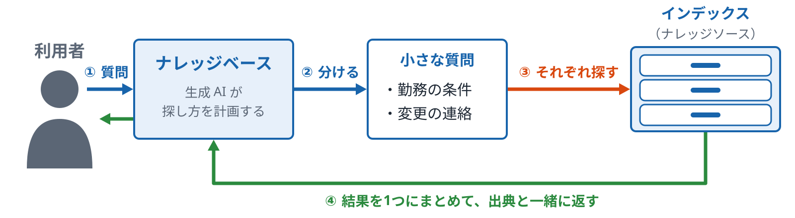
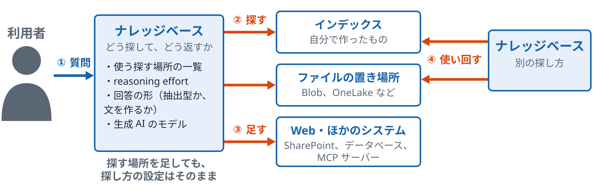
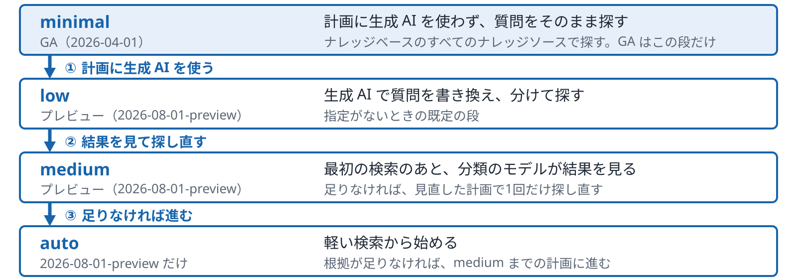
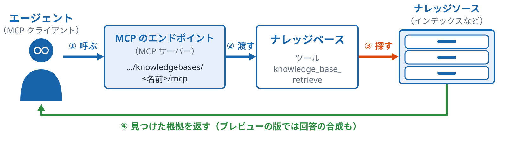

# 第3部 関係とエージェント型検索

<!-- この Markdown は docs/lecture/tools/build.py --md が、keywords.md・decks.json・diagrams/ から作る。直すときは原稿を直す -->

文書どうしの関係をたどる検索と、質問を分解して何度も検索するエージェント型検索

*ハンズオン資料 p.31〜38　／　確かめるトピック：18・19*

[目次に戻る](index.md)

## A　関係とグラフ

### p.31 文書同士の関係性を検索する

*1件ずつ探しても見つからない、文書をまたぐつながり*

- **一般的な説明**
  - **どんな質問か**
    - 「A社の社長が提携している会社はどこか」のように、2つ以上の文書の事実をつながないと答えられない質問です。
    - 文書1に「A社の社長は山田さん」、文書2に「山田さんが B社との提携を発表」と書かれている、という形です。
    - どちらの文書にも、「A社」と「B社」が一緒には出てきません。
  - **1件ずつの検索で見つからない理由**
    - キーワード検索もベクトル検索も、1つのチャンクと質問の近さを測ります。
    - 質問の全部に合う1つのチャンクがないので、上位に来にくくなります。
    - 片方の文書が見つかっても、もう片方につなぐ手がかりは検索の結果にありません。
  - **つなぐ方法**
    - 関係をたどる：文書から人、会社、関係を取り出して図（グラフ）にし、図をたどります（p.33、p.34）。
    - 何度も探す：最初の検索で見つけた名前（山田さん）で、もう一度探します（p.32）。
    - どちらの方法も、取り込みか検索のどちらかで手間が増えます。
- **Azure AI Search での説明**
  - **ない機能**
    - Azure AI Search には、関係をたどる検索（グラフ RAG）の機能はありません。
    - 人や会社の名前を取り出す Entity Recognition スキルはあり、関係を作る足がかりにはなります。
    - 名前を欄に入れて絞り込むことはできますが、関係を何歩もたどることはできません。
  - **近いことができる機能**
    - エージェント型検索で、質問を分けて何度か探すと、2つの文書を両方取れることがあります（p.32）。
    - 取れるかどうかは、質問の分け方によります。
    - 関係の図を持つわけではありません。
  - **Microsoft のほかの道**
    - Fabric の Ontology を知識ソースにする機能（プレビュー）と、Fabric IQ があります。

*「A社の社長が、B社と提携している」は、2つの文書をつながないと答えられない。名前は説明用の例*

**確かめる**：[応用 18 関係で探す（紹介）](../../../applied/topics/18-relations/README.md)

ノート

- 言いたいこと：文書をまたぐ関係は、1件ずつの検索では見つかりにくくなります。Azure AI Search には関係をたどる機能はありません。
- 気をつけること：
  - 「A社、山田さん、B社」は説明用の例です。
  - Fabric は新しいリソースや料金を伴うことがあるので、実演しません。
  - エージェント型検索で「取れることがある」は、必ず取れるという意味ではない、と言ってください。

**図のノート**

狙い：2つ以上の文書の事実をつながないと答えられない質問があり、1件ずつの検索では見つかりにくいと言える。

話すこと：

- 段階0：文書1は「A社の社長は山田さん」、文書2は「山田さんが B社との提携を発表」。どちらにも「A社」と「B社」が一緒には出てこない。1件ずつ探すと、質問の全部に合う1件がないので上位に来にくい
- 段階1：関係をたどる方法では、文書から人、会社、関係を取り出して図（グラフ）にする
- 段階2：A社 → 社長 → 山田さん → 提携 → B社。関係を2歩たどると、2つの文書がつながる

補足：Azure AI Search には、関係をたどる検索（グラフ RAG）の機能はない。人や会社の名前を取り出す Entity Recognition スキルはあり、関係を作る足がかりになる。エージェント型検索で質問を分けて何度か探すと、2つの文書を両方取れることがある（p.32）

注意：「A社、山田さん、B社」は説明用の例。エージェント型検索で「取れることがある」は、必ず取れるという意味ではない。Fabric は実演しない

### p.33 GraphRAG

*文書から関係の図を作り、図をたどって答える*

- **一般的な説明**
  - **何をするものか**
    - 関係の図を使う RAG（グラフ RAG）は、いろいろなところで提案されています。ここで扱う GraphRAG は、Microsoft Research が公開した方法です。
    - 取り込みのときに、生成 AI が文書から人、組織、出来事と、その間の関係を取り出します。
    - 取り出した関係で図（グラフ）を作り、質問のときに図を使います。
  - **作り方の段**
    - 取り出す：チャンクごとに、生成 AI がものと関係を書き出します。
    - まとめる：つながりの強いまとまり（コミュニティ）に分けます。分け方には Leiden という方法が使われます。
    - 要約する：まとまりごとに、生成 AI が要約を書きます。
  - **2つの探し方**
    - 全体を聞く質問（例: 「この資料の主な話題は何か」）では、まとまりの要約を使って答えます（global search）。
    - 特定のものを聞く質問では、そのものの周りの関係とチャンクを使って答えます（local search）。
    - local search にコミュニティの情報を加えた DRIFT search もあります。
    - 取り込みで生成 AI を何度も呼ぶので、時間と呼び出しの数が増えます。
- **Azure AI Search での説明**
  - **Azure AI Search との関係**
    - GraphRAG は、Azure AI Search の機能ではありません。
    - GraphRAG の設定では、ベクトルを入れる先（ベクトルストア）として Azure AI Search を選べます（`type: azure_ai_search`）。
    - 図を作る処理と図をたどる処理は、GraphRAG の側で行います。
  - **組み立てる場合**
    - 取り出しには、Azure OpenAI などの生成 AI を使います。
    - 図を入れる先には、グラフのデータベースや、ファイルを使います。

出典：Microsoft Research Blog「GraphRAG: Unlocking LLM discovery on narrative private data」（2024年）、論文 arXiv:2404.16130

*ここで扱うのは、Microsoft Research が公開した方法。Azure AI Search の機能ではない*

**確かめる**：[応用 18 関係で探す（紹介）](../../../applied/topics/18-relations/README.md)

ノート

- 出典の URL：https://www.microsoft.com/en-us/research/blog/graphrag-unlocking-llm-discovery-on-narrative-private-data/ と、論文 Edge ほか「From Local to Global: A GraphRAG Approach to Query-Focused Summarization」https://arxiv.org/abs/2404.16130
- 位置：p.31 の「関係をたどる方法」の代表として、GraphRAG を見るページです。p.34 のグラフの書き方、p.35 のオントロジーにつながります。
- 言いたいこと：GraphRAG は、取り込みで関係の図とまとまりの要約を作り、質問の種類で使い分ける方法です。
- 気をつけること：
  - Azure AI Search の機能ではない、と最初に言ってください。

**図のノート**

狙い：GraphRAG が、取り込みで関係の図とまとまりの要約を作り、質問の種類で使い分ける方法だと言える。

話すこと：

- 段階0：取り込みのとき、チャンクごとに、生成 AI が人、組織、出来事と、その間の関係を取り出して、関係の図（グラフ）を作る
- 段階1：図を、つながりの強いまとまり（コミュニティ）に分ける。分け方には Leiden という方法が使われる
- 段階2：まとまりごとに、生成 AI が要約を書く
- 段階3：質問のとき、全体を聞く質問（例：この資料の主な話題は何か）は、まとまりの要約で答える（global search）。特定のものを聞く質問は、そのものの周りの関係とチャンクで答える（local search）。local search にコミュニティの情報を加えた DRIFT search もある

補足：取り込みで生成 AI を何度も呼ぶので、時間と呼び出しの数が増える。GraphRAG は Azure AI Search の機能ではない。設定でベクトルを入れる先（ベクトルストア）に Azure AI Search を選べる（type: azure_ai_search）が、図を作る処理と図をたどる処理は GraphRAG の側で行う。取り出しには Azure OpenAI などの生成 AI を、図を入れる先にはグラフのデータベースやファイルを使う

注意：最初に「Azure AI Search の機能ではない」と言う

### p.34 プロパティグラフと RDF

*関係の書き方の2つの流儀*

- **一般的な説明**
  - **共通の考え方**
    - どちらも、「もの」（人、会社）と「関係」（所属、提携）で知識を書きます。
    - 関係をたどると、文書1件では見えないつながりが見えます。
    - 違いは、属性（役職、設立の年）をどこに置くかと、問い合わせの言語です。
  - **プロパティグラフ**
    - 点（もの）と線（関係）に、属性を直接付けます（例: 山田さんの点に「役職: 社長」）。
    - 線にも属性を付けられます（例: 提携の線に「開始: 2025年」）。
    - 問い合わせには、Cypher や GQL が使われます。Neo4j などのデータベースがこの形です。
  - **RDF**
    - すべての知識を、（主語, 述語, 目的語）の3つ組で書きます。
    - 属性も、3つ組の1つとして書きます（例: （山田さん, 役職, 社長））。
    - 問い合わせには SPARQL が使われ、OWL などで種類と関係の決まりを書けます（p.35）。
- **Azure AI Search での説明**
  - **Azure AI Search の中**
    - Azure AI Search は、どちらの形も持ちません。
    - 関係を欄（例: 関係する会社の一覧）として持たせることはできますが、たどる問い合わせはできません。
    - 関係をたどるときは、別のデータベースを使います。
  - **Azure の中のほかのサービス**
    - Cosmos DB の Gremlin API は、プロパティグラフの形で関係を持てます。
    - Microsoft Fabric にも、グラフ（GQL で問い合わせる）と、Fabric IQ の Ontology（プレビュー）があります。
  - **RAG の中での使い方**
    - 質問から、たどる起点（例: A社）を検索で見つけます。
    - 起点からグラフをたどり、関係のある文書を集めます。
    - 集めた文書を、生成 AI に渡して答えさせます。

*どちらも「もの」と「関係」を持つ。違いは、属性をどこに置くかと、問い合わせの言語。例は説明用*

**確かめる**：[応用 18 関係で探す（紹介）](../../../applied/topics/18-relations/README.md)

ノート

- 位置：p.33 の GraphRAG で作る「図」を、どう書くかのページです。
- 言いたいこと：関係の書き方には、点と線に属性を付けるプロパティグラフと、すべてを3つ組で書く RDF があります。
- 気をつけること：
  - どちらがよいかは言いません。書き方の違いだけを見せます。
  - 図の設立の年は架空の値です。
  - Cosmos DB や Fabric を実際に作ることはしません。

**図のノート**

狙い：関係の書き方に、点と線に属性を付けるプロパティグラフと、すべてを3つ組で書く RDF の2つの流儀があると言える。

話すこと：

- 段階0：どちらも、「もの」（人、会社）と「関係」（所属、提携）で知識を書く。関係をたどると、文書1件では見えないつながりが見える
- 段階1：プロパティグラフは、点（もの）と線（関係）に属性を直接付ける。山田さんの点に「役職: 社長」、提携の線に「開始: 2025年」
- 段階2：RDF は、属性も3つ組の1つとして書く（山田さん, 役職, 社長）
- 段階3：問い合わせに、プロパティグラフは Cypher や GQL（Neo4j などのデータベースがこの形）、RDF は SPARQL を使う。RDF は OWL などで、種類と関係の決まりも書ける（p.35）

補足：Azure AI Search は、どちらの形も持たない。関係を欄（例：関係する会社の一覧）として持たせることはできるが、たどる問い合わせはできない。Azure の中では、Cosmos DB の Gremlin API がプロパティグラフの形で関係を持てる。Microsoft Fabric にも、グラフ（GQL で問い合わせる）と、Fabric IQ の Ontology（プレビュー）がある。RAG では、質問から、たどる起点（例：A社）を検索で見つけ、起点からグラフをたどって関係のある文書を集め、生成 AI に渡して答えさせる

注意：どちらがよいかは言わない。書き方の違いだけを見せる。図の名前と「開始: 2025年」は説明用の例。Cosmos DB や Fabric を実際に作ることはしない

### p.35 オントロジー

*どんな「もの」と「関係」があるかの決まり*

- **一般的な説明**
  - **何を決めるか**
    - 個々のデータ（山田さん、A社）ではなく、その種類（人、会社、部署）を決めます。
    - 種類の間にある関係の型（人は会社に所属する、会社は会社と提携する）を決めます。
    - 守る決まり（社長は1つの会社に1人）も書けます。
  - **なぜ要るか**
    - 生成 AI に文書から関係を取り出させると、同じ関係が「所属」「勤務」「在籍」のように別の言葉で出てきます。
    - 種類と関係の型を前もって決めておくと、取り出した結果をそろえられます。
    - 決まりに合わない結果（社長が2人いる）を見つけられます。
  - **作り方の変化**
    - 以前は、人が OWL などの形式で、手で書くことが多くありました。
    - 生成 AI に文書から下書きを作らせて、人が確かめて直す、という進め方もあります。
    - どちらの場合も、最後に人が確かめる段が要ります。
- **Azure AI Search での説明**
  - **Azure AI Search の中**
    - Azure AI Search には、オントロジーを持つ機能はありません。
    - インデックスの欄の定義は、どの欄があるかを決めるもので、関係の型は持ちません。
    - 欄に保存する値をそろえるのは、取り込みのときの処理です（辞書で置き換える、生成 AI に決まった語から選ばせる、など）。
    - 同義語マップ（p.13）は、検索のときに検索語を広げる仕組みです。保存された値は変わらず、フィルターやファセットにも効きません。
  - **Microsoft のほかの道**
    - Microsoft Fabric の Fabric IQ に、Ontology という機能（プレビュー）があります。
  - **教材での見せ方**
    - p.31 の A社、山田さん、B社の例を、種類と関係の型に書き直して見せます。
    - 取り出す前に決まりを書くか、取り出した後で決まりを作るかの2つの順番を並べます。
    - どちらの順番がよいかは言いません。

*個々のデータ（山田さん、A社）ではなく、その種類と関係の型を決める。決まりの例は説明用*

**確かめる**：[応用 18 関係で探す（紹介）](../../../applied/topics/18-relations/README.md)

ノート

- 位置：第3部で、関係の図（p.33、p.34）の上に置く決まりのページです。
- 言いたいこと：オントロジーは、ものの種類と関係の型の決まりです。生成 AI で関係を取り出すときに、結果をそろえるのに使います。
- 気をつけること：
  - 決まりの例（社長は1人）は説明用です。
  - Fabric IQ の Ontology は紹介だけにします。

**図のノート**

狙い：オントロジーは、ものの種類と関係の型の決まりで、生成 AI で関係を取り出すときに結果をそろえるのに使うと言える。

話すこと：

- 段階0：個々のデータ（山田さん、A社）ではなく、その種類（人、会社、部署）を決める
- 段階1：種類の間にある関係の型を決める（人は会社に所属する、会社は会社と提携する）
- 段階2：守る決まりも書ける（社長は1つの会社に1人）
- 段階3：生成 AI に文書から関係を取り出させると、同じ関係が「所属」「勤務」「在籍」のように別の言葉で出てくる。種類と関係の型を前もって決めておくと、取り出した結果をそろえられる。決まりに合わない結果（社長が2人いる）も見つけられる

補足：作り方は、以前は人が OWL などの形式で手で書くことが多かった。生成 AI に文書から下書きを作らせて、人が確かめて直す、という進め方もある。どちらの場合も、最後に人が確かめる段が要る。Azure AI Search には、オントロジーを持つ機能はない。インデックスの欄の定義は、どの欄があるかを決めるもので、関係の型は持たない。欄に保存する値をそろえるのは、取り込みのときの処理（辞書で置き換える、生成 AI に決まった語から選ばせる、など）。同義語マップ（p.13）は、検索のときに検索語を広げる仕組みで、保存された値は変わらず、フィルターやファセットにも効かない。Microsoft Fabric の Fabric IQ に、Ontology という機能（プレビュー）がある

注意：決まりの例（社長は1人）は説明用。Fabric IQ の Ontology は紹介だけにする。取り出す前に決まりを書くか、取り出した後で決まりを作るかは、どちらがよいかを言わない

## B　エージェント型検索

### p.32 エージェント型検索（Agentic Retrieval）

*質問を分け、何度か探して、結果をまとめる（質問の分解はプレビュー）*

- **一般的な説明**
  - **何をするものか**
    - 1つの質問を、生成 AI が小さな質問に分けることができます（Azure では、LLM による計画を使うプレビューの構成）。
    - 小さな質問ごとに検索し、結果を1つにまとめて返します。
    - 会話の履歴も考えに入れて、何を探すかを決めます。
  - **1回の検索との違い**
    - 1回の検索では、質問の言葉とチャンクの近さだけで順位が決まります。
    - エージェント型では、「勤務の条件」「変更の連絡」のように、聞きたいことを分けて探します。
    - そのため、答えが複数の文書に散らばっている質問に向いています。
  - **増えるもの**
    - 生成 AI の呼び出しと、検索の回数が増えます。
    - そのぶん、答えが返るまでの時間が長くなります。
- **Azure AI Search での説明**
  - **部品**
    - ナレッジソース：どこを探すか（インデックス、Blob、OneLake、Web など）を決めます（p.36）。
    - ナレッジベース：どう探して、どう返すかを決めます。
    - Foundry IQ は、この部品の上に作られています。
  - **探し方の段**
    - reasoning effort で、計画にかける手間を決めます（p.37）。
    - GA（2026-04-01）は minimal だけで、LLM による質問の分解や、会話の履歴を使った計画はしません（reasoning effort の設定もありません）。
    - 質問を分けるのは、プレビュー（2026-08-01-preview）の low、medium、auto を使うときです。
    - それぞれの検索（サブクエリ）は、インデックスと設定に応じて、キーワード・ベクトル・ハイブリッドのどれかで行い、結果をセマンティックランカーで並べ直します。
  - **返るもの**
    - GA では、返る形は抽出型だけです。見つけた内容をそのまま返し、回答の文章を LLM が作る回答の合成はありません。
    - ただし、Web ナレッジソースの内容は、GA でも LLM が要約した、引用付きの要約として取得されます。
    - プレビューでは、回答の文を作らせる形（回答の合成）もあります。
    - 出典の一覧と、どう探したかの記録（アクティビティ）も返ります。

*質問を分けるのは、LLM による計画を使うプレビューの構成（low・medium・auto）。GA（2026-04-01）の minimal は分けずに探す*

**確かめる**：[応用 19 エージェント型検索のデモ](../../../applied/topics/19-agentic-retrieval/README.md)

ノート

- 言いたいこと：エージェント型検索は、質問を分けて何度か探し、結果をまとめます。そのかわり、時間と呼び出しが増えます。
- 気をつけること：
  - 費用の差は話しません。
  - GA と プレビューの範囲を混ぜないでください（p.51）。

**図のノート**

狙い：1回の検索との違い（分ける・何度か探す・まとめる）が言える。

話すこと：

- 段階0：利用者が1つの質問をナレッジベースに送る
- 段階1：生成 AI が、聞きたいことを小さな質問に分ける（例：勤務の条件、変更の連絡）。プレビューの low・medium・auto の構成
- 段階2：小さな質問ごとに、インデックス（ナレッジソース）を探す。それぞれの検索は、インデックスと設定に応じてキーワード・ベクトル・ハイブリッドのどれかで行い、セマンティックランカーで並べ直す
- 段階3：結果を1つにまとめて返す。出典の一覧と、どう探したかの記録（アクティビティ）も返る

補足：生成 AI の呼び出しと検索の回数が増えるので、返るまでの時間が長くなる。GA（2026-04-01）は minimal だけで、質問を分けない

注意：GA とプレビューの範囲を混ぜない（p.51）。費用の差は話さない

### p.36 ナレッジソースとナレッジベース

*「どこを探すか」と「どう探して返すか」を分けて決める*

- **一般的な説明**
  - **分ける理由**
    - 探す場所（社内の規程、メール、Web）と、探し方（何回探すか、どう返すか）は、別々に変わります。
    - 2つを分けておくと、探す場所を足しても、探し方の設定はそのまま使えます。
    - 同じ探す場所を、別の探し方で使い回すこともできます。
  - **探す場所の種類**
    - 自分で作ったインデックス。
    - ファイルの置き場所（Blob、OneLake など）を直接指す場所。
    - Web や、ほかのシステム（SharePoint、データベース、MCP サーバー）。
  - **探し方で決めること**
    - どの探す場所を使うか、いくつ使うか。
    - 計画にどれだけ手間をかけるか。
    - 返すのは見つけた文か、生成 AI が作った文か。
- **Azure AI Search での説明**
  - **ナレッジソース（どこを探すか）**
    - GA（2026-04-01）：`searchIndex`、`azureBlob`、`indexedOneLake`、`web`。
    - プレビュー（2026-08-01-preview）：SharePoint（インデックス型とリモート）、Azure SQL、ファイル、Fabric の Data Agent と Ontology、MCP サーバー、Work IQ などが加わります。
    - `azureBlob` と `indexedOneLake` は、指した場所からインデックスと取り込みの流れを作ります。
  - **ナレッジベース（どう探して、どう返すか）**
    - 使うナレッジソースの一覧を持ちます。
    - reasoning effort（p.37）と、回答の形（抽出型か、文を作るか）を決めます。
    - 計画や回答に使う生成 AI のモデルをつなぎます。

*探す場所（社内の規程、メール、Web）と、探し方（何回探すか、どう返すか）は、別々に変わる*

**確かめる**：[応用 19 エージェント型検索のデモ](../../../applied/topics/19-agentic-retrieval/README.md)

ノート

- 言いたいこと：ナレッジソースは「どこを探すか」、ナレッジベースは「どう探して、どう返すか」です。
- 気をつけること：
  - GA とプレビューのナレッジソースを分けて言ってください（p.51）。

**図のノート**

狙い：ナレッジソースは「どこを探すか」、ナレッジベースは「どう探して、どう返すか」だと言える。

話すこと：

- 段階0：利用者の質問は、ナレッジベースが受ける。ナレッジベースは、使うナレッジソースの一覧、reasoning effort（p.37）、回答の形（抽出型か、文を作るか）、計画や回答に使う生成 AI のモデルを持つ
- 段階1：ナレッジベースが、ナレッジソースを探す。探す場所の種類は、自分で作ったインデックス、ファイルの置き場所（Blob、OneLake など）を直接指す場所、Web やほかのシステム（SharePoint、データベース、MCP サーバー）
- 段階2：探す場所を足しても、探し方の設定（ナレッジベース）はそのまま使える
- 段階3：同じ探す場所を、別の探し方（別のナレッジベース）で使い回すこともできる

補足：ナレッジソースは、GA（2026-04-01）が searchIndex、azureBlob、indexedOneLake、web。プレビュー（2026-08-01-preview）では、SharePoint（インデックス型とリモート）、Azure SQL、ファイル、Fabric の Data Agent と Ontology、MCP サーバー、Work IQ などが加わる。azureBlob と indexedOneLake は、指した場所からインデックスと取り込みの流れを作る

注意：GA とプレビューのナレッジソースを分けて言う（p.51）

### p.37 reasoning effort

*検索の計画に、どれだけ手間をかけるか*

- **一般的な説明**
  - **何を決めるか**
    - 質問を受けてから、どう探すかを決める段（計画）に、どれだけ生成 AI を使うかを決めます。
    - 手間をかけると、質問を細かく分けたり、何度か探したりします。
    - 手間をかけないと、質問をほぼそのまま探します。
  - **変わるもの**
    - 生成 AI の呼び出しの数と、使う文字の量。
    - 答えが返るまでの時間。
  - **選び方の考え方**
    - 答えが1つの文書にある質問と、いくつかの文書に散らばる質問で、要る手間が違います（p.14）。
    - 同じ質問で段を変えて、検索の評価（p.42）で比べます。
    - どの段がよいかは、評価の結果と、時間と費用で決めます。
- **Azure AI Search での説明**
  - **選べる段**
    - minimal：計画に生成 AI を使わず、質問をそのまま、ナレッジベースのすべてのナレッジソースで探します。GA（2026-04-01）で使えるのはこの段だけで、設定もありません。
    - low：生成 AI で質問を書き換え、分けて探します。指定がないときの既定の段です。プレビュー（2026-08-01-preview）です。
    - medium：low より多く手間をかけます。最初の検索のあと、分類のモデルが結果を見て、足りなければ見直した計画で1回だけ探し直します。プレビューです。
    - auto：軽い検索から始め、根拠が足りなければ medium までの計画に進みます。2026-08-01-preview だけで使えます。
  - **minimal で使えないもの**
    - 回答の形は、抽出型になります。
    - 計画をしないので、会話の履歴から質問を作り直すこともしません。
  - **設定の場所**
    - プレビューでは、ナレッジベースの既定の値として設定します。
    - 検索の要求ごとに変えることもできます。
    - 返る記録（アクティビティ）で、何回探したかを確かめられます。

*下の段ほど、計画にかける手間が増え、生成 AI の呼び出しと時間が増える。GA（2026-04-01）は minimal だけ*

**確かめる**：[応用 19 エージェント型検索のデモ](../../../applied/topics/19-agentic-retrieval/README.md)

ノート

- 位置：p.36 のナレッジベースで決めることのうち、計画の手間を見るページです。
- 言いたいこと：reasoning effort は、計画の手間の段です。GA は minimal だけ、low、medium、auto はプレビューです。
- 気をつけること：
  - どの段がよいかは言いません。評価で比べる、とだけ言ってください。
  - 段を上げると費用が変わります。

**図のノート**

狙い：reasoning effort は、検索の計画に生成 AI をどこまで使うかを決める段で、GA は minimal だけ、low・medium・auto はプレビューだと言える。

話すこと：

- 段階0：minimal は、計画に生成 AI を使わず、質問をそのまま、ナレッジベースのすべてのナレッジソースで探す。GA（2026-04-01）で使えるのはこの段だけで、設定もない
- 段階1：low は、生成 AI で質問を書き換え、分けて探す。指定がないときの既定の段（プレビュー、2026-08-01-preview）
- 段階2：medium は、low より手間をかける。最初の検索のあと、分類のモデルが結果を見て、足りなければ見直した計画で1回だけ探し直す（プレビュー）
- 段階3：auto は、軽い検索から始め、根拠が足りなければ medium までの計画に進む。2026-08-01-preview だけで使える。下の段ほど、生成 AI の呼び出しの数、使う文字の量、答えが返るまでの時間が増える

補足：minimal の回答の形は抽出型になる。計画をしないので、会話の履歴から質問を作り直すこともしない。プレビューでは、ナレッジベースの既定の値として設定し、検索の要求ごとに変えることもできる。返る記録（アクティビティ）で、何回探したかを確かめられる。選ぶときは、答えが1つの文書にある質問と、いくつかの文書に散らばる質問で要る手間が違う（p.14）。同じ質問で段を変えて、検索の評価（p.42）で比べる

注意：どの段がよいかは言わない。評価で比べる、とだけ言う。段を上げると費用が変わる

### p.38 MCP（Model Context Protocol）

*ナレッジベースを、エージェントのツールとして呼ぶ*

- **一般的な説明**
  - **何の決まりか**
    - 生成 AI のアプリ（エージェント）が、外のツールやデータを呼ぶための、共通の決まりです。
    - ツールを出す側を MCP サーバー、呼ぶ側を MCP クライアントと呼びます。
    - サーバーは、自分が出すツールの名前と、入力の形を一覧で示します。
  - **何が楽になるか**
    - ツールごとに呼び方のコードを書かなくても、決まりに合うツールなら同じ方法で呼べます。
    - 1つのツールを、いくつかのエージェントから使い回せます。
    - どのツールを呼ぶかは、エージェントの生成 AI が、ツールの説明を読んで決めます。
  - **気をつける点**
    - ツールの説明の書き方で、呼ばれるかどうかが変わります。
    - ツールを呼ぶときの認証を、決めておく必要があります。
    - ツールが返した文に、指示のような文が混ざる場合に備えます。
- **Azure AI Search での説明**
  - **MCP のエンドポイント**
    - ナレッジベースには、MCP サーバーとして呼べるエンドポイントがあります。
    - ナレッジベースごとに、`…/knowledgebases/<ナレッジベースの名前>/mcp` というエンドポイントがあります。
    - 呼ぶと、ナレッジベースの検索が `knowledge_base_retrieve` というツールとして使えます。
    - 指定する API の版で、返るものが変わります。2026-04-01 は抽出型の根拠データだけ、2026-08-01-preview は回答の合成も返せます。
  - **逆の向き**
    - プレビューでは、MCP サーバーをナレッジソースにして、ナレッジベースから外のツールを探すこともできます（p.36）。
    - 向きが2つあるので、どちらの話かを分けて言います。
  - **認証**
    - 呼ぶ側は、Microsoft Entra ID のトークン（推奨）か、API キーで認証します。
    - キーやトークンは、画面やチャットに貼らないでください。

*MCP は、AI のアプリが外の道具を呼ぶための共通の約束*

**確かめる**：[応用 19 エージェント型検索のデモ](../../../applied/topics/19-agentic-retrieval/README.md)

ノート

- 言いたいこと：MCP は、エージェントがツールを呼ぶ共通の決まりです。ナレッジベースは MCP サーバーとして呼べます。
- 気をつけること：
  - 2つの向き（ナレッジベースが MCP サーバーになる向き、MCP サーバーをナレッジソースにする向き）を混ぜないでください。
  - 参加者にキーやトークンを貼ってもらうことはしません。

**図のノート**

狙い：ナレッジベースを MCP サーバーとして呼ぶと、エージェントの道具（ツール）になると言える。

話すこと：

- 段階0：エージェント（MCP クライアント）が、ナレッジベースの MCP のエンドポイントを呼ぶ。エンドポイントはナレッジベースごとに …/knowledgebases/&lt;名前>/mcp
- 段階1：呼ぶと、ナレッジベースの検索が knowledge_base_retrieve というツールとして使える
- 段階2：ナレッジベースが、ナレッジソース（インデックスなど）を探す
- 段階3：見つけた根拠を返す。2026-04-01 は抽出型の根拠データだけ、2026-08-01-preview は回答の合成も返せる

補足：どのツールを呼ぶかは、エージェントの生成 AI がツールの説明を読んで決める。呼ぶ側は Microsoft Entra ID のトークン（推奨）か API キーで認証する

注意：2つの向き（ナレッジベースが MCP サーバーになる向き、MCP サーバーをナレッジソースにする向き）を混ぜない。参加者にキーやトークンを貼ってもらうことはしない

