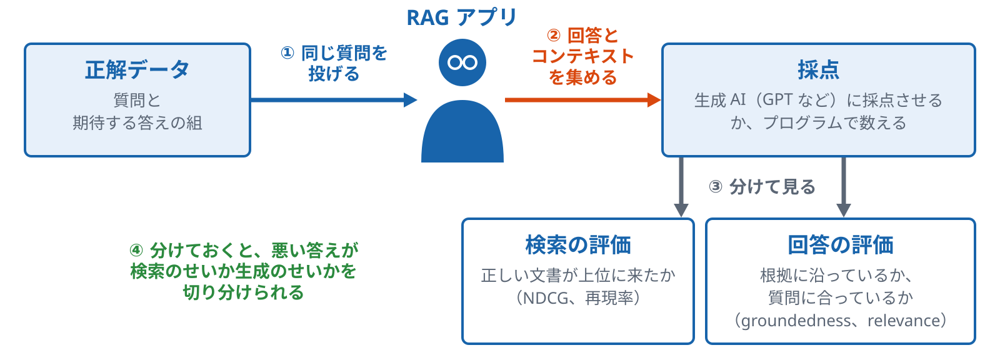
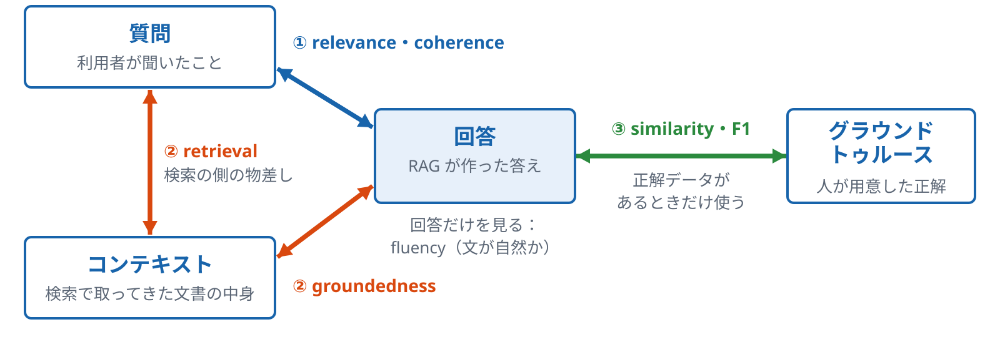
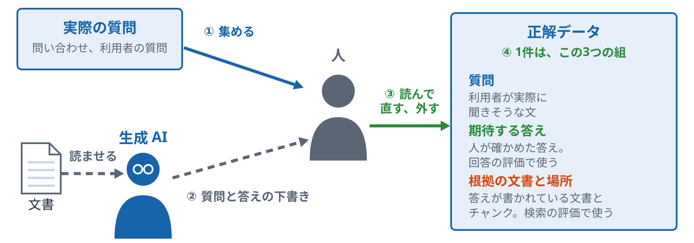
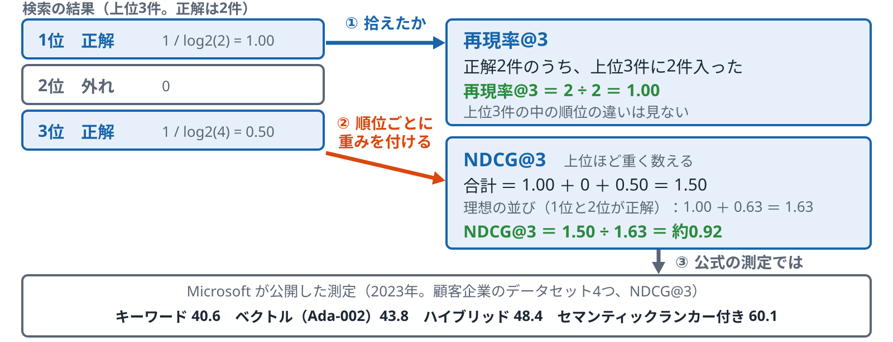
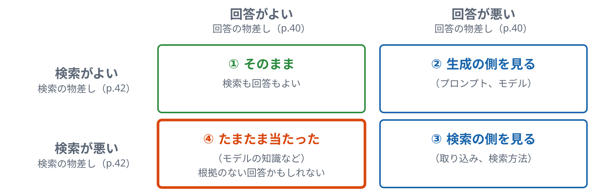
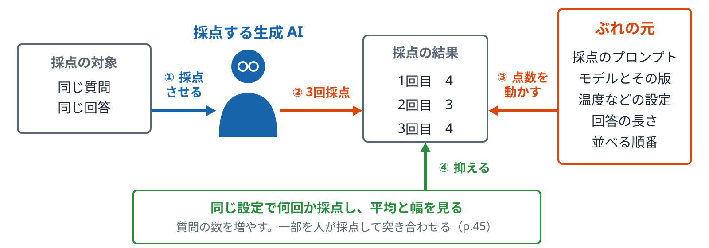
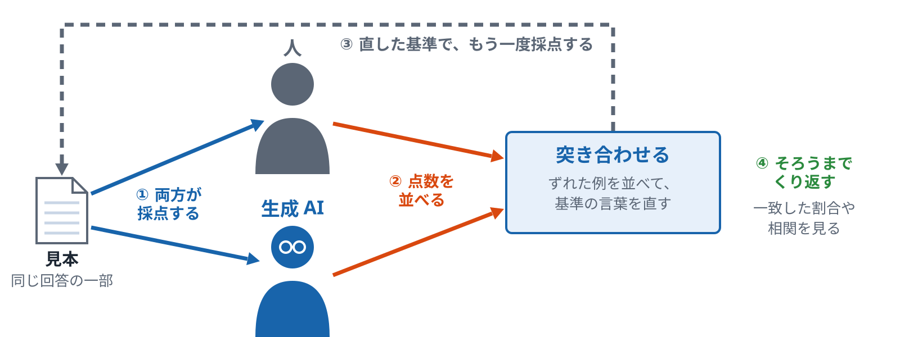

# 評価

<!-- この Markdown は docs/lecture/tools/build.py --md が、keywords.md・decks.json・diagrams/ から作る。直すときは原稿を直す -->

検索の評価と回答の評価を分けて測る

*ハンズオン資料 p.39〜45　／　確かめるトピック：05・20*

[目次に戻る](index.md)

## A　評価の流れ

### p.39 評価（RAG の回答の評価）

*検索の評価と回答の評価を分けて見る*

- **一般的な説明**
  - **何を評価するか**
    - 検索の評価：正しい文書が上位に来ているかを見ます（NDCG、再現率など）。
    - 回答の評価：検索結果をもとに作った回答がよいかを見ます。
    - 2つを分けておくと、悪い答えが検索のせいか生成のせいかを切り分けられます。
  - **評価の流れ**
    - 正解データ：質問と、期待する答えの組を用意します。
    - 回答の取得：同じ質問を自分の RAG アプリに投げ、回答と、そのとき検索で取れた文書（コンテキスト）を集めます。
    - 採点：回答と正解を、生成 AI（GPT など）に採点させるか、プログラムで数えます。
  - **指標の種類**
    - 生成 AI による指標：coherence（話の筋が通っているか）、groundedness（検索結果に基づいているか）、relevance（質問に合っているか）。1〜5 の点数です。
    - プログラムで数える指標：回答の長さ、F1 スコア（回答と正解で重なる単語の割合）、出典の記号が付いているか（自分で書く判定）。
    - 注意点：生成 AI の採点はぶれるので、同じ設定で何度か比べるか、人の判断と突き合わせます（p.44、p.45）。
- **Azure での説明**
  - **評価の道具**
    - azure-ai-evaluation SDK：groundedness、relevance、coherence などの評価器を持っています。
    - `evaluate()` 関数に、データのファイルと評価器の一覧を渡して、まとめて採点します。
    - Foundry の評価：ポータルやクラウドで評価を動かし、結果を並べて比べられます。
  - **検索側の評価**
    - Azure AI Search には NDCG や再現率を計算する機能はありません。検索の結果のキーと正解のキーを、自分のコードで比べます（p.42）。
    - 検索方式ごとの NDCG の比べ方の例として、Microsoft が公開した測定があります（p.3。顧客企業のデータセット4つ、NDCG@3）。

*検索の評価と回答の評価を分けておくと、悪い答えが検索のせいか生成のせいかを切り分けられる*

**確かめる**：[基礎 05 検索の良し悪しを数字で測る](../../../basic/topics/05-measure-search/README.md)／[応用 20 答えを評価する](../../../applied/topics/20-answer-evaluation/README.md)

ノート

- 位置：検索と取り込みのページのあと、「よくなったかをどう確かめるか」に移るページです。p.40 の組み込み評価器の前置きになります。
- 言いたいこと：検索の評価と回答の評価は別物です。分けておけば、悪い答えの原因を検索側か生成側かに切り分けられます。
- 気をつけること：
  - 評価に使う SDK は azure-ai-evaluation です。
  - 生成 AI の採点はぶれます。点数を1回だけ見せて結論を言わないようにします。
  - 評価を実際に動かすと料金がかかります。

**図のノート**

狙い：検索の評価と回答の評価は別物で、分けておけば悪い答えの原因を検索側か生成側かに切り分けられると言える。

話すこと：

- 段階0：評価の流れの1段目は正解データ（質問と、期待する答えの組）。同じ質問を自分の RAG アプリに投げる
- 段階1：回答と、そのとき検索で取れた文書（コンテキスト）を集める。それを採点する。採点は、生成 AI（GPT など）に採点させるか、プログラムで数える
- 段階2：採点を2つに分ける。検索の評価は、正しい文書が上位に来ているかを見る（NDCG、再現率など）。回答の評価は、検索結果をもとに作った回答がよいかを見る（groundedness、relevance など）
- 段階3：2つを分けておくと、悪い答えが検索のせいか生成のせいかを切り分けられる

補足：生成 AI による指標は coherence、groundedness、relevance（1〜5 の点数）。プログラムで数える指標は、回答の長さ、F1 スコア、出典の記号が付いているか（自分で書く判定）。生成 AI の採点はぶれるので、同じ設定で何度か比べるか、人の判断と突き合わせる（p.44、p.45）。Azure では、azure-ai-evaluation SDK の評価器と evaluate() 関数、Foundry の評価（ポータルやクラウドで評価を動かし、結果を並べて比べる）を使う。Azure AI Search には NDCG や再現率を計算する機能はなく、検索の結果のキーと正解のキーを自分のコードで比べる（p.42）。検索方式ごとの NDCG の比べ方の例として、Microsoft が公開した測定がある（p.3。顧客企業のデータセット4つ、NDCG@3）

注意：評価に使う SDK は azure-ai-evaluation。点数を1回だけ見せて結論を言わない。評価を実際に動かすと料金がかかる

### p.40 組み込み評価器

*質問、コンテキスト、回答、グラウンドトゥルースのどれとどれを比べるか*

- **一般的な説明**
  - **評価に使う4つの材料**
    - 質問：利用者が聞いたことです。
    - コンテキスト：検索で取ってきた文書の中身です。
    - 回答とグラウンドトゥルース：回答は RAG が作った答え、グラウンドトゥルースは人が用意した正解です。
  - **どの材料を比べるか**
    - 回答とコンテキストを比べます：回答が検索結果に基づいているかを見ます（groundedness）。
    - 質問と回答を比べます：質問に合っているか（relevance）、話の筋が通っているか（coherence）を見ます。
    - 回答だけを見ます：文が自然か、文法に合っているかを見ます（fluency）。
    - 回答とグラウンドトゥルースを比べます：正解にどれだけ近いかを見ます。正解データがあるときだけ使えます。
    - 質問とコンテキストを比べます：検索が、答えの根拠になる文書を上位に出せたかを見ます（retrieval）。回答ではなく検索の側の物差しです。
  - **採点のしかた**
    - 生成 AI に採点させるもの：groundedness、relevance、coherence、fluency、similarity、retrieval。1〜5 の点数です。
    - 計算するもの：F1 スコア（0〜1）。回答と正解で重なる単語の割合です。
    - 生成 AI の採点はぶれます。計算で出す点数はぶれませんが、言い換えを見逃します。
- **Azure での説明**
  - **azure-ai-evaluation SDK の評価器**
    - `GroundednessEvaluator`：回答とコンテキストを使います（質問は付けても付けなくてもよい）。
    - `RelevanceEvaluator`、`CoherenceEvaluator`：質問と回答を使います。`FluencyEvaluator` は回答だけを使います。
    - `SimilarityEvaluator`：質問、回答、グラウンドトゥルースを使います。`F1ScoreEvaluator`：回答とグラウンドトゥルースを使います。
    - `RetrievalEvaluator`：質問とコンテキスト（検索結果）を使います。
  - **ほかの評価器と使い方**
    - `GroundednessProEvaluator`（Azure の評価サービスで、根拠に沿っているかを真偽で判定）や、安全性の評価器などもあります。
    - `evaluate()` 関数に、データのファイルと評価器の一覧を渡してまとめて動かします。

*質問、コンテキスト、回答、グラウンドトゥルースのどれとどれを比べるか。名前より、比べる組で整理する*

**確かめる**：[応用 20 答えを評価する](../../../applied/topics/20-answer-evaluation/README.md)

ノート

- 位置：p.39 の評価の流れのうち、「採点」の部分を詳しく見るページです。
- 言いたいこと：評価器の違いは、4つの材料のどれとどれを比べるかの違いです。名前を覚えるより、比べる組で整理します。
- 気をつけること：
  - グラウンドトゥルースが要る評価器（similarity、F1）と要らない評価器（groundedness、relevance）を分けて話してください。
  - 動かすと料金がかかる点は、このページでも言います。

**図のノート**

狙い：評価器の違いは、4つの材料（質問、コンテキスト、回答、グラウンドトゥルース）のどれとどれを比べるかの違いで、名前を覚えるより、比べる組で整理すると言える。

話すこと：

- 段階0：4つの材料。質問は利用者が聞いたこと、コンテキストは検索で取ってきた文書の中身、回答は RAG が作った答え、グラウンドトゥルースは人が用意した正解。回答だけを見る評価器もある（fluency：文が自然か、文法に合っているか）
- 段階1：質問と回答を比べる。質問に合っているか（relevance）、話の筋が通っているか（coherence）
- 段階2：回答とコンテキストを比べて、回答が検索結果に基づいているかを見る（groundedness）。質問とコンテキストを比べて、検索が答えの根拠になる文書を上位に出せたかを見る（retrieval）。retrieval は、回答ではなく検索の側の物差し
- 段階3：回答とグラウンドトゥルースを比べて、正解にどれだけ近いかを見る（similarity、F1）。正解データがあるときだけ使える

補足：生成 AI に採点させるもの（groundedness、relevance、coherence、fluency、similarity、retrieval）は 1〜5 の点数。計算するもの（F1 スコア）は 0〜1 で、回答と正解で重なる単語の割合。生成 AI の採点はぶれる。計算で出す点数はぶれないが、言い換えを見逃す。azure-ai-evaluation SDK の評価器は、GroundednessEvaluator（回答とコンテキスト。質問は付けても付けなくてもよい）、RelevanceEvaluator と CoherenceEvaluator（質問と回答）、FluencyEvaluator（回答だけ）、SimilarityEvaluator（質問、回答、グラウンドトゥルース）、F1ScoreEvaluator（回答とグラウンドトゥルース）、RetrievalEvaluator（質問とコンテキスト）。GroundednessProEvaluator（Azure の評価サービスで、根拠に沿っているかを真偽で判定）や、安全性の評価器もある。evaluate() 関数に、データのファイルと評価器の一覧を渡してまとめて動かす

注意：グラウンドトゥルースが要る評価器（similarity、F1）と要らない評価器（groundedness、relevance）を分けて話す。動かすと料金がかかる

### p.40 評価器は、何と何を比べるかで整理する

| 比べる材料 | 見ること | 評価器 | 正解データ |
|---|---|---|---|
| 回答とコンテキスト | 回答が検索結果に基づいているか | groundedness | 要らない |
| 質問と回答 | 質問に合っているか、話の筋が通っているか | relevance coherence | 要らない |
| 回答だけ | 文が自然か、文法に合っているか | fluency | 要らない |
| 回答と正解 | 正解にどれだけ近いか | similarity（質問も使う） F1 スコア | 要る |
| 質問とコンテキスト | 検索が、答えの根拠になる文書を上位に出せたか（回答ではなく検索の側の物差し） | retrieval | 要らない |

**確かめる**：[応用 20 答えを評価する](../../../applied/topics/20-answer-evaluation/README.md)

ノート

p.40 の表。名前を覚えるより、比べる組で整理する。

- 正解データが要るのは、similarity と F1 スコア。
- 生成 AI に採点させるものは 1〜5 の点数、F1 スコアは計算で出す 0〜1 の点数。

## B　検索の評価

### p.41 正解データ（グラウンドトゥルース）

*質問、期待する答え、根拠の場所を組にして用意する*

- **一般的な説明**
  - **1件の形**
    - 質問：利用者が実際に聞きそうな文です。
    - 期待する答え：人が確かめた答えです。回答の評価で使います。
    - 根拠の文書と場所：答えが書かれている文書とチャンクです。検索の評価で使います。
  - **集め方**
    - 実際の問い合わせや、利用者から出た質問から集めます。
    - 生成 AI に文書を読ませて、質問と答えの下書きを作らせる方法もあります。
    - 下書きは、人が読んで直すか、外します。
  - **気をつける点**
    - 質問の種類（名前で聞く、言い換える、複数の文書にまたがる）を混ぜます（p.14）。
    - 答えが文書にない質問も入れておくと、「分からない」と言えるかを確かめられます。
    - 文書が変わったら、正解データも直します。
- **Azure AI Search での説明**
  - **検索の評価に使う形**
    - 質問ごとに、正解のチャンクのキー（id）を持たせます。
    - 検索の結果のキーと比べて、NDCG や再現率を計算します（p.42）。
    - 出典の欄（p.26）があると、正解の場所を書きやすくなります。
  - **回答の評価に使う形**
    - Foundry の評価や azure-ai-evaluation SDK では、質問、回答、コンテキスト、正解を1行にした JSONL を使います（列名の例：`query`、`response`、`context`、`ground_truth`）。
    - 正解を使う評価器と、使わない評価器があります（p.40）。
    - azure-ai-evaluation SDK のシミュレーター（プレビュー）は、文章から質問と答えの組を作れます。

*生成 AI に下書きさせても、最後は人が確かめる*

**確かめる**：[基礎 05 検索の良し悪しを数字で測る](../../../basic/topics/05-measure-search/README.md)

ノート

- 位置：p.39 の評価の流れのうち、最初の「正解データ」の段を詳しく見るページです。
- 言いたいこと：正解データは、質問、期待する答え、根拠の場所の組です。生成 AI で下書きを作っても、最後は人が確かめます。
- 気をつけること：
  - 生成 AI で下書きを作ると料金がかかります。

**図のノート**

狙い：正解データは、質問、期待する答え、根拠の場所の組で、生成 AI で下書きを作っても、最後は人が確かめると言える。

話すこと：

- 段階0：実際の問い合わせや、利用者から出た質問から集める
- 段階1：生成 AI に文書を読ませて、質問と答えの下書きを作らせる方法もある
- 段階2：下書きは、人が読んで直すか、外す
- 段階3：1件は、質問（利用者が実際に聞きそうな文）、期待する答え（人が確かめた答え。回答の評価で使う）、根拠の文書と場所（答えが書かれている文書とチャンク。検索の評価で使う）の組

補足：気をつける点は、質問の種類（名前で聞く、言い換える、複数の文書にまたがる）を混ぜる（p.14）、答えが文書にない質問も入れて「分からない」と言えるかを確かめる、文書が変わったら正解データも直す、の3つ。Azure AI Search では、質問ごとに正解のチャンクのキー（id）を持たせ、検索の結果のキーと比べて NDCG や再現率を計算する（p.42）。出典の欄（p.26）があると、正解の場所を書きやすい。Foundry の評価や azure-ai-evaluation SDK では、質問、回答、コンテキスト、正解を1行にした JSONL を使う（列名の例：query、response、context、ground_truth）。シミュレーター（プレビュー）は、文章から質問と答えの組を作れる

注意：生成 AI で下書きを作ると料金がかかる

### p.42 NDCG と再現率

*順位まで見るか、拾えたかだけを見るか*

- **一般的な説明**
  - **再現率（Recall@k）**
    - 正解の文書のうち、上位 k 件に入った割合です。
    - 例：正解が2件で、上位3件に2件とも入れば、再現率@3 は 2 ÷ 2 ＝ 1.00 です。
    - 上位 k 件の中で何位だったかは見ません。
  - **NDCG（NDCG@k）**
    - 正解が上位にあるほど重く数える指標です。順位 i の正解は 1 / log2(i+1) で数えます。
    - 例：1位と3位が正解なら、1.00 ＋ 0.50 ＝ 1.50 です。理想の並び（1位と2位が正解）は 1.00 ＋ 0.63 ＝ 1.63 なので、NDCG@3 は 1.50 ÷ 1.63 ＝ 約0.92 です。
    - 正解に段階（とても合う、少し合う）を付けて数えることもできます。
  - **使い分けの考え方**
    - 生成 AI に渡すのが上位の数件なら、その中の順位が答えに効くので、NDCG が合います。
    - 多めに取ってから並べ直す段（ランカー）の前では、拾えたかどうかを見る再現率が合います。
    - どちらも、正解データ（p.41）がないと計算できません。
- **Azure AI Search での説明**
  - **公式の測定の例**
    - Microsoft が公開した測定（2023年。顧客企業のデータセット4つ、NDCG@3）では、キーワード 40.6、ベクトル（Ada-002）43.8、ハイブリッド 48.4、セマンティックランカー付き 60.1 でした。
  - **ランカーと再現率**
    - セマンティックランカーは、上位 50 件を並べ直します（p.5）。
    - 50 件の中に正解が入っていないと、ランカーでは上げられません。
    - そのため、ランカーの前の段では、再現率@50 を見ることがあります。
  - **計算する場所**
    - Azure AI Search には、NDCG や再現率を計算する機能はありません。
    - 検索の結果のキーと正解のキーを、自分のコードで比べて計算します。
    - azure-ai-evaluation の `RetrievalEvaluator` は、質問と検索結果から検索の質を1〜5で採点します（p.40）。NDCG や再現率とは別の物差しです。

出典：Microsoft Tech Community「Azure AI Search: Outperforming vector search with hybrid retrieval and reranking」（2023年9月）

*計算の例は説明用。下の数字は Microsoft が公開した測定で、教材のデータの結果ではない*

**確かめる**：[基礎 05 検索の良し悪しを数字で測る](../../../basic/topics/05-measure-search/README.md)

ノート

- 出典の URL：https://techcommunity.microsoft.com/t5/azure-ai-foundry-blog/azure-ai-search-outperforming-vector-search-with-hybrid/ba-p/3929167
- 位置：p.39 の評価の流れのうち、検索の評価の物差しを見るページです。
- 言いたいこと：再現率は拾えたかだけ、NDCG は順位まで見ます。生成 AI に渡す件数で、見る指標が変わります。
- 気をつけること：
  - 計算の例は説明用です。
  - この数字は Microsoft が公開した測定（顧客企業のデータセット4つ、NDCG@3）で、教材のデータの結果ではない、と言ってください。
  - どの検索方法がよいかの結論にはしません。

**図のノート**

狙い：再現率は拾えたかだけ、NDCG は順位まで見る。生成 AI に渡す件数で、見る指標が変わると言える。

話すこと：

- 段階0：検索の結果の上位3件のうち、1位と3位が正解（正解は2件）という例
- 段階1：再現率@3は、正解のうち上位3件に入った割合。2 ÷ 2 ＝ 1.00。上位3件の中で何位だったかは見ない
- 段階2：NDCG@3は、正解が上位にあるほど重く数える。順位 i の正解は 1 / log2(i+1) で数える。1位は 1.00、3位は 0.50 で、合計 1.50。理想の並び（1位と2位が正解）は 1.00 ＋ 0.63 ＝ 1.63 なので、NDCG@3 ＝ 1.50 ÷ 1.63 ＝ 約0.92
- 段階3：Microsoft が公開した測定（2023年。顧客企業のデータセット4つ、NDCG@3）では、キーワード 40.6、ベクトル（Ada-002）43.8、ハイブリッド 48.4、セマンティックランカー付き 60.1。出典：Azure AI Search: Outperforming vector search with hybrid retrieval and reranking（Microsoft Tech Community、2023年9月）

補足：使い分けは、生成 AI に渡すのが上位の数件なら、その中の順位が答えに効くので NDCG が合う。多めに取ってから並べ直す段（ランカー）の前では、拾えたかどうかを見る再現率が合う。セマンティックランカーは上位 50 件を並べ直す（p.5）ので、50 件の中に正解が入っていないと上げられない。そのため、ランカーの前の段では再現率@50 を見ることがある。どちらも、正解データ（p.41）がないと計算できない。Azure AI Search には、NDCG や再現率を計算する機能はなく、検索の結果のキーと正解のキーを自分のコードで比べる。azure-ai-evaluation の RetrievalEvaluator は、質問と検索結果から検索の質を1〜5で採点する、NDCG や再現率とは別の物差し（p.40）

注意：計算の例は説明用。最後の数字は Microsoft が公開した測定（顧客企業のデータセット4つ、NDCG@3）で、教材のデータの結果ではない、と言う。どの検索方法がよいかの結論にはしない

### p.43 検索の評価と回答の評価の分け方

*どちらが悪いかで、直す場所が変わる*

- **一般的な説明**
  - **4つの組み合わせ**
    - 検索がよく、回答もよい：そのままです。
    - 検索がよく、回答が悪い：生成の側（プロンプト、モデル）を見ます。
    - 検索が悪く、回答が悪い：検索の側（取り込み、検索方法）を見ます。
  - **見落としやすい組み合わせ**
    - 検索が悪いのに、回答がよいことがあります。
    - モデルがもともと知っていた知識で、たまたま当たった可能性があります。
    - 根拠のない回答なので、文書が変わったときに間違えるおそれがあります。
  - **分けるための準備**
    - 回答だけでなく、検索の結果（どのチャンクを渡したか）を残しておきます。
    - 検索の結果には検索の物差し（p.42）、回答には回答の物差しで点を付けます。
    - 同じ質問の2つの点を並べて、4つの組み合わせのどれかを見ます。
- **Azure AI Search での説明**
  - **検索の側の記録**
    - 検索の結果のキー、点数（@search.score、@search.rerankerScore）を残します。
    - ナレッジベースを使う場合は、返る記録（アクティビティ）で、何を探したかも残せます。
    - 残した結果と正解データ（p.41）で、検索の点を計算します。
    - 検索の質を生成 AI で採点する `RetrievalEvaluator`（質問と検索結果を渡し、1〜5の点数）もあります（p.40）。
  - **回答の側の物差し**
    - azure-ai-evaluation の評価器：Groundedness（回答が根拠に沿っているか。回答と検索結果を渡す）、Relevance（回答が質問に合っているか）、Coherence と Fluency（回答の読みやすさ）。
    - Groundedness は、検索の結果を「コンテキスト」として渡して測ります。
    - 「たまたま当たった」回答は、Groundedness が低く出ることで見分けられる場合があります。

*検索の結果を残しておき、回答とは別に点を付ける。同じ質問の2つの点を並べて、4つの組み合わせのどれかを見る*

**確かめる**：[基礎 05 検索の良し悪しを数字で測る](../../../basic/topics/05-measure-search/README.md)／[応用 20 答えを評価する](../../../applied/topics/20-answer-evaluation/README.md)

ノート

- 言いたいこと：検索と回答に別々に点を付けると、悪い答えの原因が検索か生成かを分けられます。
- 気をつけること：
  - 「たまたま当たった」の組み合わせを、必ず取り上げてください。
  - 評価を実際に動かすと料金がかかります。

**図のノート**

狙い：検索と回答に別々に点を付けると、悪い答えの原因が検索か生成かを分けられると言える。

話すこと：

- 段階0：検索がよく、回答もよい：そのまま
- 段階1：検索がよく、回答が悪い：生成の側（プロンプト、モデル）を見る
- 段階2：検索が悪く、回答も悪い：検索の側（取り込み、検索方法）を見る
- 段階3：見落としやすい組み合わせ。検索が悪いのに、回答がよいことがある。モデルがもともと知っていた知識で、たまたま当たった可能性がある。根拠のない回答なので、文書が変わったときに間違えるおそれがある

補足：分けるための準備として、回答だけでなく、検索の結果（どのチャンクを渡したか）を残しておく。検索の結果には検索の物差し（p.42）、回答には回答の物差しで点を付け、同じ質問の2つの点を並べる。Azure AI Search では、検索の結果のキー、点数（@search.score、@search.rerankerScore）を残す。ナレッジベースを使う場合は、返る記録（アクティビティ）で、何を探したかも残せる。残した結果と正解データ（p.41）で、検索の点を計算する。検索の質を生成 AI で採点する RetrievalEvaluator（質問と検索結果を渡し、1〜5の点数）もある（p.40）。回答の側は、azure-ai-evaluation の Groundedness（回答が根拠に沿っているか。回答と検索結果を渡す）、Relevance、Coherence と Fluency。「たまたま当たった」回答は、Groundedness が低く出ることで見分けられる場合がある

注意：「たまたま当たった」の組み合わせを、必ず取り上げる。評価を実際に動かすと料金がかかる

## C　回答の評価

### p.44 生成 AI による採点のぶれ

*同じ回答でも、点数が変わる*

- **一般的な説明**
  - **何が起きるか**
    - 生成 AI に回答を採点させると、同じ質問と同じ回答でも、回ごとに点数が変わることがあります。
    - 1〜5 の点数では、1点の違いが、ぶれなのか差なのかを見分けにくくなります。
    - 1回の点数だけで、2つの設定のどちらがよいかを決めると、ぶれを差と見誤ることがあります。
  - **ぶれの元**
    - 採点のプロンプトの書き方と、点数の基準の言葉。
    - 採点に使うモデルとその版、温度などの設定。
    - 回答の長さや、並べる順番（2つを比べるときに、先に出したほうが有利になる「位置の偏り」。Zheng ら、2023、MT-Bench の論文）。
  - **抑え方**
    - 同じ設定で何回か採点し、平均と幅を見ます。
    - 質問の数を増やして、1問の違いに左右されにくくします。
    - 一部を人が採点し、生成 AI の点数と突き合わせます（p.45）。
- **Azure AI Search での説明**
  - **どこで起きるか**
    - 検索の点数（BM25、RRF、rerankerScore）も、まったく動かないわけではありません。インデックスの更新、レプリカごとの統計の差、同点の並びの不定で、順位や点数がわずかに変わります。セマンティックランカーの点数も、基盤側の条件やモデルの更新で、分布が少し変わります。
    - ぶれが大きいのは、Foundry の評価器や azure-ai-evaluation SDK のように、生成 AI で採点する段です。同じ入力でも、回ごとに点数が変わります。
    - NDCG や再現率（p.42）は、保存した検索結果と正解から計算式で決まる指標なので、同じ結果なら同じ値です。ただし検索結果そのものは変わりえるので、比べるときは条件（インデックスの状態、時期）をそろえ、検索結果を保存しておきます。
  - **評価器の設定**
    - 評価器には、採点に使うモデルを指定します。
    - モデルを変えると、同じ回答でも点数が変わることがあります。
    - 比べる2つの設定では、採点のモデルと版をそろえます。
  - **記録に残すもの**
    - 採点のモデル、版、日付を、点数と一緒に残します。
    - 点数の理由の文（評価器が返すもの）も残すと、ぶれた理由を後で読めます。

*点数（4、3、4）は説明用の例。1回の点数で比べず、何回か採点して幅を見てから比べる*

**確かめる**：[応用 20 答えを評価する](../../../applied/topics/20-answer-evaluation/README.md)

ノート

- 位置：p.40 の組み込み評価器で、生成 AI に採点させるときの注意のページです。p.45 のキャリブレーションにつながります。
- 言いたいこと：生成 AI の採点はぶれます。1回の点数で比べず、何回か採点して幅を見ます。
- 気をつけること：
  - 図の点数（4、3、4）は説明用の例です。
  - 検索の点数も、インデックスの更新、レプリカの差、ランカーのモデルの更新で変わり、同点の順位は決まっていません。そのことも添えてください。

**図のノート**

狙い：生成 AI の採点はぶれる。1回の点数で比べず、何回か採点して幅を見ると言える。

話すこと：

- 段階0：同じ質問と同じ回答を、生成 AI に採点させる
- 段階1：3回採点させると、点数が回ごとに変わることがある（図は4、3、4の例）。1〜5 の点数では、1点の違いが、ぶれなのか差なのかを見分けにくい。1回の点数だけで、2つの設定のどちらがよいかを決めると、ぶれを差と見誤ることがある
- 段階2：ぶれの元は、採点のプロンプトと点数の基準の言葉、採点に使うモデルとその版、温度などの設定、回答の長さ、並べる順番。並べる順番は、2つを比べるときに、先に出したほうが有利になる「位置の偏り」（Zheng ら、2023、MT-Bench の論文）
- 段階3：抑え方は、同じ設定で何回か採点して平均と幅を見る、質問の数を増やして1問の違いに左右されにくくする、一部を人が採点して生成 AI の点数と突き合わせる（p.45）

補足：Azure AI Search の検索の点数（BM25、RRF、rerankerScore）も、まったく動かないわけではない。インデックスの更新、レプリカごとの統計の差、同点の並びの不定で、順位や点数がわずかに変わる。セマンティックランカーの点数も、基盤側の条件やモデルの更新で、分布が少し変わる。ぶれが大きいのは、Foundry の評価器や azure-ai-evaluation SDK のように、生成 AI で採点する段。NDCG や再現率（p.42）は、保存した検索結果と正解から計算式で決まる指標なので、同じ結果なら同じ値。ただし検索結果そのものは変わりえるので、比べるときは条件（インデックスの状態、時期）をそろえ、検索結果を保存しておく。評価器には、採点に使うモデルを指定する。モデルを変えると、同じ回答でも点数が変わることがあるので、比べる2つの設定では採点のモデルと版をそろえる。採点のモデル、版、日付を、点数と一緒に残す。点数の理由の文（評価器が返すもの）も残すと、ぶれた理由を後で読める

注意：図の点数（4、3、4）は説明用の例。検索の点数も、インデックスの更新、レプリカの差、ランカーのモデルの更新で変わり、同点の順位は決まっていない。そのことも添える

### p.45 キャリブレーション

*採点する側どうしの物差しをそろえる*

- **一般的な説明**
  - **何をそろえるか**
    - 人と人、または人と生成 AI が、同じ回答に付ける点数のずれをそろえます。
    - 点数そのものではなく、点数の基準（何があれば4点か）の言葉をそろえます。
    - ずれは、基準がそれぞれの頭の中にあって、言葉になっていないときに起きやすくなります。
  - **進め方**
    - 回答の一部を見本にして、人と生成 AI の両方が採点します。
    - 点数がずれた例を並べて、どちらの読み方が基準に合うかを話し合います。
    - 基準の言葉を直し、直した基準で、もう一度採点します。
  - **見る数字**
    - 人と生成 AI の点数がどれだけそろったか（一致した割合や相関）を見ます。
    - そろうまで、見本の採点と基準の直しをくり返します。
    - そろった後も、文書や質問が変わったら、もう一度見本で確かめます。
- **Azure AI Search での説明**
  - **Azure の中の位置**
    - Azure AI Search には、キャリブレーションの機能はありません。
    - Foundry の評価器の採点の基準は、評価器のプロンプトの中にあります。
    - 基準を自分の言葉で書きたいときは、カスタムの評価器を作る方法があります。
  - **RAG の評価での使い方**
    - 見本の質問で、人の点数と、評価器（Groundedness、Relevance など）の点数を並べます。
    - ずれが大きい質問を読んで、評価器のプロンプトか、正解データ（p.41）を直します。

*採点者が見本の答案で目線をそろえるのと同じ。見本の答案は回答の一部、採点者は人と生成 AI*

**確かめる**：[応用 20 答えを評価する](../../../applied/topics/20-answer-evaluation/README.md)

ノート

- 言いたいこと：キャリブレーションは、点数ではなく基準の言葉をそろえる作業です。ずれた例を並べて、基準を直します。

**図のノート**

狙い：キャリブレーションは、点数ではなく基準の言葉をそろえる作業で、ずれた例を並べて基準を直すと言える。

話すこと：

- 段階0：回答の一部を見本にして、人と生成 AI の両方が、同じ見本を採点する。採点者が見本の答案で目線をそろえるのと同じ
- 段階1：点数がずれた例を並べて、どちらの読み方が基準に合うかを話し合う。そろえるのは点数そのものではなく、基準（何があれば4点か）の言葉。ずれは、基準がそれぞれの頭の中にあって、言葉になっていないときに起きやすい
- 段階2：基準の言葉を直し、直した基準で、もう一度採点する
- 段階3：人と生成 AI の点数がどれだけそろったか（一致した割合や相関）を見る。そろうまで、見本の採点と基準の直しをくり返す。そろった後も、文書や質問が変わったら、もう一度見本で確かめる

補足：Azure AI Search には、キャリブレーションの機能はない。Foundry の評価器の採点の基準は、評価器のプロンプトの中にある。基準を自分の言葉で書きたいときは、カスタムの評価器を作る方法がある。RAG の評価では、見本の質問で、人の点数と、評価器（Groundedness、Relevance など）の点数を並べ、ずれが大きい質問を読んで、評価器のプロンプトか、正解データ（p.41）を直す

注意：採点者の目線をそろえる例え話。見本の答案は回答の一部、採点者は人と生成 AI に当たる

