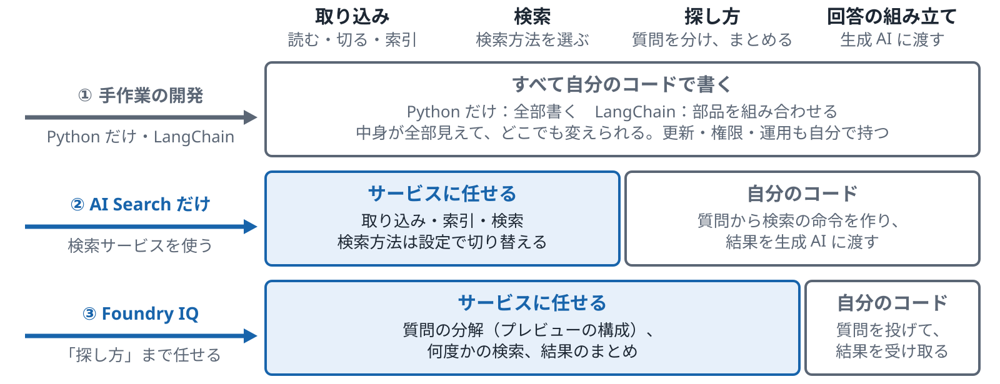
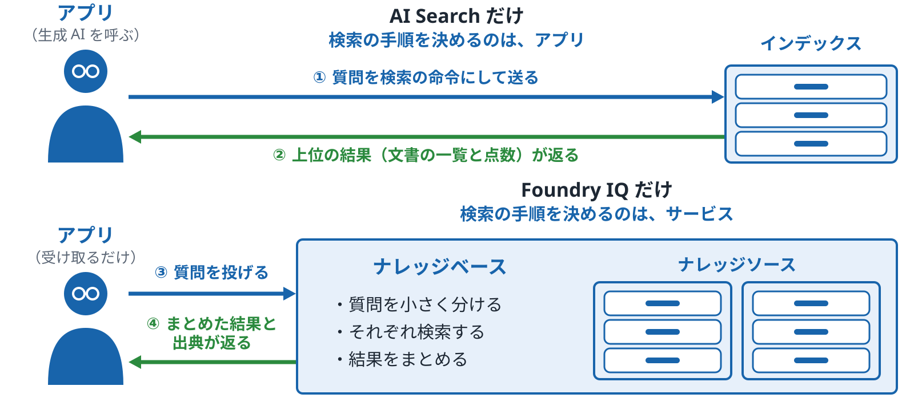
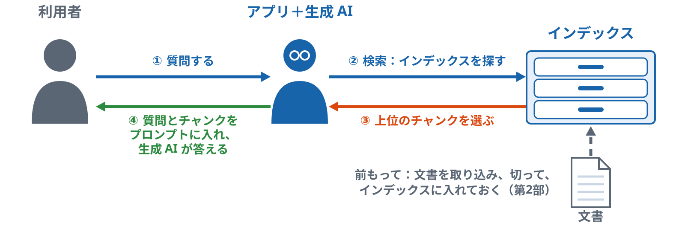
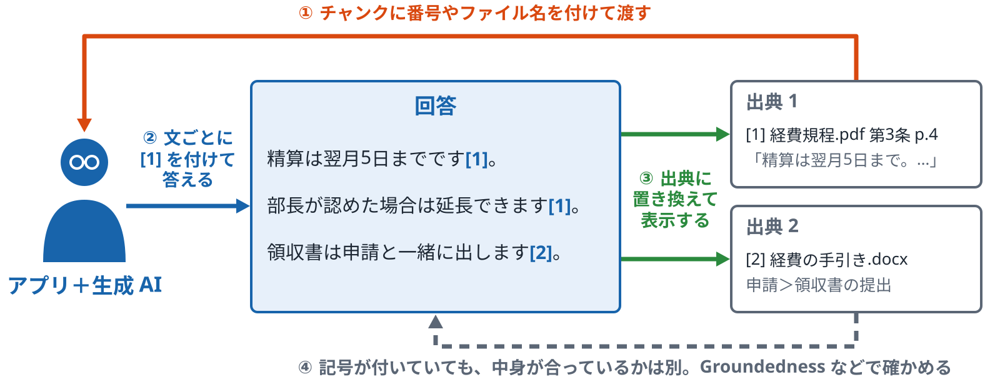
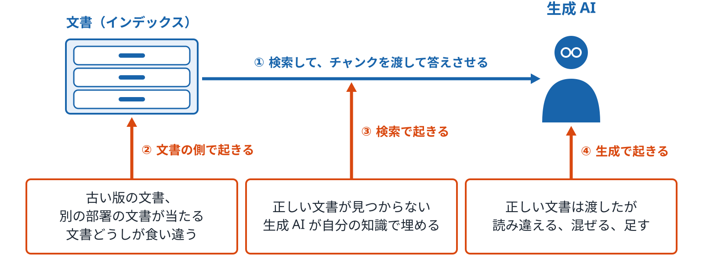
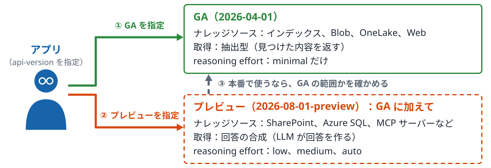
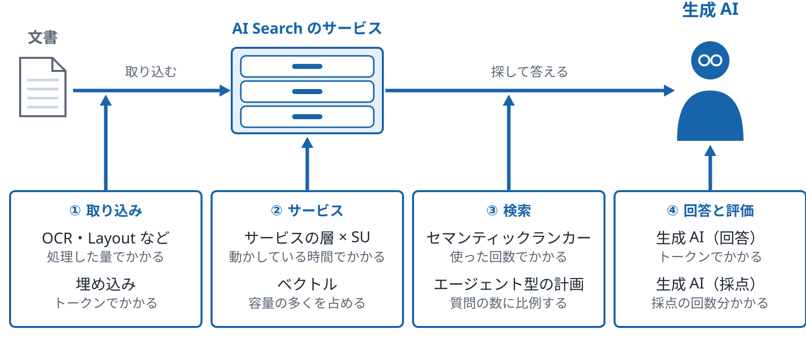

# 比較と締め

<!-- この Markdown は docs/lecture/tools/build.py --md が、keywords.md・decks.json・diagrams/ から作る。直すときは原稿を直す -->

作り方の比較、RAG の流れと出典、うまくいかない場面、プレビューと料金

*ハンズオン資料 p.46〜52　／　確かめるトピック：06・19*

[目次に戻る](index.md)

## A　作り方の比較

### p.46 手作業の開発（Python、LangChain）、AI Search だけ、Foundry IQ

*それぞれで、誰が何を受け持つか*

- **一般的な説明**
  - **手作業の開発（Python だけ、または LangChain）**
    - Python だけの場合：読む、ばらす、切る、索引、検索、回答の組み立てを、すべて自分のコードで書きます。
    - LangChain の場合：同じ流れを、部品（ローダー、分割、ベクトルストア、リトリーバー）を組み合わせて書きます。中の動きは部品に隠れます。
    - 共通の点：中身が全部見えて、どこでも変えられます。そのかわり、更新、権限、運用も自分で持つことになります。
  - **検索サービスを使う（AI Search だけ）**
    - 取り込みと索引と検索をサービスに任せ、回答の組み立ては自分で書きます。
    - 検索方法（BM25、ベクトル、ハイブリッド、ランカー）は設定で切り替えます。
    - アプリは、質問から検索の命令を作り、結果を生成 AI に渡すところを受け持ちます。
  - **検索の上に「探し方」まで任せる（Foundry IQ）**
    - 質問の分解（プレビューの構成）、何度かの検索、結果のまとめまでをサービスが受け持ちます。
    - アプリは、ナレッジベースに質問を投げて、出典付きの結果を受け取ります。
    - 中の手順は見えにくくなるので、調整は設定で行います。
- **Azure での説明**
  - **手作業の開発**
    - LangChain：`AzureSearch` などのベクトルストアのクラスで、AI Search を部品の1つとして呼べます（クラス名は LangChain の版で変わります）。
    - Azure の料金がかかるのは、呼んだサービス（埋め込み、生成、AI Search）の分だけです。
  - **AI Search だけ**
    - 取り込み：インデクサー、スキルセット、インデックスプロジェクション、統合ベクトル化です。
    - 検索：`search`、`vectorQueries`、`queryType: semantic`、RRF によるハイブリッドです。
    - 回答の組み立て：アプリ側で Azure OpenAI を呼びます。
  - **Foundry IQ（AI Search の拡張）**
    - 中身：AI Search のエージェント型検索（ナレッジソースとナレッジベース）です。
    - 設定：reasoning effort（GA は minimal だけで設定なし。2026-08-01-preview では low、medium、auto）。回答の形は GA では抽出型のみです。
    - 呼び方：REST、SDK、MCP。Foundry のエージェントからナレッジとしてつなげます。

**比べる項目**

| 項目 | Python だけ | LangChain | AI Search だけ | Foundry IQ |
|---|---|---|---|---|
| 取り込み | 自分で書く | 部品で書く | インデクサーとスキル | AI Search と同じ（ナレッジソースが作ることもある） |
| 検索方法 | 自分で書く | 部品を選ぶ | 設定で選ぶ | インデックスと設定に応じてサービスが選ぶ |
| 質問の分解 | 自分で書く | チェーンで書く | なし（アプリで書く） | サービスが行う（プレビューの構成。GA の minimal では行わない） |
| 中の見え方 | 全部見える | 部品の中は隠れる | 設定と結果が見える | 手順の記録が返る |
| 運用（更新、権限） | 自分で持つ | 自分で持つ | サービスが持つ | サービスが持つ |

*運用（更新、権限）は、手作業の開発では自分で持ち、サービスを使うとサービスが持つ*

ノート

- 位置：検索方法、取り込み、評価を見たあとで、作り方の選び方を並べるページです。p.47 で AI Search と Foundry IQ の2つに絞ります。
- 言いたいこと：4つの作り方の違いは、取り込み、検索方法、質問の分解、運用を誰が受け持つかの違いです。
- 気をつけること：
  - どれがよいかの評価はしません。受け持ちの違いだけを並べます。
  - Foundry IQ は検索の回数が増えます。費用の比較はこのページに入れていません。

**図のノート**

狙い：4つの作り方の違いが、取り込み、検索、探し方（質問の分解）、回答の組み立てを誰が受け持つかの違いだと言える。

話すこと：

- 段階0：手作業の開発（Python だけ、または LangChain）は、取り込みから回答の組み立てまで、すべて自分のコードで書く。LangChain は部品（ローダー、分割、ベクトルストア、リトリーバー）を組み合わせるが、中の動きは部品に隠れる。中身が全部見えて、どこでも変えられるかわりに、更新、権限、運用も自分で持つ
- 段階1：AI Search だけは、取り込みと索引と検索をサービスに任せる。検索方法（BM25、ベクトル、ハイブリッド、ランカー）は設定で切り替える。質問から検索の命令を作り、結果を生成 AI に渡すところはアプリが持つ。質問の分解もアプリで書く
- 段階2：Foundry IQ は、検索の上の「探し方」まで任せる。質問の分解（プレビューの構成）、何度かの検索、結果のまとめをサービスが行う。アプリは、ナレッジベースに質問を投げて、出典付きの結果を受け取る。中の手順は見えにくくなるので、調整は設定で行う

補足：運用（更新、権限）は、手作業の開発では自分で持ち、AI Search だけと Foundry IQ ではサービスが持つ。LangChain から、AzureSearch などのベクトルストアのクラスで AI Search を部品の1つとして呼ぶこともできる（クラス名は LangChain の版で変わる）。Azure の料金がかかるのは、呼んだサービス（埋め込み、生成、AI Search）の分だけ。次の p.47 で、AI Search だけと Foundry IQ だけの2つに絞る

注意：どれがよいかの評価はしない。受け持ちの違いだけを並べる。GA の minimal では、質問の分解は行わない。Foundry IQ は検索の回数が増える。費用の比較はこのページに入れていない

### p.47 AI Search だけと、Foundry IQ（AI Search の拡張）だけ

*検索の手順を、アプリが決めるかサービスが決めるか*

- **一般的な説明**
  - **AI Search だけ**
    - 1つの質問に対して、1回検索して、上位の結果を返します。
    - 質問をどう検索の命令に直すか、何回検索するかは、アプリが決めます。
    - 回答の文章を作るのも、アプリ側（生成 AI を呼ぶ）です。
  - **Foundry IQ だけ**
    - プレビューの構成（low、medium、auto）では、1つの質問を、サービスがいくつかの小さな質問に分けて、それぞれ検索します。GA の minimal では分けません。
    - 結果をまとめて、出典付きで返します。プレビューの構成では、会話の流れも考えに入れます。
    - アプリは、質問を投げて結果を受け取るだけになります。
  - **何が変わるか**
    - 決める人：AI Search では検索の手順をアプリが決め、Foundry IQ ではサービスが決めます。
    - 速さと回数：Foundry IQ は検索と生成 AI の呼び出しが増える（minimal の計画では生成 AI を使わない）ので、時間がかかり、呼び出しの数も増えます。
    - 調整のしかた：AI Search はクエリの中身で調整し、Foundry IQ は設定（どこまで考えさせるか）で調整します。
- **Azure での説明**
  - **AI Search だけ**
    - 呼び方：`/indexes/{name}/docs/search` に、`search`、`vectorQueries`、`queryType: semantic` などを指定します。
    - 返るもの：文書の一覧、`@search.score`、`@search.rerankerScore`、キャプションです。
    - 生成 AI：組み込みでは呼びません（セマンティックランカーは生成 AI ではありません）。
  - **Foundry IQ だけ**
    - 呼び方：ナレッジベースの `retrieve` の操作です。REST、SDK、MCP のどれでも呼べます。
    - 返るもの：まとめた結果、出典の一覧、どう検索したかの記録です。
    - 設定：reasoning effort は、GA では minimal だけ（設定なし）、2026-08-01-preview では low、medium、auto を選べます。回答の形は GA では抽出型のみです。
  - **中で共通のもの**
    - 取り込み：どちらもインデックスが土台です（インデクサー、スキル、統合ベクトル化）。
    - 検索方法：Foundry IQ も、中では AI Search の検索（インデックスと設定に応じて、キーワード・ベクトル・ハイブリッド）を使い、結果をセマンティックランカーで並べ直します。
    - 置き場所：Foundry IQ のナレッジベースは、AI Search のサービスの中に作られます。

**比べる項目**

| 項目 | AI Search だけ | Foundry IQ だけ |
|---|---|---|
| 1回の質問で検索する回数 | 1回（アプリが増やすことはできる） | サービスが決める（low 以上は複数回） |
| 質問の分解 | アプリが書く | サービスが行う（プレビューの構成） |
| 検索先 | 1つのインデックス | 複数のナレッジソース |
| 返るもの | 文書の一覧と点数 | まとめた結果、出典、検索の記録 |
| 生成 AI の呼び出し | なし | あり（low 以上の計画と、回答の合成。minimal の計画では使わない） |
| 調整 | クエリの中身 | reasoning effort などの設定 |

*Foundry IQ のナレッジベースは、AI Search の上に作られている。質問を分けるのはプレビューの構成（GA の minimal は分けない）*

**確かめる**：[応用 19 エージェント型検索のデモ](../../../applied/topics/19-agentic-retrieval/README.md)

ノート

- 位置：キーワード解説の最後のページです。p.46 の4列の比較から、AI Search と Foundry IQ の2列に絞ります。p.32 のエージェント型検索と合わせて見せます。
- 言いたいこと：違いは、検索の手順をアプリが決めるかサービスが決めるかです。土台のインデックスと検索方法は共通です。
- 気をつけること：
  - セマンティックランカーは生成 AI ではない、という点を言い間違えないでください。
  - reasoning effort が minimal のときは、計画に生成 AI を使いません。low 以上で、質問の分解に生成 AI を使います。
  - 費用の差は話しません。

**図のノート**

狙い：違いは、検索の手順をアプリが決めるかサービスが決めるかだと言える。土台のインデックスと検索方法は共通だと言える。

話すこと：

- 段階0：AI Search だけでは、アプリが質問を検索の命令に直して送る。1つの質問に1回検索する。何回検索するかも、アプリが決める
- 段階1：上位の結果（文書の一覧と点数）が返る。回答の文章を作るのも、アプリ側で生成 AI を呼ぶ
- 段階2：Foundry IQ だけでは、アプリは質問を投げるだけになる。プレビューの構成（low、medium、auto）では、ナレッジベースが質問をいくつかの小さな質問に分けて、複数のナレッジソースをそれぞれ検索する。GA の minimal では分けない
- 段階3：まとめた結果、出典の一覧、どう検索したかの記録が返る。プレビューの構成では、会話の流れも考えに入れる

補足：どちらも同じ Azure AI Search のサービスで動く。どちらもインデックスが土台で、Foundry IQ も、中では AI Search の検索（インデックスと設定に応じて、キーワード・ベクトル・ハイブリッド）を使い、結果をセマンティックランカーで並べ直す。ナレッジベースは AI Search のサービスの中に作られる。調整は、AI Search ではクエリの中身、Foundry IQ では設定（reasoning effort）で行う。Foundry IQ は検索と生成 AI の呼び出しが増えるので、時間がかかり、呼び出しの数も増える

注意：セマンティックランカーは生成 AI ではない。reasoning effort が minimal のときは、計画に生成 AI を使わない。low 以上で、質問の分解に生成 AI を使う。費用の差は話さない

## B　RAG と出典

### p.48 RAG の基本の流れ

*探してから、見つけた文を渡して答えさせる*

- **一般的な説明**
  - **流れの段**
    - 質問を受けて、インデックスを探し、上位のチャンクを選びます。
    - 質問と選んだチャンクを、プロンプトに入れます。
    - 生成 AI が、プロンプトをもとに答えます。
  - **前もって行うこと**
    - 文書を取り込み、切って、インデックスに入れておきます（第2部、p.16）。
    - 出典の欄を付けておきます（p.26）。
    - 文書が変わったら、インデックスも入れ直します（p.29）。
  - **生成 AI が答えに使うもの**
    - 生成 AI は、渡された文と、自分がもともと持っている知識の両方で答えます。
    - プロンプトで「渡した文だけで答える」と書いても、もともとの知識が混ざることがあります（p.50）。
    - 渡した文に答えがないときに「分からない」と言わせるかどうかも、プロンプトで決めます。
- **Azure AI Search での説明**
  - **検索と選ぶ段**
    - 検索の段は Azure AI Search が受け持ちます（キーワード、ベクトル、ハイブリッド、ランカー）。
    - 何件を選んで渡すか（top）は、アプリで決めます。
    - ランカーの点数（rerankerScore、0〜4）で、低いチャンクを外すこともできます。外す境目の値は決まっていないので、評価で決めます。
  - **組み立てと生成の段**
    - 1回の検索の形では、アプリが、検索の結果をプロンプトに入れて、Azure OpenAI などを呼びます。
    - ナレッジベースを使う形では、検索と、まとめる段をナレッジベースが受け持ちます（p.32、p.36）。
    - GA のナレッジベースでは、返るのは抽出型の結果なので、回答の文はアプリの側で生成 AI に作らせます。

*生成 AI は、渡された文と自分の知識の両方で答える*

**確かめる**：[基礎 06 検索結果から答えを作る](../../../basic/topics/06-answer-from-results/README.md)

ノート

- 位置：締めの部で、ここまでの検索と取り込みを、RAG の流れの中に置き直すページです。冒頭（はじめに）の全体図の振り返りです。
- 言いたいこと：RAG は、探してから、見つけた文を生成 AI に渡して答えさせる流れです。検索の段の質が、答えの質に効きます。
- 気をつけること：
  - 生成 AI は渡された文だけで答えるわけではない、と言ってください。
  - どちらの形がよいかは言いません。

**図のノート**

狙い：RAG の流れ（質問、検索、選ぶ、プロンプトに入れる、生成）と、前もって行うことが言える。

話すこと：

- 最初から見えているもの：前もって、文書を取り込み、切って、インデックスに入れておく（第2部、p.16）。出典の欄も付けておき（p.26）、文書が変わったらインデックスも入れ直す（p.29）
- 段階0：利用者が質問する
- 段階1：アプリがインデックスを探す。検索の段は Azure AI Search が受け持つ（キーワード、ベクトル、ハイブリッド、ランカー）
- 段階2：上位のチャンクを選ぶ。何件を選んで渡すか（top）は、アプリで決める。ランカーの点数（rerankerScore、0〜4）で低いチャンクを外すこともできる。外す境目の値は決まっていないので、評価で決める
- 段階3：質問と選んだチャンクをプロンプトに入れ、生成 AI が答える。1回の検索の形では、アプリが検索の結果をプロンプトに入れて、Azure OpenAI などを呼ぶ

補足：生成 AI は、渡された文と自分がもともと持っている知識の両方で答える。プロンプトで「渡した文だけで答える」と書いても、もともとの知識が混ざることがある（p.50）。渡した文に答えがないときに「分からない」と言わせるかどうかも、プロンプトで決める。ナレッジベースを使う形では、検索と、まとめる段をナレッジベースが受け持つ（p.32、p.36）。GA のナレッジベースが返すのは抽出型の結果なので、回答の文はアプリの側で生成 AI に作らせる

注意：生成 AI は渡された文だけで答えるわけではない、と言う。どちらの形がよいかは言わない。冒頭（はじめに）の全体図の振り返りとして見せる

### p.49 出典付きの回答

*回答の文ごとに、根拠のチャンクを示す*

- **一般的な説明**
  - **何のためか**
    - 利用者が、回答の根拠を元の文書で確かめられるようにします。
    - 根拠のない文（出典が付かない文）を見つけやすくなります。
    - 回答が間違っていたときに、文書の側か生成の側かを調べやすくなります。
  - **付け方**
    - プロンプトで、チャンクに番号やファイル名を付けて渡します。
    - 生成 AI に、文ごとに [1] のような記号で、使ったチャンクを示すように指示します。
    - 記号を、ファイル名とページなどの出典に置き換えて表示します。
  - **気をつける点**
    - 生成 AI が、渡していない番号や、内容と合わない番号を付けることがあります。
    - 記号が付いていても、その文が本当にチャンクに書かれているとは限りません。
    - 記号が付いているかは、プログラムで数えられます（has_citation など）。中身が合っているかは、Groundedness などで確かめます。
- **Azure AI Search での説明**
  - **出典の材料**
    - チャンクごとの出典の欄（ファイル名、ページ、見出し、シートと行）を、検索の結果と一緒に返します（p.26）。
    - 返す欄は `select` で決めます。
    - 欄が `retrievable` でないと、結果に返りません。
  - **ナレッジベースの場合**
    - エージェント型検索では、結果と、参照（references）が分けて返ります。
    - 参照には、どのナレッジソースのどの文書かが入ります。
    - プレビューの回答の文を作る形（回答の合成）でも、参照の番号（`[ref_id:3]` のような形）が回答の中に付きます。

*チャンクに出典の欄があれば、回答から元の文書へ戻れる*

ノート

- 位置：p.48 の RAG の流れのうち、回答の出し方を見るページです。p.26 の出典の欄が、ここで使われます。
- 言いたいこと：出典は、チャンクごとの欄と、生成 AI に付けさせる記号の組で示します。記号が付いていても、中身が合っているとは限りません。
- 気をつけること：
  - 図の文と出典は説明用です。
  - 出典が付いていることと、正しいことは別だ、と言ってください。

**図のノート**

狙い：回答の文ごとに根拠のチャンクを示す付け方と、出典が付いていても中身が合うとは限らない点が言える。

話すこと：

- 段階0：プロンプトで、チャンクに番号やファイル名を付けて生成 AI に渡す。チャンクごとの出典の欄（ファイル名、ページ、見出し、シートと行）は、検索の結果と一緒に返しておく（p.26）
- 段階1：生成 AI に、文ごとに [1] のような記号で、使ったチャンクを示すように指示する。回答の中に、記号が付く
- 段階2：記号を、ファイル名とページなどの出典に置き換えて表示する。利用者は、回答の根拠を元の文書で確かめられる。根拠のない文（出典が付かない文）を見つけやすくなり、回答が間違っていたときに、文書の側か生成の側かも調べやすくなる
- 段階3：記号が付いていても、その文が本当にチャンクに書かれているとは限らない。生成 AI が、渡していない番号や、内容と合わない番号を付けることもある。付いているかは、プログラムで数えられる（has_citation など）。中身が合っているかは、Groundedness などで確かめる

補足：文と出典は説明用の例。出典の欄は select で決め、retrievable でない欄は結果に返らない。エージェント型検索では、結果と参照（references）が分けて返り、参照には、どのナレッジソースのどの文書かが入る。プレビューの回答の合成でも、参照の番号（[ref_id:3] のような形）が回答の中に付く

注意：出典が付いていることと、正しいことは別、と言う。図の文と出典は説明用

### p.50 ハルシネーション

*根拠にないことを、もっともらしく答える*

- **一般的な説明**
  - **何が起きるか**
    - 生成 AI が、渡した文にも事実にもないことを、もっともらしく答えます。
    - 文の形は自然なので、読んだだけでは気付きにくくなります。
    - RAG にしても、なくなるわけではありません。
  - **RAG で起きる場所**
    - 検索で起きる：正しい文書が見つからず、生成 AI が自分の知識で埋めます。
    - 生成で起きる：正しい文書は渡したが、読み違えたり、別の文書と混ぜたり、書かれていないことを足したりします。
    - 文書の側で起きる：古い版の文書や別の部署の文書が当たる、文書どうしが食い違う、などです。
  - **見つけ方と減らし方**
    - 検索の結果を残し、回答の文が検索の結果に書かれているかを確かめます。
    - 渡した文に答えがないときは「分からない」と答えるように、プロンプトで決めます。
    - 古い版の文書は、日付の欄で見分けるか、外します（p.29）。
- **Azure AI Search での説明**
  - **検索の側で減らす**
    - ハイブリッド検索とセマンティックランカーで、正しい文書を上位に出しやすくします（p.3、p.5）。
    - フィルターで、部署や期間を絞ります（p.11）。
    - ランカーの点数（rerankerScore）の低いチャンクを外すと、合わない文書を渡しにくくなります。
  - **回答の側で確かめる**
    - Groundedness の評価器（azure-ai-evaluation の `GroundednessEvaluator` など）で、回答が渡した文に沿っているかを点数にします。
    - Groundedness は、渡した文が正しいかどうかは見ません。
    - 文書の側で起きた場合は、Groundedness が高くても間違った回答になることがあります。

*RAG では、どこで起きたかによって見る場所が変わる*

**確かめる**：[基礎 06 検索結果から答えを作る](../../../basic/topics/06-answer-from-results/README.md)

ノート

- 位置：p.48 の RAG の流れで、どこで間違いが起きるかを見るページです。p.43 の検索と回答の評価の分け方とつながります。
- 言いたいこと：RAG のハルシネーションは、検索、生成、文書の側の3つの場所で起きます。場所によって、見る物差しが変わります。
- 気をつけること：
  - Groundedness は渡した文に沿っているかを見るもので、文が正しいかは見ない、と必ず言ってください。
  - 「RAG にすればなくなる」とは言いません。

**図のノート**

狙い：RAG のハルシネーションが起きる3つの場所（文書の側、検索、生成）と、場所によって見る物差しが変わることが言える。

話すこと：

- 段階0：文書を入れたインデックスを検索し、見つけたチャンクを生成 AI に渡して答えさせる。ハルシネーションは、渡した文にも事実にもないことを、もっともらしく答えること。文の形は自然なので、読んだだけでは気付きにくく、RAG にしても、なくなるわけではない
- 段階1：文書の側で起きる。古い版の文書や別の部署の文書が当たる、文書どうしが食い違う、など。古い版の文書は、日付の欄で見分けるか、外す（p.29）
- 段階2：検索で起きる。正しい文書が見つからず、生成 AI が自分の知識で埋める。ハイブリッド検索とセマンティックランカー（p.3、p.5）で正しい文書を上位に出しやすくし、フィルターで部署や期間を絞り（p.11）、ランカーの点数（rerankerScore）の低いチャンクを外すと、減らせる
- 段階3：生成で起きる。正しい文書は渡したが、読み違えたり、別の文書と混ぜたり、書かれていないことを足したりする。Groundedness の評価器（azure-ai-evaluation の GroundednessEvaluator など）で、回答が渡した文に沿っているかを点数にする

補足：Groundedness は「回答が渡した文に沿っているか」を見る。渡した文が正しいかは見ない。文書の側で起きた場合は、Groundedness が高くても間違った回答になることがある。見つけ方は、検索の結果を残し、回答の文が検索の結果に書かれているかを確かめること。渡した文に答えがないときは「分からない」と答えるように、プロンプトで決める。p.43 の検索と回答の評価の分け方とつながる

注意：Groundedness は渡した文に沿っているかを見るもので、文が正しいかは見ない、と必ず言う。「RAG にすればなくなる」とは言わない

## C　直し方

### うまくいかない5つの場面と直し方

| 場面 | 何が起きるか | 直し方 |
|---|---|---|
| 版の違い | 古い版と新しい版が両方出て、古い値で答える | 有効期間の欄で絞る（フィルター） |
| 表の分断 | 表の見出しと行が別のチャンクに分かれ、行の意味が失われる | 条ごとに切る、表の行を1件にする |
| 似た条文 | 国内と海外、隣の行など、似た一節を取り違える | 上位を確かめる、欄で絞る、親を渡す |
| 数え上げ | 生成 AI に渡るのは上位の数件だけで、全部を数えられない | 絞り込みと件数（count）で数える |
| 資料にない質問 | それらしい答えを作ってしまう | 「資料にない」と答える約束をプロンプトに書く |

ノート

言いたいこと：検索をよくしても直らない場面がある。何が起きたかに合わせて、絞り込み、切り方、件数の数え方、プロンプトの約束で直す。

- 版の違い：たとえば求人票 REQ-042 は、v1 が週4日出社、v3 が週2日出社（応用 17）。版を別の文書として置くと、絞り込みがなければ、時点に関係なく両方の版が検索に出る。
- 表の分断：たとえば、ページをまたぐ表は、見出しの行が1ページ目、最後の行が2ページ目に分かれる。ページの切れ目で切ると、見出しと行が別のチャンクになる（例）。
- 数え上げ：たとえば上位3件しか渡さないと、該当が10件あっても、数えられるのは3件まで。絞り込みと件数で数える（件数は例）。
- 資料にない質問は、出典つきで答える仕組み（p.49・p.50）で扱う。

### 直す前に、どこで壊れたかを確かめる

**取り込み** → **切り方** → **検索** → **回答**

- **取り込み**：文字や表が読めているか
- **切り方**：根拠がどのチャンクにあるか
- **検索**：根拠のチャンクが何位か
- **回答**：渡した中に根拠があるのに外したか

> 工程の順に確かめると、直す場所が1つに決まる

ノート

言いたいこと：答えが違ったときは、取り込み、切り方、検索、回答の順に、どこで壊れたかを確かめる。

- 取り込みで失ったもの（表の見出し、数字）は、あとで取り戻せない。
- 根拠が上位に来ていないなら検索、上位にあるのに答えが違うなら回答（プロンプト）を直す。

## D　版と料金

### p.51 GA とプレビュー

*どの機能が GA で、どの機能がプレビューか*

- **一般的な説明**
  - **GA とプレビューの違い**
    - GA（一般提供）は、正式な機能として、サポートや SLA の対象になります。
    - プレビューは、試しに使える段の機能で、名前や形が変わったり、なくなったりすることがあります。
    - プレビューの機能は、本番で使う前に、使ってよい条件を確かめます。
  - **API の版**
    - REST API には、日付の付いた版があり、`api-version` で指定します。
    - `-preview` の付いた版には、プレビューの機能が入ります。
    - 同じ機能でも、版によって書き方が違うことがあります。
  - **教材での書き分け**
    - 機能ごとに、GA かプレビューかを書きます。
    - 画面や資料が古いときは、今の状態を確かめてから使います。
    - 状態は変わるので、版の日付（2026-04-01、2026-08-01-preview）を添えます。

    | 項目 | GA 2026-04-01 | プレビュー 2026-08-01-preview |
    |---|---|---|
    | ナレッジソース | searchIndex、azureBlob、indexedOneLake、web | 左に加えて SharePoint、Azure SQL、ファイル、MCP サーバー、Fabric、Work IQ など |
    | 取得 | 抽出型（見つけた内容を返す。Web の内容だけは LLM が要約） | 抽出型に加えて、LLM が回答を作る回答の合成 |
    | reasoning effort | minimal だけ（設定なし） | minimal、low、medium、auto |

*プレビューは、名前や形が変わったり、なくなったりすることがある*

ノート

- 言いたいこと：この資料で見せる機能には、プレビューのものがあります（エージェント型検索の質問の分解など）。本番で使うなら、GA の範囲を確かめます。
- 気をつけること：
  - どちらを使うべきかは言いません。
  - 状態は変わるので、表の日付（2026-04-01、2026-08-01-preview）を必ず添えてください。

**図のノート**

狙い：api-version で版を選ぶと使える機能が変わること、プレビューの機能は本番で使う前に確かめることが言える。

話すこと：

- 段階0：アプリは、REST API の api-version で版を指定して呼ぶ。GA（一般提供）の版（2026-04-01）は、正式な機能として、サポートや SLA の対象になる。ナレッジソースは searchIndex、azureBlob、indexedOneLake、web。取得は抽出型（Web の内容だけは LLM が要約）。reasoning effort は minimal だけ（設定なし）
- 段階1：-preview の付いた版（2026-08-01-preview）には、GA に加えて、プレビューの機能が入る。ナレッジソースに SharePoint、Azure SQL、ファイル、MCP サーバー、Fabric、Work IQ など。取得に、LLM が回答を作る回答の合成。reasoning effort は minimal、low、medium、auto
- 段階2：この資料で見せる機能には、プレビューのもの（エージェント型検索の質問の分解など）がある。プレビューは、名前や形が変わったり、なくなったりすることがあるので、本番で使うなら、GA の範囲と、使ってよい条件を確かめる

補足：同じ機能でも、版によって書き方が違うことがある。状態は変わるので、版の日付を添える。画面や資料が古いときは、今の状態を確かめてから使う。3つの軸の一覧は、前のスライドの表にある

注意：どちらを使うべきかは言わない。状態は変わるので、版の日付（2026-04-01、2026-08-01-preview）を必ず添える

### p.52 料金の構造

*何に対して料金がかかるか*

- **一般的な説明**
  - **かかり方の種類**
    - 動かしている時間でかかるもの（サービスの台数や大きさ）。
    - 使った回数や量でかかるもの（呼び出しの数、処理したページ、トークン）。
    - 置いているデータの量でかかるもの。
  - **RAG で増えやすいところ**
    - 取り込み：OCR やベクトルにする処理は、文書の量に比例します。
    - 検索：ランカーやエージェント型検索の計画は、質問の数に比例します。
    - 評価：生成 AI で採点すると、採点の回数分かかります。
  - **金額を書かない理由**
    - 料金は地域と時期で変わります。
    - この教材では、金額は書かず、何に対してかかるかだけを書きます。
- **Azure AI Search での説明**
  - **4つのかかり方**
    - サービスの層 × SU：Free、Basic、Standard などの層と、SU（パーティション × レプリカ）の数で、動かしている時間でかかります。
    - セマンティックランカー：Free プラン（既定）は毎月の無料枠（回数は公式の料金ページ https://azure.microsoft.com/ja-jp/pricing/details/search/）まで使え、使い切ると要求は課金のエラーになります。Standard プラン（Basic 以上）は、無料枠を超えた分が使った回数でかかります。
    - ここでの Free は、検索サービスの層の Free（共有の小さなサービス）とは別のものです。
    - AI エンリッチメントと、埋め込み・生成 AI：OCR や Document Layout は処理した量で、Azure OpenAI などはトークンでかかります。
  - **ベクトルの容量**
    - ベクトルは、インデックスの容量の多くを占めます。
    - 量子化（p.8）で小さくできます（スカラーは約4分の1、バイナリは最大で約28分の1）。
    - 小さくすると、検索の質が変わることがあるので、評価で確かめます（p.42）。
  - **この教材での扱い**
    - 実際に試すと、課金や新しいリソースを伴うことがあるので、紹介にとどめます。
    - エージェント型検索は、トークンの量でかかります。検索側（サブクエリの実行とセマンティックランキング）と、Azure OpenAI 側（計画と回答の合成）の2系統です。金額は公式の料金ページで見ます。

*金額は書かない。料金は地域と時期で変わるので、公式の料金ページで確かめる*

ノート

- 言いたいこと：料金は、時間、回数や量、データの量でかかります。金額はこの教材では書きません。
- 気をつけること：
  - 層を上げることや、プランを変えることを勧めません。

**図のノート**

狙い：料金が、動かしている時間、使った回数や量、置いているデータの量でかかることと、RAG のどこで増えやすいかが言える。金額は言わない。

話すこと：

- 段階0：取り込み。OCR や Document Layout などの AI エンリッチメントは処理した量で、埋め込み（Azure OpenAI など）はトークンでかかる。どちらも文書の量に比例して増える
- 段階1：サービス。Free、Basic、Standard などの層と、SU（パーティション × レプリカ）の数で、動かしている時間でかかる。ベクトルは、インデックスの容量の多くを占める。量子化（p.8）で小さくできるが、検索の質が変わることがあるので、評価で確かめる（p.42）
- 段階2：検索。セマンティックランカーは、Free プラン（既定）は毎月の無料枠まで使え、使い切ると要求は課金のエラーになる。Standard プラン（Basic 以上）は、無料枠を超えた分が使った回数でかかる。エージェント型検索の計画は、質問の数に比例する
- 段階3：回答と評価。生成 AI（Azure OpenAI など）はトークンでかかる。生成 AI で採点すると、採点の回数分かかる

補足：エージェント型検索は、トークンの量でかかる。検索側（サブクエリの実行とセマンティックランキング）と、Azure OpenAI 側（計画と回答の合成）の2系統。エージェント型検索の計画にかかる料金の数え方と金額は、公式の料金ページ（https://azure.microsoft.com/ja-jp/pricing/details/search/）で確かめる。ここでの Free プランは、検索サービスの層の Free（共有の小さなサービス）とは別のもの。実際に試すと、課金や新しいリソースを伴うことがあるので、紹介にとどめる

注意：金額は書かない（セマンティックランカーの無料枠の回数も、料金ページで見る）。層を上げることや、プランを変えることを勧めない

