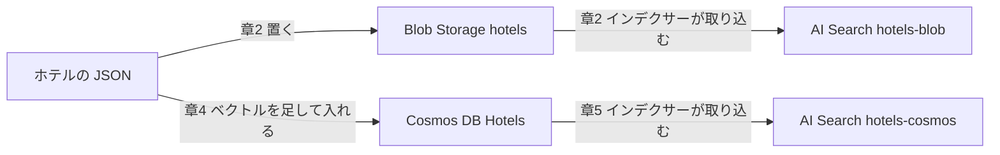

# ホテル：Azure の検索を、ポータルで作る

Microsoft のホテルのサンプルデータ（日本語版）で、Azure AI Search を作って試す自習用の手順です。画面の操作を中心に、1章から順に進めます。

## 0. この手順の使い方

### 役割

- 構築する人（チームで1人）が、ポータルの画面を操作します。
- ほかのメンバーは、手順を声に出して読み、画面と合っているか確かめます。
- ボタンが押せないとき、画面が書いてあるとおりでないときは、進行役に聞きます。

### 前提

- [Azure の準備](setup/azure-setup.md)が終わっている（リソース グループ、ストレージ、AI Search、Cosmos DB、Foundry、モデルのデプロイ）。
- 構築する人が、Azure で「所有者」になっている（ロールの割り当てに使います）。
- 1〜3章で使うのは、ストレージと AI Search です。4〜5章は、Cosmos DB と、埋め込みのモデル（Foundry）も使います。

### 名前

手順の中の `<org>`・`<team>` は、組織の名前とチームの名前に置き換えます。リソースの名前は、`python tools/team.py names` で表示できます。

例は、組織が `acme`、チームが `red` のときです。

- リソース グループ：`rg-<org>-<team>`（例 `rg-acme-red`。既存のリソース グループに作ったときは、その名前）
- ストレージ アカウント：`st<org><team>`（例 `stacmered`）
- AI Search：`srch-<org>-<team>`（例 `srch-acme-red`）
- Cosmos DB：`cosmos-<org>-<team>`（例 `cosmos-acme-red`）

どのチームでも同じ名前を使うもの：

- ストレージのコンテナー：`hotels`
- 検索のインデックス：`hotels-blob`、`hotels-cosmos`
- 検索のデータソース：`hotels-blob-ds`、`hotels-cosmos-ds`
- 検索のインデクサー：`hotels-blob-indexer`、`hotels-cosmos-indexer`
- Cosmos DB のデータベース：`Hotels`
- Cosmos DB のコンテナー：`hotels_diskann`、`hotels_quantizedflat`

### 使うファイル

- ホテルのデータ（日本語版）：[HotelsData_toAzureBlobs_ja.json](https://github.com/dmasubuchi/azure-search-sample-data-ja/blob/82c5f4a/hotels/ja/HotelsData_toAzureBlobs_ja.json)（50ホテル。元のデータの英語とフランス語の欄に、日本語の欄を足したもの）
  - GitHub の画面でファイルを開き、「Download raw file」で保存します。
  - 日本語は AI で作った訳です。出どころとライセンスは、同じフォルダーの [README](https://github.com/dmasubuchi/azure-search-sample-data-ja/blob/82c5f4a/hotels/ja/README.md) に書いてあります。
- ホテルのデータに含まれる項目：`HotelId`（キー）、`HotelName`・`HotelName_ja`、`Description`（英語）・`Description_fr`・`Description_ja`、`Category`・`Category_ja`、`Tags`・`Tags_ja`、`ParkingIncluded`、`IsDeleted`、`LastRenovationDate`、`Rating`、`Address`（住所の入れ子）、`Location`（緯度と経度）、`Rooms`（客室の配列）

### 確認の欄

各章の最後の「確認」の欄を、1つずつ確かめます。

### 全体の流れ

- 章1〜3：リソースを作る、Blob にホテルを置く、AI Search に取り込む、検索を試す
- 章4〜5：Cosmos DB でベクトル検索をする、Cosmos DB を AI Search に取り込む



Cosmos DB の中でも、ベクトル検索ができます（章4）。

## 1. リソースを作る

[Azure の準備](setup/azure-setup.md)の「3. リソースを作る」で作ります。

## 2. Blob のホテルを AI Search に取り込む

### 2-1. AI Search のマネージド ID をオンにする

1. チームのリソース グループを開き、`srch-<org>-<team>` を選びます。
2. 左メニューの「設定」の「ID（Identity）」を開きます。
3. 「システム割り当て済み」で、状態を「オン」にします。
4. 「保存」を選び、確認が出たら「はい」を選びます。
5. 「オブジェクト識別子（Object (principal) ID）」が表示されたことを確認します。

- すでに「オン」のときは、そのままです（az で作ったときは、オンになっています）。
- オフのままだと、次の手順のロールの割り当てで、Search が候補に出ません。

確認：

- [ ] 「システム割り当て済み」の状態が「オン」で、オブジェクト識別子が出ている。

### 2-2. Blob を読む権限を付ける

AI Search に、ストレージの Blob を読む権限を付けます。

1. ストレージ `st<org><team>` を開き、「アクセス制御 (IAM)」を開きます。
2. 「追加」を選び、「ロールの割り当ての追加」を選びます。
3. 「ジョブ機能ロール」で「Storage Blob Data Reader」（ストレージ BLOB データ閲覧者）を選び、「次へ」を選びます。
4. 「メンバー」で「マネージド ID」を選び、「メンバーの選択（Select members）」を開きます。
5. 「システム割り当てマネージド ID」を選び、種類「Search Service (Foundry IQ)」から `srch-<org>-<team>` を選んで、「選択」を選びます。
6. 「次へ」で進み、「レビューと割り当て（Review + assign）」で対象とメンバーが正しいことを確認して、もう一度「レビューと割り当て」を選びます。
7. 「ロールの割り当て」タブで `srch-<org>-<team>` を検索します。

- 日本語の画面でロールが見つからないときは、`Blob` で検索します。
- 付けるのは読み取りだけです。書き込みと削除のロールは付けません。
- Search は、このマネージド ID で Blob を読みます。
- ボタンが押せないときは、あなたに「所有者」の権限があるか、進行役に確認します。

az で付けるとき（変数は [Azure の準備の補助](setup/azure-setup.md#5-補助az-で作る)と同じです）：

```powershell
$p = az search service show -n "srch-$org-$t" -g $rg --query identity.principalId -o tsv
$st = az storage account show -n "st$org$t" -g $rg --query id -o tsv
az role assignment create --assignee-object-id $p --assignee-principal-type ServicePrincipal --role "Storage Blob Data Reader" --scope $st
```

確認：

- [ ] `srch-<org>-<team>` の行があり、ロールが「Storage Blob Data Reader」になっている。

### 2-3. ホテルの JSON を Blob に置く

1. ストレージ `st<org><team>` の「データ ストレージ」の「コンテナー」を開きます。
2. 「+ コンテナー」を選び、名前に `hotels` と入れます。
3. 「匿名アクセス レベル」は「プライベート (匿名アクセスなし)」のままにします。
4. 「作成」を選びます。
5. 「使うファイル」のホテルのデータ（日本語版）を、「Download raw file」で保存します。
6. コンテナー `hotels` を開き、「アップロード」を選びます。
7. 「アップロード」の画面で、保存した `HotelsData_toAzureBlobs_ja.json` を選び、「アップロード」を選びます。

- ホテル50件は、1つのファイルのままで構いません。50ファイルに分けません。
- このコンテナーには、このファイルだけを置きます。
- アップロードで権限のエラーが出たら、進行役に伝えます。

az で行うとき：

```powershell
az storage container create -n hotels --account-name "st$org$t" --auth-mode key
az storage blob upload --account-name "st$org$t" -c hotels -n HotelsData_toAzureBlobs_ja.json -f HotelsData_toAzureBlobs_ja.json --auth-mode key
```

確認：

- [ ] コンテナー `hotels` に、`HotelsData_toAzureBlobs_ja.json` が表示されている。
- [ ] 「匿名アクセス レベル」が「プライベート (匿名アクセスなし)」になっている。

### 2-4. インデックスを作る

作る順番：インデックス、データソース、インデクサー。

1. Search `srch-<org>-<team>` を開き、左メニュー「検索管理」の「インデックス」を開きます。
2. 「インデックスの追加」の「∨」を開き、JSON で追加する項目を選びます。
3. 入力欄にある文字を消し、次の JSON を貼り付けます。

```json
{
 "name":"hotels-blob",
 "fields":[
  {"name":"HotelId","type":"Edm.String","key":true,"searchable":true,
   "filterable":true,"sortable":true,"facetable":true,"retrievable":true},
  {"name":"HotelName","type":"Edm.String","searchable":true,
   "filterable":false,"sortable":true,"facetable":false,"retrievable":true},
  {"name":"HotelName_ja","type":"Edm.String","searchable":true,
   "filterable":false,"sortable":true,"facetable":false,"retrievable":true,
   "analyzer":"ja.microsoft"},
  {"name":"Description","type":"Edm.String","searchable":true,
   "filterable":false,"sortable":false,"facetable":false,"retrievable":true,
   "analyzer":"en.lucene"},
  {"name":"Description_fr","type":"Edm.String","searchable":true,
   "filterable":false,"sortable":false,"facetable":false,"retrievable":true,
   "analyzer":"fr.lucene"},
  {"name":"Description_ja","type":"Edm.String","searchable":true,
   "filterable":false,"sortable":false,"facetable":false,"retrievable":true,
   "analyzer":"ja.microsoft"},
  {"name":"Category","type":"Edm.String","searchable":true,"filterable":true,
   "sortable":true,"facetable":true,"retrievable":true},
  {"name":"Category_ja","type":"Edm.String","searchable":true,"filterable":true,
   "sortable":true,"facetable":true,"retrievable":true,
   "analyzer":"ja.microsoft"},
  {"name":"Tags","type":"Collection(Edm.String)","searchable":true,
   "filterable":true,"sortable":false,"facetable":true,"retrievable":true},
  {"name":"Tags_ja","type":"Collection(Edm.String)","searchable":true,
   "filterable":true,"sortable":false,"facetable":true,"retrievable":true,
   "analyzer":"ja.microsoft"},
  {"name":"ParkingIncluded","type":"Edm.Boolean","searchable":false,
   "filterable":true,"sortable":true,"facetable":true,"retrievable":true},
  {"name":"IsDeleted","type":"Edm.Boolean","searchable":false,
   "filterable":true,"sortable":true,"facetable":false,"retrievable":true},
  {"name":"LastRenovationDate","type":"Edm.DateTimeOffset","searchable":false,
   "filterable":true,"sortable":true,"facetable":true,"retrievable":true},
  {"name":"Rating","type":"Edm.Double","searchable":false,"filterable":true,
   "sortable":true,"facetable":true,"retrievable":true},
  {"name":"Address","type":"Edm.ComplexType","fields":[
   {"name":"StreetAddress","type":"Edm.String","searchable":true,
    "filterable":false,"sortable":false,"facetable":false,"retrievable":true},
   {"name":"City","type":"Edm.String","searchable":true,"filterable":true,
    "sortable":true,"facetable":true,"retrievable":true},
   {"name":"StateProvince","type":"Edm.String","searchable":true,
    "filterable":true,"sortable":true,"facetable":true,"retrievable":true},
   {"name":"PostalCode","type":"Edm.String","searchable":true,
    "filterable":true,"sortable":true,"facetable":true,"retrievable":true},
   {"name":"Country","type":"Edm.String","searchable":true,"filterable":true,
    "sortable":true,"facetable":true,"retrievable":true}
  ]},
  {"name":"Location","type":"Edm.GeographyPoint","searchable":false,
   "filterable":true,"sortable":true,"facetable":false,"retrievable":true},
  {"name":"Rooms","type":"Collection(Edm.ComplexType)","fields":[
   {"name":"Description","type":"Edm.String","searchable":true,
    "filterable":false,"sortable":false,"facetable":false,"retrievable":true,
    "analyzer":"en.lucene"},
   {"name":"Description_fr","type":"Edm.String","searchable":true,
    "filterable":false,"sortable":false,"facetable":false,"retrievable":true,
    "analyzer":"fr.lucene"},
   {"name":"Description_ja","type":"Edm.String","searchable":true,
    "filterable":false,"sortable":false,"facetable":false,"retrievable":true,
    "analyzer":"ja.microsoft"},
   {"name":"Type","type":"Edm.String","searchable":true,"filterable":true,
    "sortable":false,"facetable":true,"retrievable":true},
   {"name":"Type_ja","type":"Edm.String","searchable":true,"filterable":true,
    "sortable":false,"facetable":true,"retrievable":true,
    "analyzer":"ja.microsoft"},
   {"name":"BaseRate","type":"Edm.Double","searchable":false,
    "filterable":true,"sortable":false,"facetable":true,"retrievable":true},
   {"name":"BedOptions","type":"Edm.String","searchable":true,
    "filterable":true,"sortable":false,"facetable":true,"retrievable":true},
   {"name":"SleepsCount","type":"Edm.Int32","searchable":false,
    "filterable":true,"sortable":false,"facetable":true,"retrievable":true},
   {"name":"SmokingAllowed","type":"Edm.Boolean","searchable":false,
    "filterable":true,"sortable":false,"facetable":true,"retrievable":true},
   {"name":"Tags","type":"Collection(Edm.String)","searchable":true,
    "filterable":true,"sortable":false,"facetable":true,"retrievable":true}
  ]}
 ],
 "suggesters":[{"name":"sg","searchMode":"analyzingInfixMatching",
  "sourceFields":["HotelName"]}],
 "semantic":{
  "configurations":[{"name":"hotels-semantic",
   "prioritizedFields":{
    "titleField":{"fieldName":"HotelName_ja"},
    "prioritizedContentFields":[{"fieldName":"Description_ja"},{"fieldName":"Description"}],
    "prioritizedKeywordsFields":[{"fieldName":"Tags_ja"},{"fieldName":"Category_ja"}]}}]}
}
```

4. 「保存」を選びます。

- 項目の名前が画面と違うときは、進行役に聞きます。
- `HotelId` がキーです。
- `HotelName_ja`・`Description_ja` は、日本語のホテル名と説明です（`ja.microsoft` で日本語の単語に分けます）。`Category_ja`・`Tags_ja` は、日本語のカテゴリとタグです。
- `Description` は英語の全文検索、`Rating` は絞り込みと並べ替え、`Location` は地理検索に使います。
- `Rooms` は、客室の配列です。
- データにある項目は、入れ子の中も、すべてインデックスに書いてあります。

確認：

- [ ] インデックスの一覧に `hotels-blob` がある。

### 2-5. データソースを作る

1. 左メニュー「検索管理」の「データ ソース」を開き、「データ ソースの追加」を選びます。
2. 名前に `hotels-blob-ds` と入れます。
3. 種類で「Azure Blob Storage」を選びます。
4. ストレージ アカウント `st<org><team>` とコンテナー `hotels` を指定し、認証でシステム割り当てのマネージド ID（System-assigned managed identity）を選びます。
5. 「保存」を選びます。

- キーは使いません。Search のマネージド ID で Blob を読みます。
- JSON を貼る画面のときは、次の JSON を貼ります。`<サブスクリプション ID>`・`<org>`・`<team>` は置き換えます（サブスクリプション ID は `workshop.config` の `AZURE_SUBSCRIPTION_ID` の値です）。

```json
{
  "name": "hotels-blob-ds",
  "type": "azureblob",
  "container": { "name": "hotels" },
  "credentials": {
    "connectionString":
      "ResourceId=/subscriptions/<サブスクリプション ID>/resourceGroups/rg-<org>-<team>/providers/Microsoft.Storage/storageAccounts/st<org><team>/;"
  }
}
```

- `rg-<org>-<team>` は、チームのリソース グループの名前です。既存のリソース グループに作ったとき（`workshop.config` の `AZURE_RESOURCE_GROUP`）は、その名前に置き換えます。

確認：

- [ ] データソースの一覧に `hotels-blob-ds` がある。

### 2-6. インデクサーを作る

1. 左メニュー「検索管理」の「インデクサー」を開き、「インデクサーの追加」を選びます。
2. 名前に `hotels-blob-indexer` と入れます。
3. インデックスで `hotels-blob`、データソースで `hotels-blob-ds` を選びます。
4. 解析モードで「JSON 配列」（`jsonArray`）を選びます。
5. スケジュールで「カスタム」を選び、5分ごと（`PT5M`）にします。
6. フィールド マッピングで、`HotelId` を `HotelId` に対応させます。
7. 「失敗したアイテムの最大数」（Max failed items）を `0` にします。
8. 「保存」を選びます。

- `jsonArray` は、1つの Blob にある配列の各要素を、別々の検索ドキュメントにする指定です。
- 保存すると、取り込みが始まります。
- 「インデクサー定義 (JSON)」タブがあるときは、次の JSON を貼ります。

```json
{
  "name": "hotels-blob-indexer",
  "dataSourceName": "hotels-blob-ds",
  "targetIndexName": "hotels-blob",
  "parameters": {
    "maxFailedItems": 0,
    "maxFailedItemsPerBatch": 0,
    "configuration": { "parsingMode": "jsonArray" }
  },
  "fieldMappings": [
    { "sourceFieldName": "HotelId", "targetFieldName": "HotelId" }
  ],
  "schedule": { "interval": "PT5M" }
}
```

確認：

- [ ] インデクサーの一覧に `hotels-blob-indexer` がある。

### 2-7. 取り込みと、5分ごとの取り込みを確かめる

1. 「インデクサー」の一覧で `hotels-blob-indexer` を開きます。
2. 「設定」の「スケジュール」で、5分ごと（`PT5M`）であることを確認します。
3. 「実行履歴」で、最初の実行が「成功（Success）」であることを確認します。
4. 処理された件数（「成功したドキュメント」）が50、失敗が0であることを確認します。
5. 「インデックス」の一覧で、`hotels-blob` のドキュメント数が50であることを確認します。
6. 手動の「実行」は押しません。
7. ストレージの `hotels` に、同じファイルをもう一度アップロードして、置き換えます。
8. 5分ほど待ちます。
9. 実行履歴に、アップロードのあとの新しい実行が増えていることを確認します。

- Blob に保存してすぐに取り込む方式ではありません。5分ごとに取り込みます。
- Blob 用のインデックスは、ベクトル インデックス（Vector index size）が `0 Bytes` のままで正常です。ベクトルの列がないためです。
- 権限を付けた直後に失敗したときは、5分ほど待って、次の実行を見ます。

確認：

- [ ] 最初の実行が「成功」で、処理50・失敗0になっている。
- [ ] `hotels-blob` のドキュメント数が50になっている。
- [ ] 上書きのあと、手動で実行しなくても、新しい実行が「成功」になった。

## 3. 6つの機能を試す

### 3-0. 検索エクスプローラーを開く

1. Search `srch-<org>-<team>` の「概要」を開き、コマンド バーの「検索エクスプローラー」を選びます。
2. インデックスで `hotels-blob` を選びます。
3. 表示を「JSON ビュー（JSON view）」に切り替えます。
4. 以降は、クエリを入れて「検索」を選びます。

- 見つからないときは、左メニュー「検索管理」の「インデックス」で `hotels-blob` を開き、「検索エクスプローラー」タブを選びます。
- 結果の `@odata.count` が、件数です。
- Rating は、サンプルの評価値です。公式の星の数ではありません。

確認：

- [ ] 検索エクスプローラーで、`hotels-blob` を選んだ JSON ビューになっている。

### 3-1. 自動取り込み

インデックスは先に作ってあり、取り込みだけをインデクサーに任せています。取り込まれた件数を見ます。

1. 次のクエリを入れ、「検索」を選びます。

```json
{
  "search": "*",
  "count": true,
  "top": 0
}
```

2. `@odata.count` を見ます。

- Blob のファイルを置き換えると、次の5分ごとの取り込みで、インデックスも更新されます。

確認：

- [ ] `@odata.count` が `50` になっている。

### 3-2. キーワード検索

1. 次のクエリ（beach）を入れ、「検索」を選びます。

```json
{
  "search": "beach",
  "searchFields": "HotelName,Description,Tags",
  "count": true,
  "top": 50,
  "select": "HotelId,HotelName,Tags,Rating,Address/City"
}
```

2. 次のクエリ（pool）を入れ、「検索」を選びます。

```json
{
  "search": "pool",
  "searchFields": "HotelName,Description,Tags",
  "count": true,
  "top": 50,
  "select": "HotelId,HotelName,Tags,Rating,Address/City"
}
```

3. 次のクエリ（wifi）を入れ、「検索」を選びます。

```json
{
  "search": "wifi",
  "searchFields": "HotelName,Description,Tags",
  "count": true,
  "top": 50,
  "select": "HotelId,HotelName,Tags,Rating,Address/City"
}
```

4. 日本語で、次のクエリ（ビーチ）を入れ、「検索」を選びます。

```json
{
  "search": "ビーチ",
  "searchFields": "HotelName_ja,Description_ja",
  "count": true,
  "top": 50,
  "select": "HotelId,HotelName_ja,Description_ja,Rating"
}
```

5. `"search"` を `プール` に替えて、もう一度「検索」を選びます。

- 検索する場所は、`HotelName`、`Description`、`Tags` です（4・5 は日本語の `HotelName_ja`、`Description_ja`）。
- 4・5 の件数を、英語の beach・pool と比べます。訳し方（「浜辺」「海辺」など）で件数が変わることがあります。
- 「value」の `HotelName` で、どのホテルが出たかを見ます。
- beach の4件は、次のホテルです。
  - Happy Lake Resort & Restaurant
  - Johnson's Family Resort
  - Lakeside B & B
  - Windy Ocean Motel

確認：

- [ ] beach の `@odata.count` が `4` になっている。
- [ ] pool の `@odata.count` が `18` になっている。
- [ ] wifi の `@odata.count` が `22` になっている。
- [ ] ビーチ・プールで、日本語の名前と説明のホテルが出た。

### 3-3. フィルタ検索

1. 評価4以上のクエリを入れ、「検索」を選びます。

```json
{
  "search": "*",
  "filter": "Rating ge 4",
  "count": true,
  "top": 50,
  "select": "HotelId,HotelName,Rating"
}
```

2. 200ドル以下の客室があるホテルのクエリを入れ、「検索」を選びます。

```json
{
  "search": "*",
  "filter": "Rooms/any(r: r/BaseRate le 200)",
  "count": true,
  "top": 50,
  "select": "HotelId,HotelName,Rating"
}
```

3. ダブルベッド2台の客室があるホテルのクエリを入れ、「検索」を選びます。

```json
{
  "search": "*",
  "filter": "Rooms/any(r: r/BedOptions eq '2 Double Beds')",
  "count": true,
  "top": 50,
  "select": "HotelId,HotelName,Rating"
}
```

4. 3つの条件を合わせたクエリを入れ、「検索」を選びます。

```json
{
  "search": "*",
  "filter": "Rating ge 4 and Rooms/any(r: r/BaseRate le 200 and r/BedOptions eq '2 Double Beds')",
  "count": true,
  "top": 50,
  "select": "HotelId,HotelName,Rating"
}
```

- 200ドル以下の客室も、ダブルベッド2台の客室も、このサンプルでは、どのホテルにもあります。
- そのため、単独の条件では50件です。
- 3つを合わせると、22件に絞られます。
- 料金とベッドの条件は、同じ客室が両方を満たすように、1つの `any` の中に書きます。
- 「ダブルルーム」は、`BedOptions` が `2 Double Beds` の客室です。

確認：

- [ ] 評価4以上の `@odata.count` が `23` になっている。
- [ ] 200ドル以下の `@odata.count` が `50` になっている。
- [ ] ダブルベッド2台の `@odata.count` が `50` になっている。
- [ ] 3つを合わせた `@odata.count` が `22` になっている。

### 3-4. 地理検索

1. 次のクエリを入れ、「検索」を選びます。

```json
{
  "search": "*",
  "filter": "geo.distance(Location, geography'POINT(-73.9857 40.7484)') le 10",
  "orderby": "geo.distance(Location, geography'POINT(-73.9857 40.7484)') asc",
  "count": true,
  "top": 50,
  "select": "HotelId,HotelName,Address/City,Location,Rating"
}
```

- ニューヨークの基準点から、半径10kmのホテルです。
- `POINT` の並びは、経度、緯度の順です。
- `geo.distance` の単位は、km です。
- 近い順：By the Market Hotel、Stay-Kay City Hotel、City Skyline Antiquity Hotel

確認：

- [ ] `@odata.count` が `3` になっている。
- [ ] 3件とも、市が New York になっている。

### 3-5. ファセット（集計）

1. 次のクエリを入れ、「検索」を選びます。

```json
{
  "search": "*",
  "count": true,
  "top": 0,
  "facets": [
    "Rating,interval:1",
    "Category_ja,count:10"
  ]
}
```

2. 結果の `@search.facets` を見ます。

- 数えているのは、ホテルの件数です。客室の件数ではありません。
- `Rating`：2 が11件、3 が16件、4 が23件（合計50）
- `Category_ja`：バジェット 13件、スイート 12件、ブティック 7件、リゾート＆スパ 7件、長期滞在型 6件、ラグジュアリー 5件（合計50）

確認：

- [ ] `Rating` の合計が50になっている。
- [ ] `Category_ja` の合計が50になっている。

### 3-6. ソート

1. 評価が高い順のクエリを入れ、「検索」を選びます。

```json
{
  "search": "*",
  "orderby": "Rating desc,HotelId asc",
  "count": true,
  "top": 50,
  "select": "HotelId,HotelName,Rating"
}
```

2. 改装が新しい順のクエリを入れ、「検索」を選びます。

```json
{
  "search": "*",
  "orderby": "LastRenovationDate desc,HotelId asc",
  "count": true,
  "top": 50,
  "select": "HotelId,HotelName,LastRenovationDate"
}
```

- 同じ値のときは、`HotelId` の昇順で並べています。
- `Rooms/BaseRate` は客室の配列なので、そのままでは並べ替えに使えません。客室の最安料金などで並べたいときは、ホテルごとの値（例：`MinRoomRate`）をデータとインデックスに足します。
- 評価が高い順の先頭の3件は、次のとおりです。
  - City Center Summer Wind Resort（4.9）
  - Gastronomic Landscape Hotel（4.8）
  - Johnson's Family Resort（4.8）
- 改装が新しい順の先頭の3件は、次のとおりです。
  - Bellevue Suites（2024年1月）
  - Royal Cottage Resort（2023年11月）
  - Twin Vortex Hotel（2023年11月）

確認：

- [ ] 評価が高い順の先頭が、City Center Summer Wind Resort になっている。
- [ ] 改装が新しい順の先頭が、Bellevue Suites になっている。
- [ ] 6つの機能とも、件数や先頭のホテルが合っていた。

ここまでが、章1〜3です。続きの章4〜5は、Cosmos DB を使います。

## 4. Cosmos DB のベクトル検索

章1〜3で作ったリソースと、`.env.local`（[Azure の準備の 4](setup/azure-setup.md#4-接続の設定を作る)）を使います。

### 4-1. ベクトル検索の機能を有効にする

1. Cosmos DB `cosmos-<org>-<team>` を開きます。
2. 左メニューの「機能」を開きます。
3. 「NoSQL API のベクトル検索」を選び、「有効にする」を選びます。
4. 反映されるまで待ちます。

- 反映には、最大15分かかります。
- 管理画面で完了と出ても、反映には時間がかかります。
- 反映の前にコンテナーを作ると、「capability has not been enabled」というエラーで失敗します。
- az で作ったとき（Cosmos DB の作成で指定したとき）は、有効になっています。

確認：

- [ ] ベクトル検索の機能が「有効」になっている。
- [ ] 有効にしてから、15分たった。

### 4-2. データベースとコンテナーを作る

ベクトルの設定は、2つのコンテナーで共通です。索引の種類だけを変えます。

ベクトルの設定：

- パス：`/DescriptionVector`
- データ型：`float32`
- 次元数：`1536`
- 距離関数：`cosine`

1. 左メニューの「データ エクスプローラー」を開きます。
2. 「新しいコンテナー」を選びます。
3. データベース ID を新しく作り、`Hotels` と入れます。
4. コンテナー ID に `hotels_diskann` と入れます。
5. パーティション キーに `/HotelId` と入れます。
6. スループットを手動にし、`400` と入れます。
7. ベクトル ポリシーで、ベクトル埋め込みを1つ足し、上の4つの値を入れます。
8. ベクトル インデックスで、パス `/DescriptionVector`、種類 `diskANN` を選びます。
9. インデックス作成ポリシーで、`/_etag/?` と `/DescriptionVector/*` を除外します。
10. 「OK」を選びます。
11. もう一度「新しいコンテナー」を選び、データベースは `Hotels` を選びます。
12. コンテナー ID に `hotels_quantizedflat` と入れます。
13. パーティション キーに `/HotelId` と入れ、スループットを手動の `400` にします。
14. ベクトル ポリシーに、手順7と同じ値を入れます。
15. ベクトル インデックスで、パス `/DescriptionVector`、種類 `quantizedFlat` を選びます。
16. インデックス作成ポリシーで、手順9と同じ2つを除外します。
17. 「OK」を選びます。

- 画面が JSON で入れる形のときは、次の JSON を使います。
- 50件では、どちらの索引も全走査になります（1,000件未満のため）。
- 速さを比べるのではなく、検索の動きを見ます。

ベクトル埋め込みポリシー：

```json
{
  "vectorEmbeddings": [
    {
      "path": "/DescriptionVector",
      "dataType": "float32",
      "dimensions": 1536,
      "distanceFunction": "cosine"
    }
  ]
}
```

インデックス作成ポリシー（`hotels_diskann`）：

```json
{
  "indexingMode": "consistent",
  "automatic": true,
  "includedPaths": [ { "path": "/*" } ],
  "excludedPaths": [
    { "path": "/_etag/?" },
    { "path": "/DescriptionVector/*" }
  ],
  "vectorIndexes": [
    { "path": "/DescriptionVector", "type": "diskANN" }
  ]
}
```

`hotels_quantizedflat` は、`"type": "quantizedFlat"` だけを変えます。

確認：

- [ ] `Hotels` に、`hotels_diskann` と `hotels_quantizedflat` の2つがある。
- [ ] 2つとも、スループットが400になっている。

### 4-3. ベクトルを足して、ホテルを入れる

日本語版のホテルの JSON には、ベクトルが入っていません。各ホテルの日本語の説明（`Description_ja`）を、チームの埋め込みのモデル（`text-embedding-3-small`）でベクトルにして、Cosmos DB に入れるファイルを作ります。

1. 2-3 で保存したホテルの JSON（`HotelsData_toAzureBlobs_ja.json`）を、Repo 直下の `_work/hotel-vectors` フォルダーに置きます（なければ作ります。`_work` は Git に入りません）。
2. Repo 直下で、ファイルを作ります。

```
python tools/hotel_vectors.py hotels
```

3. `_work/hotel-vectors/hotels_cosmos.json` ができたことを確認します（約1MB）。
4. `hotels_diskann` の「Items」で「Upload Items」を開き、`hotels_cosmos.json` を入れます。
5. `hotels_quantizedflat` にも、同じファイルを入れます。
6. 各コンテナーで、次のクエリを実行します。

```sql
SELECT VALUE COUNT(1) FROM c
```

- 作ったファイルでは、各ホテルに `HotelId` と同じ値の `id` と、1536個の数のベクトル `DescriptionVector` を足してあります。
- 「Upload Items」の上限は、1回の全ファイル合計で2MB未満です。作ったファイルが大きすぎるときは、道具が止まって知らせます。
- `.env.local` の Azure OpenAI の接続先とキーを使います。メンバーの設定でも動きます。

確認：

- [ ] `hotels_diskann` の件数が `50` になっている。
- [ ] `hotels_quantizedflat` の件数が `50` になっている。

### 4-4. 検索文のベクトルを用意する

Cosmos DB の検索は、検索文を1536個の数のベクトルにして渡します。

1. Repo 直下で、検索文をベクトルにします。

```
python tools/hotel_vectors.py query "海の近くで、屋外プールがあり、海が見えるホテル"
```

2. `_work/hotel-vectors/query.txt` を、メモ帳か VS Code で開きます。
3. 中身（`[` から `]` まで）を、全部コピーします。

- 別の検索文も試せます。ファイルの名前を変えるときは、`--name city` のように付けます（`city.txt` ができます）。

確認：

- [ ] `query.txt` のベクトルをコピーできた。

### 4-5. 自然文で検索する

1. コンテナー `hotels_diskann` で、「新しい SQL クエリ」を開きます。
2. 次の SQL を入れ、`@embedding`（2か所）を、コピーしたベクトルに置き換えます。
3. 「クエリの実行」を選びます。

```sql
SELECT TOP 5 c.HotelId, c.HotelName, c.HotelName_ja, c.Description_ja,
  c.Rating, c.ParkingIncluded, c.Address.City AS City,
  VectorDistance(c.DescriptionVector, @embedding) AS SimilarityScore
FROM c
ORDER BY VectorDistance(c.DescriptionVector, @embedding)
```

- `SimilarityScore` は、Cosine では高いほど近い内容です。
- 結果の `Description_ja` を読んで、検索文に近い内容のホテルが上に来ているかを見ます。

確認：

- [ ] 上位5件が出ている。
- [ ] 上位のホテルの説明が、検索文（海の近く、屋外プール、海の眺め）に近い内容になっている。

### 4-6. 条件をつけて検索する

1. 4-5 の SQL に、評価と駐車場の条件を足して実行します（同じベクトル）。

```sql
SELECT TOP 5 c.HotelId, c.HotelName, c.HotelName_ja, c.Description_ja,
  c.Rating, c.ParkingIncluded, c.Address.City AS City,
  VectorDistance(c.DescriptionVector, @embedding) AS SimilarityScore
FROM c
WHERE c.Rating >= 4 AND c.ParkingIncluded = true
ORDER BY VectorDistance(c.DescriptionVector, @embedding)
```

2. 客室の条件を足して実行します。

```sql
SELECT TOP 5 c.HotelId, c.HotelName, c.HotelName_ja, c.Description_ja,
  c.Rating, c.ParkingIncluded, c.Address.City AS City,
  VectorDistance(c.DescriptionVector, @embedding) AS SimilarityScore
FROM c
WHERE c.Rating >= 4 AND EXISTS(SELECT VALUE r FROM r IN c.Rooms
  WHERE r.BaseRate <= 100 AND r.BedOptions = '2 Double Beds')
ORDER BY VectorDistance(c.DescriptionVector, @embedding)
```

- 2 は、評価4以上で、同じ客室が100ドル以下かつダブルベッド2台のホテルです。

確認：

- [ ] 1 の結果が、すべて評価4以上で、駐車場ありになっている。
- [ ] 2 の結果が、すべて評価4以上になっている。

### 4-7. 2つのコンテナーを比べる

1. 4-5 の SQL を、コンテナー `hotels_quantizedflat` でも実行します。
2. 上位5件を、`hotels_diskann` の結果と比べます。

- 50件のサンプルでは、2つの上位5件は同じになります。
- 索引の性能を比べるものではありません。

確認：

- [ ] 2つのコンテナーの上位5件が、同じになっている。

### 4-8. 距離の種類を変える

1. `hotels_diskann` で、次の SQL を実行します（同じベクトル）。

```sql
SELECT TOP 5 c.HotelId, c.HotelName,
  VectorDistance(c.DescriptionVector, @embedding, true,
    {'distanceFunction': 'Cosine'}) AS SimilarityScore
FROM c
ORDER BY VectorDistance(c.DescriptionVector, @embedding, true,
    {'distanceFunction': 'Cosine'})
```

2. 上の SQL の `Cosine`（2か所）を、`DotProduct` に変えて実行します。
3. 同じ2か所を、`Euclidean` に変えて実行します。

- 3つとも、上位5件の順位は同じです。`text-embedding-3-small` のベクトルは長さが1にそろっているため、3つの距離で順位が変わりません。
- Cosine と DotProduct は、高いほど近い内容です。
- Euclidean は、小さいほど近い内容です。

確認：

- [ ] 3つとも、上位5件の順位が同じになっている。

### 4-9. 全走査で確かめる

1. `hotels_diskann` で、次の SQL を実行します（同じベクトル）。

```sql
SELECT TOP 5 c.HotelId, c.HotelName,
  VectorDistance(c.DescriptionVector, @embedding, true) AS SimilarityScore
FROM c
ORDER BY VectorDistance(c.DescriptionVector, @embedding, true)
```

2. 上位5件を、4-5 の結果と比べます。

確認：

- [ ] 上位5件が、4-5 の結果と同じになっている。

## 5. Cosmos DB のホテルを AI Search に取り込む

### 5-1. Search に Cosmos DB を読む権限を付ける

AI Search に、Cosmos DB のホテルを読む権限を付けます。2つのロールが要ります。

1. Search `srch-<org>-<team>` の「ID」で、システム割り当て済みが「オン」であることを確認します。
2. Cosmos DB `cosmos-<org>-<team>` の「アクセス制御 (IAM)」を開きます。
3. 「追加」を選び、「ロールの割り当ての追加」を選びます。
4. ロール「Cosmos DB Account Reader Role」を選びます。
5. 「メンバー」で「マネージド ID」を選び、`srch-<org>-<team>` を選んで保存します（画面の進み方は 2-2 の 3〜6 と同じ）。
6. もう1つのロール「Cosmos DB Built-in Data Reader」は、下の az で付けます。

- 「Cosmos DB Built-in Data Reader」は、データ用のロールです。IAM の画面では付けられません。
- このロールは、アカウントの中のデータを読める範囲です。

az で付けるとき（変数は [Azure の準備の補助](setup/azure-setup.md#5-補助az-で作る)と同じです）。2つのロールとも、az で付けられます。

```powershell
$p = az search service show -n "srch-$org-$t" -g $rg --query identity.principalId -o tsv
$cos = az cosmosdb show -n "cosmos-$org-$t" -g $rg --query id -o tsv
az role assignment create --assignee-object-id $p --assignee-principal-type ServicePrincipal --role "Cosmos DB Account Reader Role" --scope $cos
az cosmosdb sql role assignment create --account-name "cosmos-$org-$t" -g $rg --role-definition-name "Cosmos DB Built-in Data Reader" --principal-id $p --scope "/"
```

確認：

- [ ] 「Cosmos DB Account Reader Role」が付いている。
- [ ] `az cosmosdb sql role assignment list --account-name "cosmos-$org-$t" -g $rg` に、「Cosmos DB Built-in Data Reader」の割り当てが出る。

### 5-2. インデックス hotels-cosmos を作る

1. Search `srch-<org>-<team>` の、左メニュー「検索管理」の「インデックス」を開きます。
2. 「インデックスの追加」の「∨」を開き、JSON で追加する項目を選びます。
3. 入力欄にある文字を消し、次の JSON を貼り付けます。

```json
{
 "name":"hotels-cosmos",
 "fields":[
  {"name":"HotelId","type":"Edm.String","key":true,"searchable":true,
   "filterable":true,"sortable":true,"facetable":true,"retrievable":true},
  {"name":"HotelName","type":"Edm.String","searchable":true,
   "filterable":false,"sortable":true,"facetable":false,"retrievable":true},
  {"name":"HotelName_ja","type":"Edm.String","searchable":true,
   "filterable":false,"sortable":true,"facetable":false,"retrievable":true,
   "analyzer":"ja.microsoft"},
  {"name":"Description","type":"Edm.String","searchable":true,
   "filterable":false,"sortable":false,"facetable":false,"retrievable":true,
   "analyzer":"en.lucene"},
  {"name":"Description_fr","type":"Edm.String","searchable":true,
   "filterable":false,"sortable":false,"facetable":false,"retrievable":true,
   "analyzer":"fr.lucene"},
  {"name":"Description_ja","type":"Edm.String","searchable":true,
   "filterable":false,"sortable":false,"facetable":false,"retrievable":true,
   "analyzer":"ja.microsoft"},
  {"name":"Category","type":"Edm.String","searchable":true,"filterable":true,
   "sortable":true,"facetable":true,"retrievable":true},
  {"name":"Category_ja","type":"Edm.String","searchable":true,"filterable":true,
   "sortable":true,"facetable":true,"retrievable":true,
   "analyzer":"ja.microsoft"},
  {"name":"Tags","type":"Collection(Edm.String)","searchable":true,
   "filterable":true,"sortable":false,"facetable":true,"retrievable":true},
  {"name":"Tags_ja","type":"Collection(Edm.String)","searchable":true,
   "filterable":true,"sortable":false,"facetable":true,"retrievable":true,
   "analyzer":"ja.microsoft"},
  {"name":"ParkingIncluded","type":"Edm.Boolean","searchable":false,
   "filterable":true,"sortable":true,"facetable":true,"retrievable":true},
  {"name":"IsDeleted","type":"Edm.Boolean","searchable":false,
   "filterable":true,"sortable":true,"facetable":false,"retrievable":true},
  {"name":"LastRenovationDate","type":"Edm.DateTimeOffset","searchable":false,
   "filterable":true,"sortable":true,"facetable":true,"retrievable":true},
  {"name":"Rating","type":"Edm.Double","searchable":false,"filterable":true,
   "sortable":true,"facetable":true,"retrievable":true},
  {"name":"Address","type":"Edm.ComplexType","fields":[
   {"name":"StreetAddress","type":"Edm.String","searchable":true,
    "filterable":false,"sortable":false,"facetable":false,"retrievable":true},
   {"name":"City","type":"Edm.String","searchable":true,"filterable":true,
    "sortable":true,"facetable":true,"retrievable":true},
   {"name":"StateProvince","type":"Edm.String","searchable":true,
    "filterable":true,"sortable":true,"facetable":true,"retrievable":true},
   {"name":"PostalCode","type":"Edm.String","searchable":true,
    "filterable":true,"sortable":true,"facetable":true,"retrievable":true},
   {"name":"Country","type":"Edm.String","searchable":true,"filterable":true,
    "sortable":true,"facetable":true,"retrievable":true}
  ]},
  {"name":"Location","type":"Edm.GeographyPoint","searchable":false,
   "filterable":true,"sortable":true,"facetable":false,"retrievable":true},
  {"name":"Rooms","type":"Collection(Edm.ComplexType)","fields":[
   {"name":"Description","type":"Edm.String","searchable":true,
    "filterable":false,"sortable":false,"facetable":false,"retrievable":true,
    "analyzer":"en.lucene"},
   {"name":"Description_fr","type":"Edm.String","searchable":true,
    "filterable":false,"sortable":false,"facetable":false,"retrievable":true,
    "analyzer":"fr.lucene"},
   {"name":"Description_ja","type":"Edm.String","searchable":true,
    "filterable":false,"sortable":false,"facetable":false,"retrievable":true,
    "analyzer":"ja.microsoft"},
   {"name":"Type","type":"Edm.String","searchable":true,"filterable":true,
    "sortable":false,"facetable":true,"retrievable":true},
   {"name":"Type_ja","type":"Edm.String","searchable":true,"filterable":true,
    "sortable":false,"facetable":true,"retrievable":true,
    "analyzer":"ja.microsoft"},
   {"name":"BaseRate","type":"Edm.Double","searchable":false,
    "filterable":true,"sortable":false,"facetable":true,"retrievable":true},
   {"name":"BedOptions","type":"Edm.String","searchable":true,
    "filterable":true,"sortable":false,"facetable":true,"retrievable":true},
   {"name":"SleepsCount","type":"Edm.Int32","searchable":false,
    "filterable":true,"sortable":false,"facetable":true,"retrievable":true},
   {"name":"SmokingAllowed","type":"Edm.Boolean","searchable":false,
    "filterable":true,"sortable":false,"facetable":true,"retrievable":true},
   {"name":"Tags","type":"Collection(Edm.String)","searchable":true,
    "filterable":true,"sortable":false,"facetable":true,"retrievable":true}
  ]},
  {"name":"DescriptionVector","type":"Collection(Edm.Single)",
   "searchable":true,"retrievable":false,"dimensions":1536,
   "vectorSearchProfile":"hotels-vector-profile"}
 ],
 "suggesters":[{"name":"sg","searchMode":"analyzingInfixMatching",
  "sourceFields":["HotelName"]}],
 "vectorSearch":{
  "algorithms":[{"name":"hotels-hnsw","kind":"hnsw",
   "hnswParameters":{"metric":"cosine"}}],
  "profiles":[{"name":"hotels-vector-profile",
   "algorithm":"hotels-hnsw"}]}
}
```

4. 「保存」を選びます。

- `hotels-blob`（2-4）に、`DescriptionVector` と `vectorSearch` を足したものです。
- `DescriptionVector` は、1536次元、cosine、HNSW のベクトル列です。
- Cosmos DB の diskANN 索引そのものを、コピーするわけではありません。Search に、別のインデックスを作ります。

確認：

- [ ] インデックスの一覧に `hotels-cosmos` がある。

### 5-3. データソース hotels-cosmos-ds を作る

1. 左メニュー「検索管理」の「データ ソース」を開き、「データ ソースの追加」を選びます。
2. 名前に `hotels-cosmos-ds` と入れます。
3. 種類で「Azure Cosmos DB for NoSQL」を選びます。
4. アカウントで `cosmos-<org>-<team>` を選びます。
5. データベースに `Hotels` と入れます。
6. コンテナーに `hotels_diskann` と入れます。
7. 認証で「システム割り当てのマネージド ID」を選びます。
8. 変更の検出に、`_ts` を指定します。
9. 「保存」を選びます。

- アカウントのキーは使いません。
- JSON を貼る画面のときは、次の JSON を貼ります。`<サブスクリプション ID>`・`<org>`・`<team>` は置き換えます。

```json
{
  "name": "hotels-cosmos-ds",
  "type": "cosmosdb",
  "credentials": {
    "connectionString":
      "ResourceId=/subscriptions/<サブスクリプション ID>/resourceGroups/rg-<org>-<team>/providers/Microsoft.DocumentDB/databaseAccounts/cosmos-<org>-<team>;Database=Hotels;IdentityAuthType=AccessToken"
  },
  "container": { "name": "hotels_diskann" },
  "dataChangeDetectionPolicy": {
    "@odata.type": "#Microsoft.Azure.Search.HighWaterMarkChangeDetectionPolicy",
    "highWaterMarkColumnName": "_ts"
  }
}
```

- `rg-<org>-<team>` は、チームのリソース グループの名前です。既存のリソース グループに作ったとき（`workshop.config` の `AZURE_RESOURCE_GROUP`）は、その名前に置き換えます。

確認：

- [ ] データソースの一覧に `hotels-cosmos-ds` がある。

### 5-4. インデクサー hotels-cosmos-indexer を作る

1. 左メニュー「検索管理」の「インデクサー」を開き、「インデクサーの追加」を選びます。
2. 名前に `hotels-cosmos-indexer` と入れます。
3. インデックスで `hotels-cosmos` を選びます。
4. データソースで `hotels-cosmos-ds` を選びます。
5. スケジュールを5分ごと（`PT5M`）にします。
6. 「保存」を選びます。

- 保存すると、取り込みが始まります。
- 変更の検出は、Cosmos DB の `_ts` です。
- この設定では、Cosmos DB で物理的に削除したホテルは、Search に自動で反映されません。
- JSON を貼る画面のときは、次の JSON を貼ります。

```json
{
  "name": "hotels-cosmos-indexer",
  "dataSourceName": "hotels-cosmos-ds",
  "targetIndexName": "hotels-cosmos",
  "schedule": { "interval": "PT5M" }
}
```

確認：

- [ ] インデクサーの一覧に `hotels-cosmos-indexer` がある。

### 5-5. 取り込みを確かめる

1. `hotels-cosmos-indexer` の実行履歴を開きます。
2. 「インデックス」の一覧で、`hotels-cosmos` を見ます。

確認：

- [ ] 実行が「成功」で、処理50・失敗0・警告0になっている。
- [ ] `hotels-cosmos` のドキュメント数が50になっている。
- [ ] ベクトル インデックスの容量が、`0 Bytes` ではない。

### 5-6. Search で検索する

1. 「検索エクスプローラー」で、インデックス `hotels-cosmos` を選び、JSON 表示にします。
2. キーワード検索のクエリを入れ、「検索」を選びます。

```json
{
  "search": "beach",
  "searchFields": "HotelName,Description,Tags",
  "count": true,
  "select": "HotelId,HotelName,Rating,ParkingIncluded",
  "top": 5
}
```

3. ベクトル検索のクエリを入れます。`[ここにベクトルの数を貼る]` を、4-4 でコピーしたベクトル（`[` から `]` まで）に置き換えます。

```json
{
  "vectorQueries": [
    {
      "kind": "vector",
      "vector": [ここにベクトルの数を貼る],
      "fields": "DescriptionVector",
      "k": 5,
      "exhaustive": true
    }
  ],
  "select": "HotelId,HotelName,Rating,ParkingIncluded",
  "top": 5
}
```

4. ハイブリッド検索のクエリを入れます。`[ここにベクトルの数を貼る]` を、同じベクトルに置き換えます。

```json
{
  "search": "beach pool",
  "searchFields": "HotelName,Description,Tags",
  "vectorQueries": [
    {
      "kind": "vector",
      "vector": [ここにベクトルの数を貼る],
      "fields": "DescriptionVector",
      "k": 5
    }
  ],
  "select": "HotelId,HotelName,Rating,ParkingIncluded",
  "top": 5
}
```

5. 条件つきのベクトル検索のクエリを入れます。`[ここにベクトルの数を貼る]` を、同じベクトルに置き換えます。

```json
{
  "filter": "Rating ge 4 and ParkingIncluded eq true",
  "vectorFilterMode": "preFilter",
  "vectorQueries": [
    {
      "kind": "vector",
      "vector": [ここにベクトルの数を貼る],
      "fields": "DescriptionVector",
      "k": 5,
      "exhaustive": true
    }
  ],
  "select": "HotelId,HotelName,Rating,ParkingIncluded",
  "top": 5
}
```

- キーワード検索は、全文検索です。ベクトルは使いません。
- ハイブリッド検索は、全文検索とベクトル検索を組み合わせます。
- 検索のスコアは、サービスによって意味が違います。数をそのまま比べません。

確認：

- [ ] キーワード検索（beach）の `@odata.count` が `4` になっている。
- [ ] ベクトル検索の上位5件が、4-5 の結果と同じになっている。
- [ ] 条件つきのベクトル検索の上位5件が、4-6 の 1 の結果と同じになっている。
- [ ] ハイブリッド検索の結果が、5件出ている。

### 5-7. 章5の確認

確認：

- [ ] Search に、`hotels-blob` と `hotels-cosmos` の2つのインデックスがある。

## 6. つまずいたとき

章1〜3と、章4〜5の両方で使います。

- ロールの付与で Search が候補に出ない：Search の ID が「オン」か（2-1）、チームのリソース グループの Search を選んでいるかを確認します。
- 50件にならない：Blob の中身が JSON の配列か、インデクサーの解析モードが `jsonArray` か（2-6）を確認します。
- 検索結果が変わらない、インデクサーが失敗する：実行履歴を見ます（2-7）。失敗が続くときは、エラーを読み、進行役に伝えます。
- ポータルの画面の読み込みが遅い：待ち続けず、ページを読み込み直します。それでも進まないときは、進行役に伝えます。
- 名前が使われていると言われる（ストレージなど）：チームの名前を変えます（[Azure の準備の 2](setup/azure-setup.md#2-チームの名前を決める)）。
- コンテナーを作ると「capability has not been enabled」と出る（章4）：ベクトル検索の機能の反映待ちです。最大15分待ちます（4-1）。
- 「Upload Items」が失敗する（章4）：1回の全ファイル合計が2MB未満か確認します。超えているときは、`python tools/hotel_vectors.py hotels --decimals 5` のように、ベクトルの小数の桁を減らして作り直します。
- `hotel_vectors.py` が止まる（章4）：
  - 「次の項目がありません」：Repo 直下に `.env.local` があるか確認します（[Azure の準備の 4](setup/azure-setup.md#4-接続の設定を作る)）。
  - 「埋め込みのデプロイが見つかりません」：Foundry に `text-embedding-3-small` をデプロイしたか確認します（[Azure の準備の 3-6](setup/azure-setup.md#3-6-モデルのデプロイ)）。
